<p align="center">
  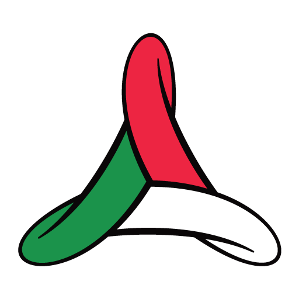
</p>

<h1 align="center">DPC Alert</h1>

<p align="center">Warnungen und Wetterlage für jeden Ort in Italien, aus den offiziellen Bulletins des DPC</p>

<p align="center">
  <a href="https://github.com/caiosweet/Home-Assistant-custom-components-DPC-Alert/releases/latest"></a>
  <a href="https://analytics.home-assistant.io/custom_integrations"></a>
  <a href="https://hacs.xyz/"></a>
  <a href="https://github.com/caiosweet/Home-Assistant-custom-components-DPC-Alert/actions/workflows/tests.yaml"></a>
  <a href="https://github.com/caiosweet/Home-Assistant-custom-components-DPC-Alert/blob/main/LICENSE.md"></a>
</p>

<p align="center"><a href="https://github.com/caiosweet/Home-Assistant-custom-components-DPC-Alert/blob/main/README.md">English</a> · <a href="https://github.com/caiosweet/Home-Assistant-custom-components-DPC-Alert/blob/main/README.it.md">Italiano</a> · <a href="https://github.com/caiosweet/Home-Assistant-custom-components-DPC-Alert/blob/main/README.fr.md">Français</a> · <a href="https://github.com/caiosweet/Home-Assistant-custom-components-DPC-Alert/blob/main/README.es.md">Español</a> · <b>Deutsch</b></p>

Die Warnungen der italienischen Zivilschutzabteilung (Dipartimento della Protezione Civile, DPC) in Home Assistant, für jeden Ort in Italien: das Hochwasser-, das hydrogeologische und das Gewitterrisiko von heute und morgen und die Wetterlage der nächsten drei Tage mit den Phänomenen in deiner Nähe.

So funktioniert das Warnsystem: [_Civil Protection Department_](https://rischi.protezionecivile.gov.it/en/meteo-hydro/alert) · [_Dipartimento Protezione Civile_](https://rischi.protezionecivile.gov.it/it/meteo-idro/allertamento)

## Funktionen

- **Ein Gerät für jeden Tag**: Torino · Heute, Torino · Morgen und Torino · Übermorgen, Teil des Geräts des Ortes. Die Einrichtung und die Optionen legen die Tage fest.
- **Jeder Tag**: die Warnung (keine, gelb, orange oder rot) mit den Risiken auf dieser Stufe; das Gefährdungspotenzial, das das DPC für das Gebiet angibt, z. B. „Mäßiges Gefährdungspotenzial für hydrogeologisches Risiko“; die Stufe des Hochwasser-, des hydrogeologischen und des Gewitterrisikos und für jedes einen Binärsensor, der einschaltet, wenn es die von dir gewählte Warnstufe erreicht; der erwartete Niederschlag; und die Wetterphänomene innerhalb des von dir gewählten Radius, auf einer Karte, sobald du sie in den Optionen einschaltest. Das Bulletin zum Gefährdungspotenzial deckt heute und morgen ab, das Bulletin zur Wetterlage auch übermorgen.
- **Der Ort**: seine höchste Warnung und sein höchster Niederschlag, seine DPC-Gebiete und seine Bulletins.
- **Karten** der Bulletins zum Gefährdungspotenzial und zur Wetterlage, heute und morgen, als Bilder.
- **Ein Dashboard** aller Orte, aufgebaut aus den Karten von Home Assistant, in den Farben der DPC-Warnungen: siehe [Dashboard](#dashboard).
- **Drei Karten** für deine eigenen Dashboards, mit visuellem Editor: die Warnung und der Niederschlag jedes Tages, die Bulletins und die Karten der Bulletins: siehe [Karten](#karten).
- **Mehrere Orte**, auf einer Karte oder aus einer Zone gewählt, jeder mit seiner Gemeinde. Jedes Bulletin wird für alle nur einmal heruntergeladen.
- **Dreizehn Sprachen**: Englisch, Italienisch, Französisch, Deutsch, Spanisch und brasilianisches Portugiesisch sowie die Sprachen einiger der größten ausländischen Gemeinschaften in Italien: Rumänisch, Albanisch, Arabisch, vereinfachtes Chinesisch, Ukrainisch, Bengalisch und Hindi. Die Texte der Stufen, Risiken, Phänomene und Richtungen stammen aus der Bibliothek [aiodpc](https://github.com/webysther/aiodpc); auf Italienisch sind die Stufen, Risiken und Phänomene die, die das DPC schreibt.
- **Offizielle Daten**: das Bulletin zum hydrogeologischen und hydraulischen Gefährdungspotenzial und das Bulletin zur Wetterlage, die das DPC jeden Tag veröffentlicht.

Erfordert Home Assistant 2025.2 oder neuer. Was sich in jeder Version geändert hat, steht im [Changelog](https://github.com/caiosweet/Home-Assistant-custom-components-DPC-Alert/blob/main/CHANGELOG.md) (auf Englisch).

## Anwendungsfälle

- Eine Benachrichtigung erhalten, wenn das DPC für deinen Ort eine gelbe, orange oder rote Warnung herausgibt, für heute oder morgen, mit dem Risiko und seiner Stufe.
- Die Warnungen jedes Tages, den erwarteten Niederschlag und die Karten der Bulletins im Dashboard DPC Alert sehen, oder in deinen eigenen Dashboards mit den DPC-Alert-Karten oder den Karten von Home Assistant.
- Die Wetterphänomene in der Nähe deiner Orte auf einer Karte sehen.
- Morgens die Warnungen des Tages über einen Lautsprecher ansagen.
- Die Rollläden schließen oder die Gartenmöbel hereinholen, wenn in der Nähe starker Wind oder Gewitter erwartet werden, anhand der Wetterphänomene in der Nähe des Ortes.
- Vor einer Reise den Zielort hinzufügen und seine Warnungen verfolgen.

## Installation

DPC Alert ist im Community-Katalog, aus dem sowohl der Marketplace von Home Assistant als auch HACS installieren.

### Mit dem Marketplace (Home Assistant 2026.11 oder neuer)

1. Gehe zu **Einstellungen → Marketplace** und suche nach `DPC Alert`.
2. Öffne **DPC Alert (Protezione Civile)** und wähle **Installieren**.
3. Starte Home Assistant neu.

### Mit [HACS](https://hacs.xyz/) (Home Assistant 2025.2 bis 2026.10)

1. Öffne **HACS** im Home-Assistant-Menü und suche nach `DPC Alert`.
2. Öffne **DPC Alert (Protezione Civile)** und wähle **Herunterladen**.
3. Starte Home Assistant neu.

## Konfiguration

[](https://my.home-assistant.io/redirect/config_flow_start/?domain=dpc)

1. Gehe in Home Assistant zu **Einstellungen → Geräte & Dienste → Integration hinzufügen** und suche nach `Dpc`, oder verwende die Schaltfläche oben.
2. Wähle, wie du den zu überwachenden Ort angibst:
   - **Auf der Karte wählen**: Die Karte startet bei deinem Zuhause; verschiebe die Markierung.
   - **Eine Zone verwenden**, z. B. Zuhause.
3. Die Integration prüft den Ort beim DPC und zeigt sein Warngebiet. Wähle seine **Gemeinde** unter denen des Gebiets: Eine Gemeinde, die sich über mehrere Warngebiete erstreckt, erhält die höchste Warnung all dieser Gebiete.
4. **Was anzeigen**: die Tage (standardmäßig heute) und die Arten von Entitäten (standardmäßig alle außer den Phänomenen).
5. **Warnungen**: die Mindestwarnstufe, der Radius der Phänomene und das Aktualisierungsintervall. Jedes Feld erklärt, was es bewirkt, und in den Optionen kannst du sie später ändern.

<p>
  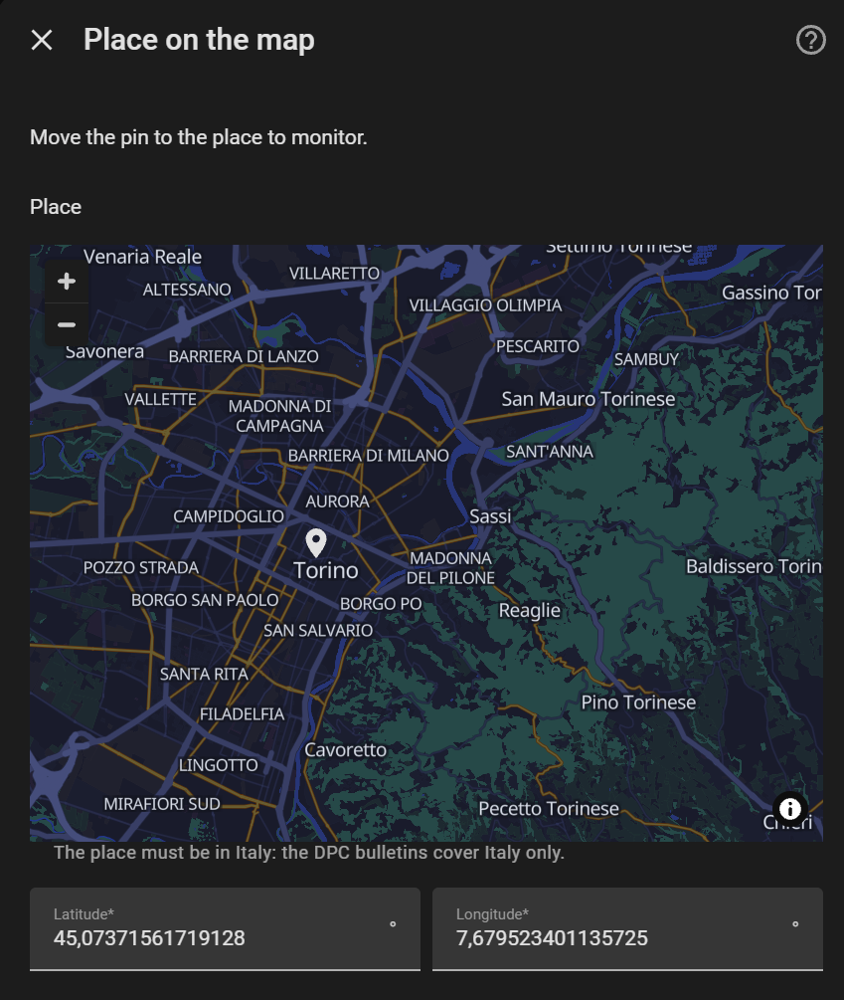
  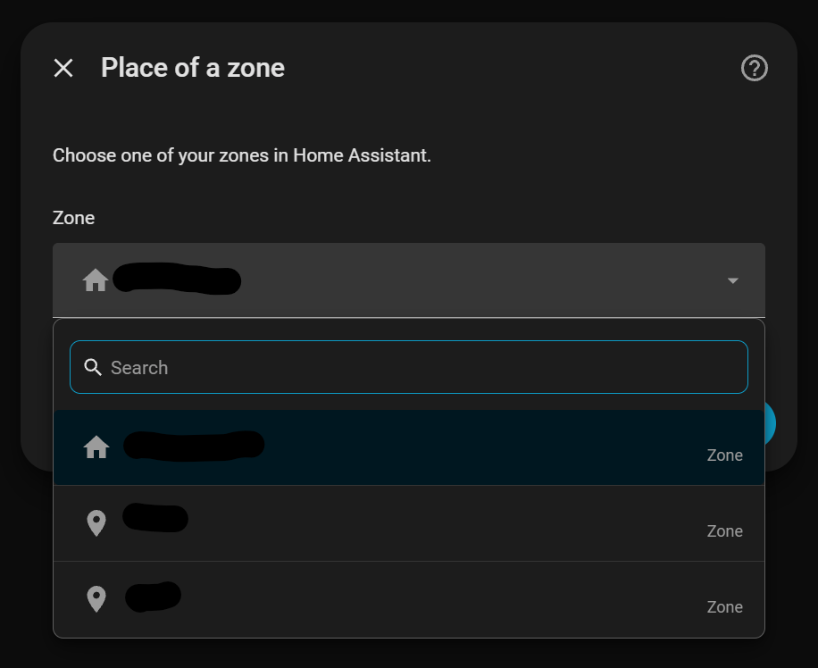
  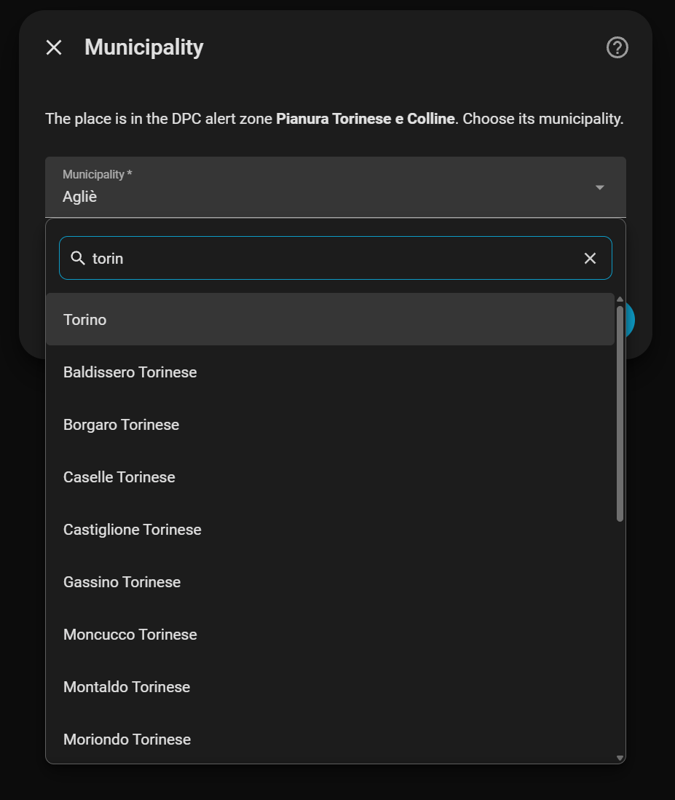
  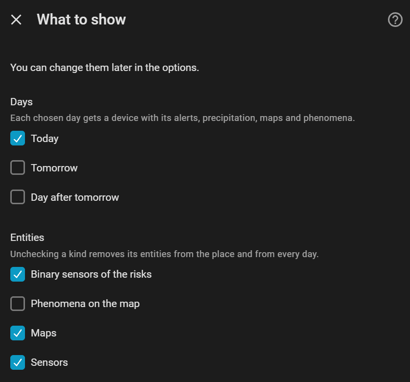
  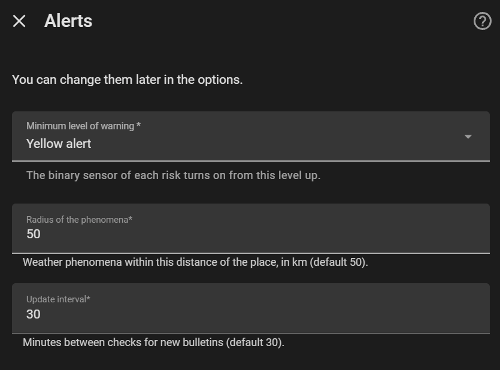
</p>

Füge so viele Orte hinzu, wie du willst, jeden mit seiner eigenen Gemeinde: Zwei Orte in derselben Gemeinde würden dieselben Bulletins erhalten. Die Orte teilen sich die Downloads: Jedes Bulletin wird für alle nur einmal heruntergeladen.

Ein Ort wird nach seinem Warngebiet benannt und sein Gerät nach seiner Gemeinde: Für einen Ort in Turin ist das Gerät Torino und das Gerät von heute Torino · Heute. Ein neuer Ort zeigt heute an, sofern du keine anderen Tage wählst. Die Entitäts-IDs beginnen mit `dpc_`, gefolgt vom Ort, vom Tag und von der Entität, auf Englisch, unabhängig von der Sprache: `sensor.dpc_torino_highest_alert`, `binary_sensor.dpc_torino_today_hydraulic_risk`. Alle findest du unter [Entitäten](#entitäten).

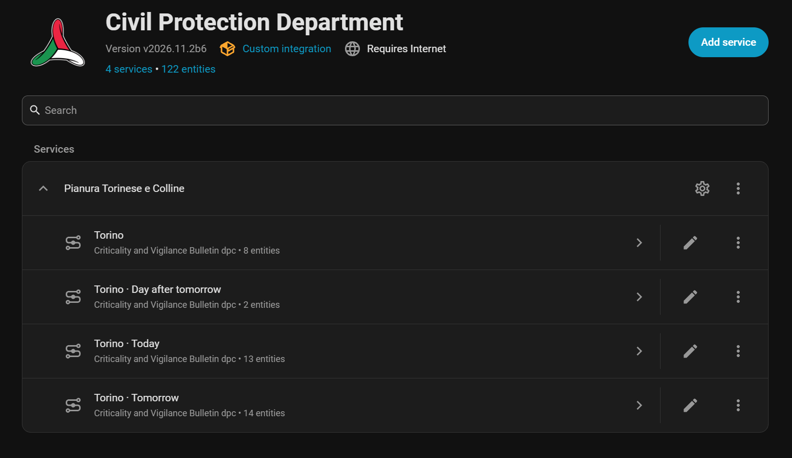

### Optionen

**Konfigurieren** an der Integration öffnet ein Menü mit den Schritten der Einrichtung: Wähle den Schritt, den du ändern willst; er wird von selbst gespeichert.

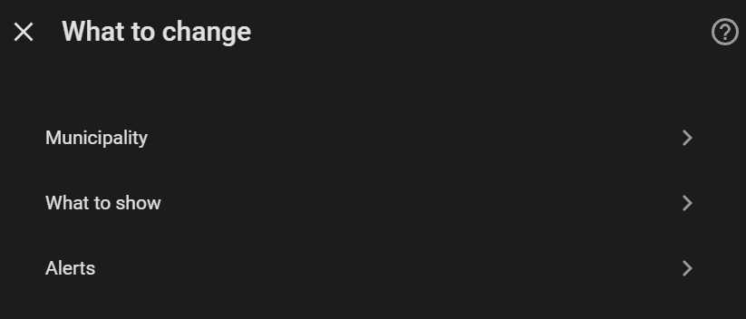

1. **Gemeinde**: unter denen des Warngebiets des Ortes; solange das DPC nicht erreichbar ist, kann jeder Name eingegeben werden.
2. **Was anzeigen**:
   - **Tage**: heute, morgen und übermorgen, jeder ein Gerät mit seinen Entitäten. Wird ein Tag abgewählt, werden sein Gerät und seine Entitäten entfernt; der Ort behält seine höchste Warnung, seinen höchsten Niederschlag und seine Bulletins.
   - **Entitäten**: die Binärsensoren der Risiken, die Sensoren, die Karten und die Phänomene auf der Karte (standardmäßig aus). Wird eine Art abgewählt, werden ihre Entitäten vom Ort und von jedem Tag entfernt. Der Ort muss etwas anzeigen: Ohne Tage geben ihm nur die Sensoren Entitäten, und übermorgen hat weder Risiken noch Karten.
3. **Warnungen**:
   - **Mindestwarnstufe**: gelbe (Standard), orange oder rote Warnung. Der Binärsensor jedes Risikos schaltet ab dieser Stufe ein.
   - **Radius der Phänomene** (km, Standard 50).
   - **Aktualisierungsintervall** (Minuten, Standard 30).

### Entfernung

1. Gehe zu **Einstellungen → Geräte & Dienste** und öffne **Zivilschutzabteilung**, wie Home Assistant die Integration auf Deutsch nennt (auf Englisch Civil Protection Department).
2. Öffne für jeden Ort sein **⋮**-Menü und wähle **Löschen**.
3. Um auch die Integration zu deinstallieren, öffne **DPC Alert (Protezione Civile)** unter **Einstellungen → Marketplace** und wähle **Deinstallieren**; vor Home Assistant 2026.11 öffne sie in **HACS** und wähle **Entfernen** in ihrem **⋮**-Menü. Starte dann Home Assistant neu.

## Dashboard

Die Integration bringt ein Dashboard mit, aufgebaut aus den Karten von Home Assistant, in der Sprache jedes Benutzers, mit den Namen der Tage und der Entitäten; nur die Namen der Phänomene folgen der Sprache des Systems (siehe [Fehlerbehebung](#fehlerbehebung)):

1. Gehe zu **Einstellungen → Dashboards → Dashboard hinzufügen**.
2. Wähle unter **Community-Dashboards** den Eintrag **DPC Alert**. Falls er nicht aufgeführt ist, lade die Seite neu.

Es hat einen Tab für jeden Ort, mit den Stufen in den Farben der Warnkarte des DPC, von Grün bis Rot, und dem Niederschlag in derselben Skala, von schwach bis sehr stark (kein Niederschlag im Blau der Symbole des Designs):

- **Der Ort**: seine höchste Warnung und sein höchster Niederschlag, seine Gebiete, wann jedes Bulletin veröffentlicht wurde und bis wann es gilt.
- **Jeder Tag**, den er anzeigt: ein Banner für jedes Risiko ab der Mindestwarnstufe, in der Farbe seiner Stufe (ohne die Sensoren eine Kachel für jedes Risiko, an oder aus); die Warnung mit den Risiken auf dieser Stufe; das Gefährdungspotenzial; die Karten der Bulletins; die Phänomene des Tages auf einer Karte; die Stufe jedes Risikos; der erwartete Niederschlag und die Anzahl der Phänomene.

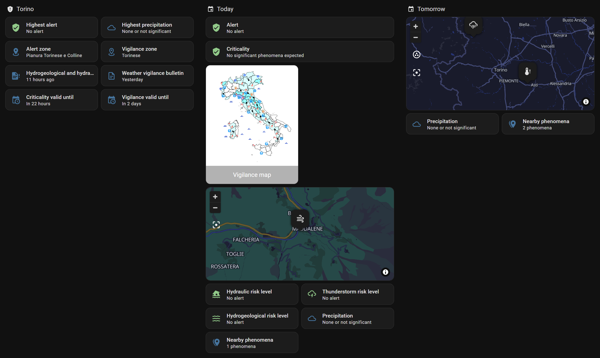

Das Dashboard folgt deinen Orten: Es ändert sich von selbst, wenn du einen hinzufügst, einen Tag an- oder abwählst und wenn ein Bulletin andere Phänomene bringt. Was keine Daten hat, ist ausgeblendet, etwa die Warnung, die Risiken und die Karten von morgen nach Mitternacht, bis das DPC das nächste Bulletin veröffentlicht; ein Tag ganz ohne Daten ist vollständig ausgeblendet. Die farbigen Banner der Risiken erfordern Home Assistant 2026.9 oder neuer; davor werden die Risiken als Kacheln angezeigt.

Um einen Ort in einem anderen Dashboard anzuzeigen, füge eine Ansicht mit der Strategie des Dashboards und der ID des Geräts des Ortes hinzu, dem Ende der Adresse seiner Geräteseite:

```yaml
views:
  - title: Torino
    strategy:
      type: custom:dpc-alert
      device_id: 0123456789abcdef0123456789abcdef
```

Die Binärsensoren der Risiken sind Sicherheitssensoren: Auch das Dashboard **Sicherheit** von Home Assistant (2025.11 oder neuer) listet sie auf.

## Karten

Die Integration bringt drei Karten für deine eigenen Dashboards mit, die nach der Installation sofort in der Kartenauswahl stehen: Suche nach **DPC Alert**. Jede ist eine einzelne Karte, aufgebaut aus den Karten von Home Assistant, in den Farben der DPC-Warnungen und in der Sprache jedes Benutzers, findet die Entitäten des Ortes auch, nachdem du sie umbenannt hast, und lässt weg, was keine Daten hat, wie das Dashboard.

- **DPC Alert** (`custom:dpc-card`): die höchste Warnung und der höchste Niederschlag des Ortes, dann die Warnung und der Niederschlag jedes Tages; übermorgen hat nur seinen Niederschlag.
- **DPC Alert · Bulletins** (`custom:dpc-bulletin-card`): das Bulletin zum Gefährdungspotenzial und daneben das Bulletin zur Wetterlage: ihre Gebiete, wann sie veröffentlicht wurden und bis wann sie gelten.
- **DPC Alert · Karten** (`custom:dpc-map-card`): die Karte eines Tages und daneben eine Liste, so hoch wie die Karte: ein Block für jeden Tag mit einer Karte, das Gebiet der Karte und die Anzahl der Phänomene in der Nähe des Ortes. Bei zwei Tagen zeigt ein Klick auf einen Block seine Karte. Ohne Karte, etwa wenn das DPC sie leer veröffentlicht oder nach Mitternacht bis zum nächsten Bulletin, nimmt die Liste die ganze Fläche ein.

<p>
  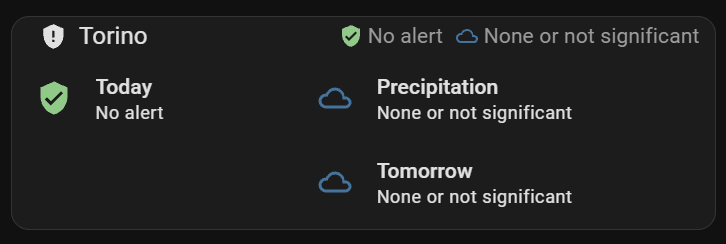
  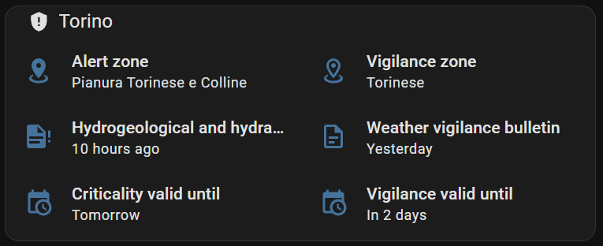
  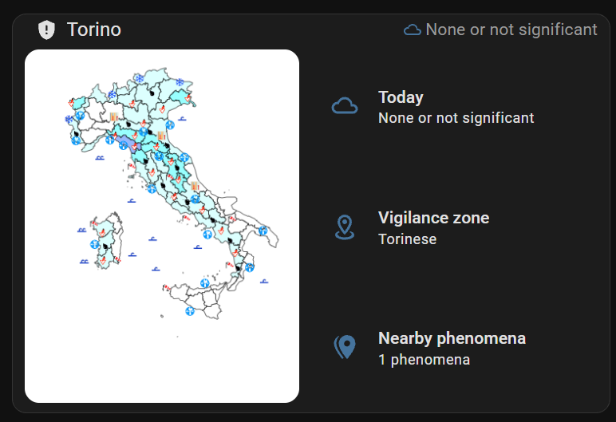
</p>

Der visuelle Editor legt fest, was jede Karte anzeigt. In YAML zeigt eine weggelassene Option alles an:

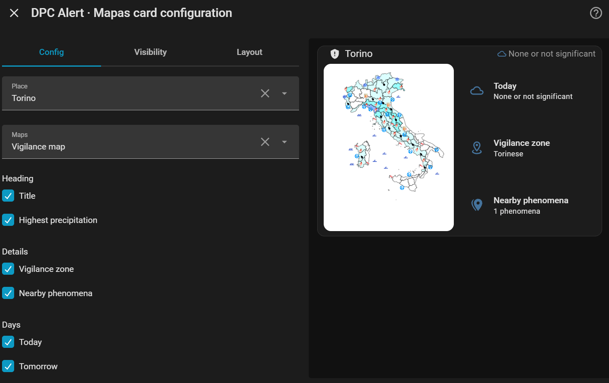

| Option | Karten | Ohne die Option |
| --- | --- | --- |
| `device_id` | alle | Der erste Ort. Die ID des Geräts des Ortes, das Ende der Adresse seiner Geräteseite. |
| `show_title: false` | alle | Der Name des Ortes, über dem Rest. Ohne ihn rücken die höchsten Stufen an den Anfang. |
| `show_highest_alert: false` | DPC Alert, Karten (Gefährdungskarte) | Die höchste Warnung des Ortes, neben seinem Namen. |
| `show_highest_precipitation: false` | DPC Alert, Karten (Wetterlagekarte) | Der höchste Niederschlag des Ortes, neben seinem Namen. |
| `days` | DPC Alert, Karten | Alle Tage des Ortes: `today`, `tomorrow`, `aftertomorrow`; bei den Karten heute und morgen. |
| `items` | Bulletins | Alle sechs: `alert_zone`, `criticality_bulletin`, `criticality_valid_until`, `vigilance_zone`, `vigilance_bulletin`, `vigilance_valid_until`. |
| `columns: 1` | DPC Alert, Bulletins | Zwei Spalten: die Warnung neben dem Niederschlag, das Bulletin zum Gefährdungspotenzial neben dem Bulletin zur Wetterlage. |
| `map: vigilance` | Karten | Die Gefährdungskarte. |
| `show_zone: false` | Karten | Das Gebiet der Karte, daneben. |
| `show_nearby_phenomena: false` | Karten | Die Anzahl der Phänomene in der Nähe des Ortes am Tag der Karte, daneben. |

```yaml
# Die Wetterlagekarte von heute, ohne den Namen des Ortes
type: custom:dpc-map-card
device_id: 0123456789abcdef0123456789abcdef
map: vigilance
show_title: false
days:
  - today
```

### Mit den Karten von Home Assistant

Die Entitäten passen ohne Templates zu den Karten von Home Assistant. Für einen Ort in Turin:

```yaml
# Die Warnung von morgen und die Risiken auf ihrer Stufe: „Orange Warnung · Hydrogeologisches Risiko“
type: tile
entity: sensor.dpc_torino_tomorrow_alert
state_content:
  - state
  - risks
```

```yaml
# Dieselbe Kachel im Orange der DPC-Karte, solange die Warnung orange ist; füge
# eine für jede Stufe hinzu: Grün #90c985, Gelb #f8f865, Orange #f0bf01, Rot #fd6767
type: tile
entity: sensor.dpc_torino_tomorrow_alert
color: "#f0bf01"
visibility:
  - condition: state
    entity: sensor.dpc_torino_tomorrow_alert
    state: orange
```

```yaml
# Ein Banner, solange das hydrogeologische Risiko von morgen die Mindestwarnstufe
# erreicht und orange ist (Home Assistant 2026.9 oder neuer)
type: alert
entity: binary_sensor.dpc_torino_tomorrow_hydrogeological_risk
alert_color: "#f0bf01"
visibility:
  - condition: state
    entity: binary_sensor.dpc_torino_tomorrow_hydrogeological_risk
    state: "on"
  - condition: state
    entity: sensor.dpc_torino_tomorrow_hydrogeological_risk_level
    state: orange
```

```yaml
# Die Gefährdungskarte von heute
type: picture-entity
entity: image.dpc_torino_today_criticality_map
show_state: false
```

```yaml
# Die Wetterphänomene in der Nähe all deiner Orte
type: map
geo_location_sources:
  - dpc
```

## Wie die Daten aktualisiert werden

- Das DPC veröffentlicht das Bulletin zum Gefährdungspotenzial jeden Tag bis 16:00 Uhr (italienische Zeit), manchmal später am selben Tag aktualisiert, und das Bulletin zur Wetterlage bis 15:00 Uhr.
- Alle 30 Minuten (die Option **Aktualisierungsintervall**) prüft jeder Ort, ob das DPC neue Bulletins veröffentlicht hat. Orte, die sich zur selben Zeit aktualisieren, teilen sich die Prüfung.
- Ein neues Bulletin wird für alle Orte nur einmal heruntergeladen und für jeden Ort gelesen: etwa 11 MB für ein Bulletin zum Gefährdungspotenzial, 8 MB für ein Bulletin zur Wetterlage.
- Die Karten der Tage werden mit dem Bulletin heruntergeladen, für alle Orte nur einmal, jeweils etwa 100 kB. Das DPC veröffentlicht eine Karte oft leer und ersetzt sie manchmal später unter derselben Adresse: Eine leere Karte wird nicht angezeigt und bei jeder Aktualisierung erneut heruntergeladen, bis das DPC die Karte veröffentlicht.
- Heute und morgen folgen dem italienischen Datum: Nach Mitternacht wird der zweite Tag des Bulletins zu heute, bis das DPC das nächste Bulletin veröffentlicht.
- Wenn das DPC nicht erreichbar ist, behalten die Orte ihre Bulletins, deren Tage gültig bleiben, und prüfen nach 10 Minuten erneut, oder früher bei einem kürzeren Aktualisierungsintervall.

## Bekannte Einschränkungen

- Das DPC deckt nur Italien ab. San Marino und die Vatikanstadt liegen in keinem Warngebiet des DPC.
- Das DPC veröffentlicht die Karte eines Tages oft leer: von August bis November 2026 40 % der Gefährdungskarten und 5 % der Wetterlagekarten, und es hat nur etwa ein Drittel davon später ersetzt. Die Karte ist dann nicht verfügbar, und die Dashboards lassen sie weg, manchmal den ganzen Tag.
- Das Bulletin zum Gefährdungspotenzial deckt heute und morgen ab, das Bulletin zur Wetterlage drei Tage. Die höchste Warnung eines Ortes ist die von heute und morgen, auch wenn er nur heute anzeigt.
- Jede Gemeinde kann nur einmal hinzugefügt werden: Zwei Orte darin würden dieselben Bulletins erhalten. Weit voneinander entfernte Gemeinden gleichen Namens, wie Peglio in der Lombardei und in den Marken, sind verschiedene Gemeinden: Die Entitäts-IDs der zweiten enden auf `_2`, z. B. `sensor.dpc_peglio_highest_alert_2`.
- Die Texte der Stufen, Risiken, Gefährdungspotenziale, Phänomene und Richtungen stammen aus der Bibliothek aiodpc; auf Italienisch sind die Stufen, Risiken, Gefährdungspotenziale und Phänomene die, die das DPC schreibt, während die Richtungen von aiodpc berechnet werden. Orte, Gebiete und Gemeinden behalten die Namen, die das DPC ihnen gibt, auf Italienisch; in Südtirol funktionieren auch die deutschen Namen der Gemeinden.
- In Templates und Benachrichtigungen liefert `state_translated()` den übersetzten Zustand, `state_attr_translated()` (Home Assistant 2026.4 oder neuer) ein übersetztes Attribut, z. B. das `phenomenon` eines Phänomens. Listen, wie die `risks` der Warnung eines Tages, werden nur von den Dashboards übersetzt.

## Fehlerbehebung

- **Die Integration zeigt „Einrichtungsfehler, wird erneut versucht“**: Das DPC ist nicht erreichbar. Home Assistant versucht es von selbst erneut; prüfe, ob es `mappe.protezionecivile.gov.it` und `raw.githubusercontent.com` erreichen kann.
- **„… liegt in keinem Warngebiet des DPC“**: Der Ort liegt außerhalb Italiens oder in San Marino oder in der Vatikanstadt. Lösche ihn und füge einen Ort in Italien hinzu.
- **Die Entitäten eines Tages fehlen**: Prüfe die Option **Tage** des Ortes. Orte, die vor dieser Version hinzugefügt wurden, zeigen heute und morgen.
- **Eine Automation liest ein Attribut, das es nicht mehr gibt**, z. B. `level`, `info`, `zone_name` oder `expires`: Die Daten der Bulletins sind zu Entitäten geworden. Das [Changelog](https://github.com/caiosweet/Home-Assistant-custom-components-DPC-Alert/blob/main/CHANGELOG.md) listet auf, wo sich jedes Attribut jetzt befindet.
- **Nach einem Update Texte auf Englisch oder Namen wie `municipality_in_use` in den Formularen**: Home Assistant und der Browser behalten die Texte der vorherigen Version. Starte Home Assistant neu und lade dann die Seite neu, wobei du ihren Cache leerst (Strg+F5).
- **Entitäts- und Gerätenamen in einer anderen Sprache**: Home Assistant benennt Entitäten und Geräte in der Sprache des Systems, nicht in der deines Profils: **Einstellungen → System → Zuhause-Informationen → Sprache** (Allgemein, in älteren Versionen). Das gilt auch für die Namen der Phänomene. Die Zustände und die übersetzten Werte der Attribute folgen deinem Profil, ebenso die Namen im Dashboard und in den Karten von DPC Alert.
- **Entitäts-IDs wie `binary_sensor.dpc_torino_idraulico_oggi`**: Die Entitäten von Orten, die mit einer früheren Version hinzugefügt wurden, behalten ihre IDs, damit Automationen weiter funktionieren. Um ihnen die IDs neuer Orte zu geben, wie `binary_sensor.dpc_torino_today_hydraulic_risk` (Home Assistant 2025.6 oder neuer): Wähle auf der Seite jedes Geräts **⋮ → Entitäts-IDs neu erstellen**, oder wähle die Entitäten unter **Einstellungen → Entitäten** aus und wähle **IDs der ausgewählten Entitäten neu erstellen**. Aktualisiere dann die Automationen und Dashboards, die sie verwenden. Auf dieselbe Weise erhältst du nach dem Umbenennen eines Ortes die neuen IDs.
- **DPC Alert fehlt unter den Community-Dashboards, oder seine Karten fehlen in der Kartenauswahl**: Der Browser lädt sie, wenn er Home Assistant öffnet. Lade die Seite neu, nachdem du die Integration installiert oder aktualisiert hast.
- **Ein vor 2026.11 hinzugefügter Ort hat keine Gemeinde**: Er verwendet das Warngebiet seiner Koordinaten, und sein Gerät ist nach seinem Eintrag benannt. Wähle in seinen Optionen unter **Gemeinde** seine Gemeinde unter denen seines Warngebiets.
- **Ein Problem melden**: Wähle an der Integration im **⋮**-Menü **Debug-Protokoll aktivieren**, reproduziere das Problem und deaktiviere es dann, um das Protokoll herunterzuladen. Füge die Diagnosedaten (**⋮ → Diagnosedaten herunterladen**) einem [Issue](https://github.com/caiosweet/Home-Assistant-custom-components-DPC-Alert/issues) hinzu. Sie lassen die Koordinaten des Ortes und die Positionen, Entfernungen und Richtungen der Phänomene weg, aber nicht die Gemeinde und die DPC-Gebiete des Ortes, die die Namen seiner Geräte und Entitäten zeigen: Entferne sie vor dem Veröffentlichen aus der Datei, wenn du sie lieber privat halten möchtest.

## Entitäten

Für einen Ort in Turin, mit Home Assistant auf Deutsch (die Bilder sind auf Englisch). Das Gerät des Ortes, **Torino**:

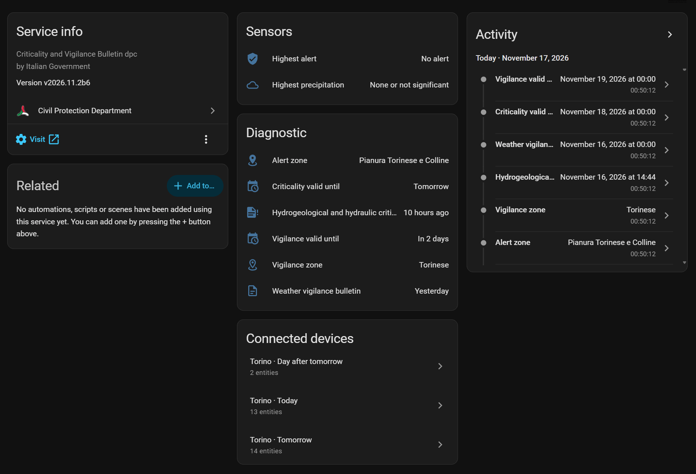

| Entität | Zustand |
| --- | --- |
| `sensor.dpc_torino_highest_alert` | Die höchste Warnstufe von heute und morgen: 1 (keine Warnung) bis 4 (rot), angezeigt als Warnung, z. B. „Orange Warnung“ |
| `sensor.dpc_torino_highest_precipitation` | Der höchste erwartete Niederschlag der nächsten drei Tage: 1 (kein oder unbedeutend) bis 5 (sehr stark), angezeigt als Niederschlag |
| `sensor.dpc_torino_alert_zone`, `…_vigilance_zone` | Die DPC-Gebiete des Ortes, für seine Diagnose |
| `sensor.dpc_torino_criticality_bulletin`, `…_vigilance_bulletin` | Wann das neueste Bulletin veröffentlicht wurde, für seine Diagnose: die Uhrzeit des Bulletins zum Gefährdungspotenzial; der Tag des Bulletins zur Wetterlage, um Mitternacht |
| `sensor.dpc_torino_criticality_valid_until`, `…_vigilance_valid_until` | Das Ende des letzten Tages, den das Bulletin abdeckt, für seine Diagnose |

Die Geräte der Tage, **Torino · Heute** und **Torino · Morgen** (`today` und `tomorrow` in den IDs):

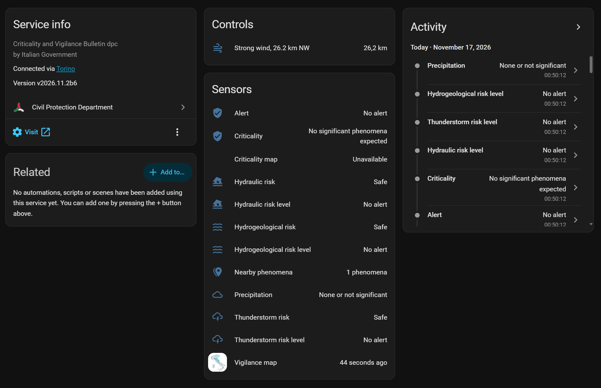

| Entität | Zustand |
| --- | --- |
| `sensor.dpc_torino_today_alert` | Die Warnung des Tages: keine, gelbe, orange oder rote Warnung |
| `sensor.dpc_torino_today_criticality` | Das Gefährdungspotenzial, das das DPC für das Gebiet angibt, und das Risiko, das seine Karte zeigt: „Mäßiges Gefährdungspotenzial für hydrogeologisches Risiko“ (`moderate_hydrogeological`) oder „Keine bedeutenden Phänomene zu erwarten“ (`absent`) |
| `binary_sensor.dpc_torino_today_hydraulic_risk`, `…_thunderstorm_risk`, `…_hydrogeological_risk` | An, wenn das Risiko die Mindestwarnstufe der Optionen erreicht |
| `sensor.dpc_torino_today_hydraulic_risk_level`, `…_thunderstorm_risk_level`, `…_hydrogeological_risk_level` | Die Stufe des Risikos: keine, gelbe, orange oder rote Warnung |
| `sensor.dpc_torino_today_precipitation` | Der erwartete Niederschlag des Tages: von „Kein oder unbedeutend“ bis „Sehr stark“ |
| `sensor.dpc_torino_today_nearby_phenomena` | Die Anzahl der Wetterphänomene innerhalb des Radius |
| `image.dpc_torino_today_criticality_map`, `…_vigilance_map` | Die nationale Karte des Bulletins, wie das DPC sie als Vorschau zeigt; nicht verfügbar, solange das DPC sie leer veröffentlicht |
| `geo_location.dpc_torino_today_gale_nw` und so weiter | Ein Wetterphänomen innerhalb des Radius, sobald die Phänomene in den Optionen eingeschaltet sind, benannt nach Art, Entfernung und Richtung („Stürmischer Wind, 12,4 km NW“): seine Entfernung, in km |

Das Gerät von übermorgen, **Torino · Übermorgen** (`after_tomorrow` in den IDs), hat den Niederschlag, die Anzahl der Phänomene und die Phänomene: Das Bulletin zum Gefährdungspotenzial deckt zwei Tage ab.

Die Warnung und die Stufen eines Tages sind die des Bulletins, unabhängig von der Mindestwarnstufe der Optionen. Nach Mitternacht, bis das DPC die nächsten Bulletins veröffentlicht, sind die Warnung, das Gefährdungspotenzial, die Risiken und ihre Stufen von morgen unbekannt und seine Karten nicht verfügbar; der Niederschlag und die Anzahl der Phänomene von übermorgen sind unbekannt und seine Phänomene entfernt.

Home Assistant übersetzt die Zustände und, in den Dashboards, die Werte der Attribute. Templates und Automationen sehen die Werte unten; jede Entität hat außerdem die `attribution` der Daten des DPC.

<details>
<summary>Attribute</summary>

```yaml
# sensor.dpc_torino_tomorrow_alert
state: orange # green (keine Warnung), yellow, orange oder red
risks: # die Risiken auf dieser Stufe, keine bei green
  - hydrogeological # hydraulic, thunderstorms oder hydrogeological
```

```yaml
# sensor.dpc_torino_highest_alert, und ebenso für den höchsten Niederschlag
state: 3
total_alerts: 3 # die Risiken (beim Niederschlag die Tage) ab der Mindestwarnstufe
```

```yaml
# sensor.dpc_torino_criticality_bulletin, und ebenso für das Bulletin zur Wetterlage
state: '2026-11-14T13:30:00+00:00' # wann es veröffentlicht wurde
id: '20261114_1430'
link: https://mappe.protezionecivile.gov.it/it/mappe-rischi/bollettino-di-criticita/
last_check: '2026-11-14T15:00:00+01:00' # wann das DPC zuletzt bestätigt hat, dass es das neueste ist
```

```yaml
# image.dpc_torino_today_criticality_map
image_url: https://raw.githubusercontent.com/pcm-dpc/DPC-Bollettini-Criticita-Idrogeologica-Idraulica/master/files/preview/20261114_1430_oggi.png
```

```yaml
# geo_location.dpc_torino_tomorrow_light_snow_nne
state: 44.3 # die Entfernung vom Ort, in km
source: dpc
latitude: 45.83
longitude: 9.41
phenomenon: light_snow # angezeigt als „Leichter bis mäßiger Schneefall“
direction: nne # vom Ort aus, angezeigt als „NNO“
```

Wetterphänomene kommen und gehen mit den Bulletins, jedes auf dem Gerät seines Tages.

</details>

## Beispiele für Automationen

Die Beispiele verwenden Turin: Ersetze `torino` in den Entitäts-IDs durch deinen Ort und `notify.mobile_app_your_phone` durch deine Benachrichtigung. Füge ein Beispiel in den YAML-Editor einer neuen Automation ein. Die Nachrichten sind in der Sprache von Home Assistant.

<details>
<summary>Die Warnung von heute oder morgen melden</summary>

```yaml
alias: DPC-Warnung
triggers:
  - trigger: state
    entity_id:
      - sensor.dpc_torino_today_alert
      - sensor.dpc_torino_tomorrow_alert
    to:
      - yellow
      - orange
      - red
actions:
  - action: notify.mobile_app_your_phone
    data:
      title: "{{ state_attr(trigger.entity_id, 'friendly_name') }}"
      message: "{{ state_translated(trigger.entity_id) }}"
mode: queued
```

Zum Beispiel *Torino · Morgen Warnung: Orange Warnung*, wenn die Warnung eines Tages gelb, orange oder rot wird oder zwischen diesen Stufen wechselt.

</details>

<details>
<summary>Ein Risiko ab der Mindestwarnstufe melden</summary>

```yaml
alias: DPC-Risiken
triggers:
  - trigger: state
    entity_id:
      - binary_sensor.dpc_torino_today_hydraulic_risk
      - binary_sensor.dpc_torino_today_thunderstorm_risk
      - binary_sensor.dpc_torino_today_hydrogeological_risk
      - binary_sensor.dpc_torino_tomorrow_hydraulic_risk
      - binary_sensor.dpc_torino_tomorrow_thunderstorm_risk
      - binary_sensor.dpc_torino_tomorrow_hydrogeological_risk
    to: "on"
actions:
  - action: notify.mobile_app_your_phone
    data:
      title: "{{ state_attr(trigger.entity_id, 'friendly_name') }}"
      # Die Stufe desselben Risikos und Tages: binary_sensor.…_risk → sensor.…_risk_level
      message: >-
        {{ state_translated(trigger.entity_id | replace('binary_sensor.', 'sensor.')
        ~ '_level') }}
mode: queued
```

Zum Beispiel *Torino · Morgen Hydrogeologisches Risiko: Orange Warnung*. Die Binärsensoren schalten bei der Mindestwarnstufe der Optionen ein, jeweils für ein Risiko. Die Nachricht ermittelt die Stufe aus der Entitäts-ID des Binärsensors und benötigt daher die Entitäts-IDs neuer Orte.

</details>

<details>
<summary>Starken Niederschlag melden</summary>

```yaml
alias: DPC-Niederschlag
triggers:
  - trigger: state
    entity_id:
      - sensor.dpc_torino_today_precipitation
      - sensor.dpc_torino_tomorrow_precipitation
      - sensor.dpc_torino_after_tomorrow_precipitation
    to:
      - moderate
      - heavy
      - very_heavy
actions:
  - action: notify.mobile_app_your_phone
    data:
      title: "{{ state_attr(trigger.entity_id, 'friendly_name') }}"
      message: "{{ state_translated(trigger.entity_id) }}"
mode: queued
```

</details>

<details>
<summary>Ein Wetterphänomen in der Nähe von Zuhause melden</summary>

```yaml
alias: DPC-Phänomene in der Nähe von Zuhause
triggers:
  - trigger: geo_location
    source: dpc
    zone: zone.around_home
    event: enter
actions:
  - action: notify.mobile_app_your_phone
    data:
      title: DPC
      message: "{{ state_attr(trigger.to_state.entity_id, 'friendly_name') }}"
mode: queued
```

Die Phänomene müssen in den Optionen eingeschaltet sein. `zone.around_home` ist eine Zone, die du um dein Zuhause anlegst, mit dem Radius, der dich interessiert, z. B. 20 km, unter **Einstellungen → Bereiche, Labels & Zonen → Zonen**: Die Zone Zuhause ist meist zu klein. Die Automation läuft, wenn ein Phänomen des Bulletins darin liegt, zum Beispiel *Torino · Morgen Leichter bis mäßiger Schneefall, 44,3 km NNO*: sein Tag, seine Art, seine Entfernung und seine Richtung vom Ort.

</details>

## Community

Hilfe und Neuigkeiten auf Italienisch in der Community [HassioHelp](https://hassiohelp.eu/): ihr [Forum](https://forum.hassiohelp.eu/), ihre [Telegram](https://t.me/HassioHelp)- und ihre [Facebook](https://www.facebook.com/groups/2062381507393179/)-Gruppe.

[](https://paypal.me/hassiohelp)

## Mitwirken

Fehlerberichte, Übersetzungen und Korrekturen sind willkommen: siehe die [Anleitung zum Mitwirken](https://github.com/caiosweet/Home-Assistant-custom-components-DPC-Alert/blob/main/CONTRIBUTING.md) (auf Englisch).

## Lizenz

Der Code von DPC Alert steht unter der [MIT-Lizenz](https://github.com/caiosweet/Home-Assistant-custom-components-DPC-Alert/blob/main/LICENSE.md). Die Bulletins sind Daten des Dipartimento della Protezione Civile – Presidenza del Consiglio dei Ministri, unter der Lizenz [CC BY 4.0](https://creativecommons.org/licenses/by/4.0/deed.de): Jede Entität trägt diese Namensnennung.

Die Namen, Logos und Marken in diesem Repository, etwa die des Dipartimento della Protezione Civile und von Home Assistant, gehören ihren Inhabern und dienen nur dazu, sie zu kennzeichnen; ihre Verwendung bedeutet keine Billigung durch sie.
