<p align="center">
  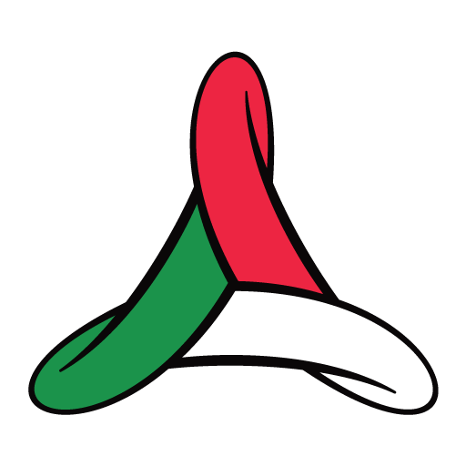
</p>

<h1 align="center">DPC Alert</h1>

<p align="center">Alertas y vigilancia meteorológica para cualquier lugar de Italia, a partir de los boletines oficiales del DPC</p>

<p align="center">
  <a href="https://github.com/caiosweet/Home-Assistant-custom-components-DPC-Alert/releases/latest"></a>
  <a href="https://analytics.home-assistant.io/custom_integrations"></a>
  <a href="https://hacs.xyz/"></a>
  <a href="https://github.com/caiosweet/Home-Assistant-custom-components-DPC-Alert/actions/workflows/tests.yaml"></a>
  <a href="https://github.com/caiosweet/Home-Assistant-custom-components-DPC-Alert/blob/main/LICENSE.md"></a>
</p>

<p align="center"><a href="https://github.com/caiosweet/Home-Assistant-custom-components-DPC-Alert/blob/main/README.md">English</a> · <a href="https://github.com/caiosweet/Home-Assistant-custom-components-DPC-Alert/blob/main/README.it.md">Italiano</a> · <a href="https://github.com/caiosweet/Home-Assistant-custom-components-DPC-Alert/blob/main/README.fr.md">Français</a> · <b>Español</b> · <a href="https://github.com/caiosweet/Home-Assistant-custom-components-DPC-Alert/blob/main/README.de.md">Deutsch</a></p>

Las alertas del Departamento de Protección Civil de Italia (Dipartimento della Protezione Civile, DPC) en Home Assistant, para cualquier lugar de Italia: el riesgo hidráulico, hidrogeológico y de tormentas de hoy y mañana, y la vigilancia meteorológica de los próximos tres días con los fenómenos cercanos a ti.

Cómo funciona el sistema de alerta: [_Civil Protection Department_](https://rischi.protezionecivile.gov.it/en/meteo-hydro/alert) · [_Dipartimento Protezione Civile_](https://rischi.protezionecivile.gov.it/it/meteo-idro/allertamento)

## Características

- **Un dispositivo por cada día**: Torino · Hoy, Torino · Mañana y Torino · Pasado mañana, que forman parte del dispositivo del lugar. Los días se eligen en la configuración y en las opciones.
- **Cada día**: la alerta (sin alerta, amarilla, naranja o roja) con los riesgos de ese nivel; la criticidad que el DPC indica para la zona, como "Criticidad moderada por riesgo hidrogeológico"; el nivel del riesgo hidráulico, hidrogeológico y de tormentas, y un sensor binario de cada uno, que se activa cuando alcanza el nivel de alerta que elijas; la precipitación prevista; y los fenómenos meteorológicos dentro del radio que elijas, en un mapa, una vez activados en las opciones. El boletín de criticidad cubre hoy y mañana; el de vigilancia, también pasado mañana.
- **El lugar**: su alerta máxima y su precipitación máxima, sus zonas del DPC y sus boletines.
- **Mapas** de los boletines de criticidad y de vigilancia, de hoy y mañana, como imágenes.
- **Un panel de control** de todos los lugares, hecho con las tarjetas de Home Assistant, en los colores de las alertas del DPC: consulta [Panel de control](#panel-de-control).
- **Tres tarjetas** para tus propios paneles de control, con un editor visual: la alerta y la precipitación de cada día, los boletines y los mapas: consulta [Tarjetas](#tarjetas).
- **Varios lugares**, elegidos en un mapa o a partir de una zona, cada uno con su municipio. Cada boletín se descarga una sola vez para todos.
- **Trece idiomas**: inglés, italiano, francés, alemán, español y portugués de Brasil, y los de algunas de las mayores comunidades extranjeras de Italia: rumano, albanés, árabe, chino simplificado, ucraniano, bengalí e hindi. Los textos de los niveles, riesgos, fenómenos y direcciones son los de la biblioteca [aiodpc](https://github.com/webysther/aiodpc); en italiano, los niveles, riesgos y fenómenos son los que escribe el DPC.
- **Datos oficiales**: los boletines de criticidad y de vigilancia meteorológica que el DPC publica cada día.

Requiere Home Assistant 2025.2 o posterior. Consulta el [registro de cambios](https://github.com/caiosweet/Home-Assistant-custom-components-DPC-Alert/blob/main/CHANGELOG.md) (en inglés) para ver qué cambió en cada versión.

## Casos de uso

- Recibir una notificación cuando el DPC emita una alerta amarilla, naranja o roja para tu lugar, hoy o mañana, con el riesgo y su nivel.
- Ver las alertas de cada día, la precipitación prevista y los mapas de los boletines en el panel de control DPC Alert, o en los tuyos con las tarjetas DPC Alert o las tarjetas de Home Assistant.
- Ver en un mapa los fenómenos meteorológicos cercanos a tus lugares.
- Anunciar por la mañana las alertas del día en un altavoz.
- Cerrar las persianas o recoger los muebles de jardín cuando se esperan viento fuerte o tormentas en las cercanías, a partir de los fenómenos meteorológicos cercanos al lugar.
- Antes de un viaje, añadir el lugar al que vas y seguir sus alertas.

## Instalación

DPC Alert está en el catálogo de la comunidad, desde el que instalan tanto el Marketplace de Home Assistant como HACS.

### Con el Marketplace (Home Assistant 2026.11 o posterior)

1. Ve a **Configuración → Marketplace** y busca `DPC Alert`.
2. Abre **DPC Alert (Protezione Civile)** y elige **Instalar**.
3. Reinicia Home Assistant.

### Con [HACS](https://hacs.xyz/) (de Home Assistant 2025.2 a 2026.10)

1. Abre **HACS** en el menú de Home Assistant y busca `DPC Alert`.
2. Abre **DPC Alert (Protezione Civile)** y elige **Descargar**.
3. Reinicia Home Assistant.

## Configuración

[](https://my.home-assistant.io/redirect/config_flow_start/?domain=dpc)

1. En Home Assistant, ve a **Configuración → Dispositivos y servicios → Añadir integración** y busca `Dpc`, o usa el botón de arriba.
2. Elige cómo indicar el lugar que vigilar:
   - **Elegirlo en el mapa**: el mapa empieza en tu casa; mueve el marcador.
   - **Usar una zona**, como Casa.
3. La integración comprueba el lugar con el DPC y muestra su zona de alerta. Elige su **municipio** entre los de la zona: un municipio que abarca varias zonas de alerta recibe la alerta más alta de todas ellas.
4. **Qué mostrar**: los días (hoy, por defecto) y los tipos de entidades (todos menos los fenómenos, por defecto).
5. **Alertas**: el nivel mínimo de alerta, el radio de los fenómenos y el intervalo de actualización. Cada campo explica lo que hace, y puedes cambiarlos más tarde en las opciones.

<p>
  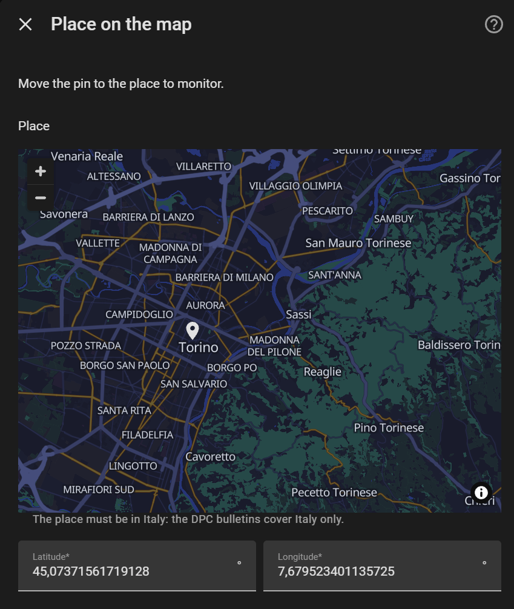
  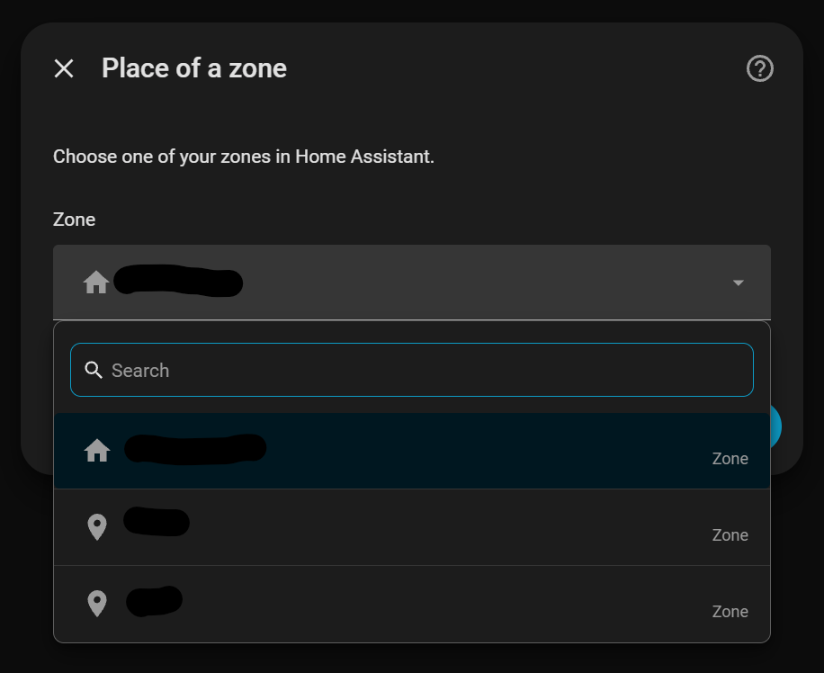
  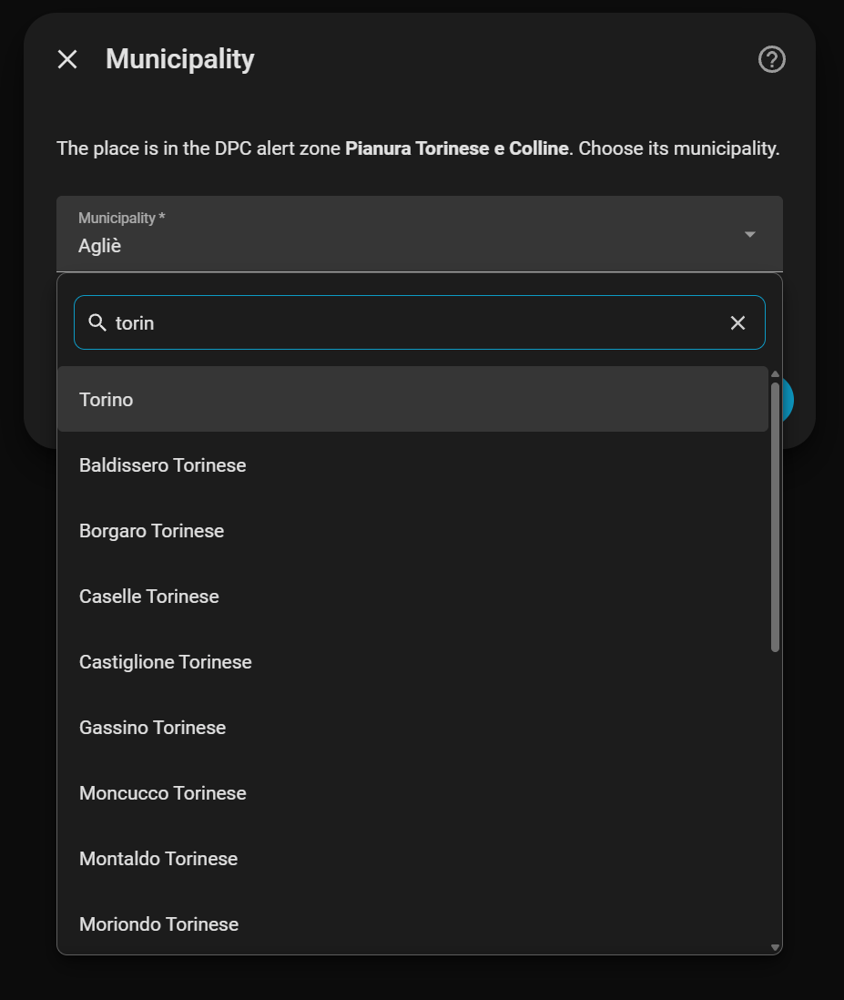
  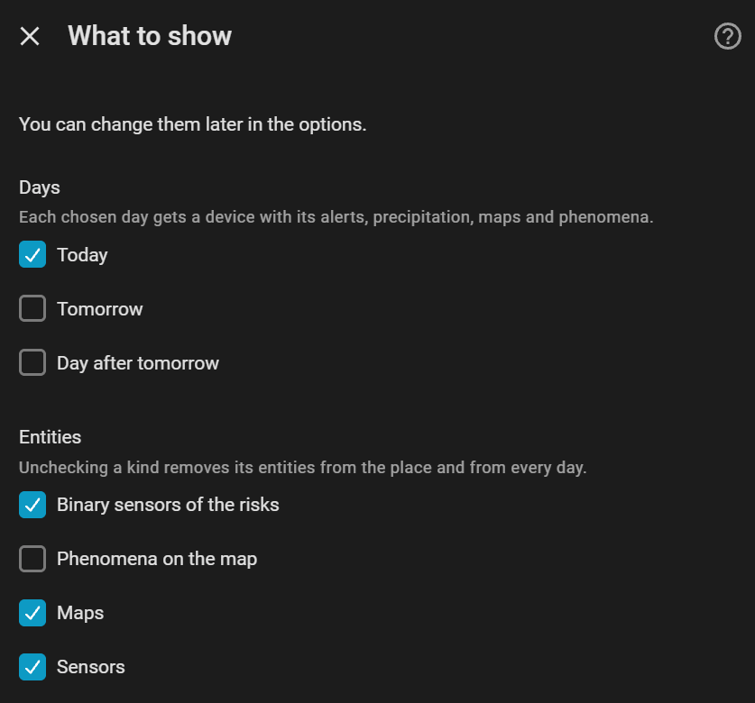
  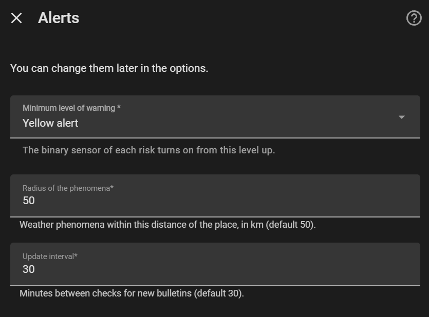
</p>

Añade tantos lugares como quieras, cada uno con su propio municipio: dos lugares en el mismo municipio recibirían los mismos boletines. Los lugares comparten las descargas: cada boletín se descarga una sola vez para todos.

Un lugar toma el nombre de su zona de alerta, y su dispositivo, el de su municipio: para un lugar en Turín, el dispositivo es Torino, y el dispositivo de hoy es Torino · Hoy. Un lugar nuevo muestra hoy, salvo que elijas otros días. Los IDs de entidad empiezan por `dpc_`, seguido del lugar, el día y la entidad, en inglés sea cual sea el idioma: `sensor.dpc_torino_highest_alert`, `binary_sensor.dpc_torino_today_hydraulic_risk`. Consulta [Entidades](#entidades) para verlas todas.

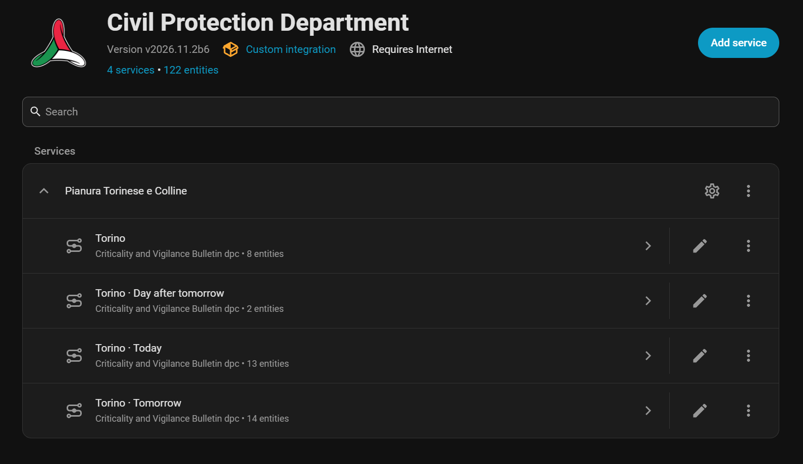

### Opciones

**Configurar** en la integración abre un menú con los pasos de la configuración: elige el que quieras cambiar, que se guarda por sí solo.

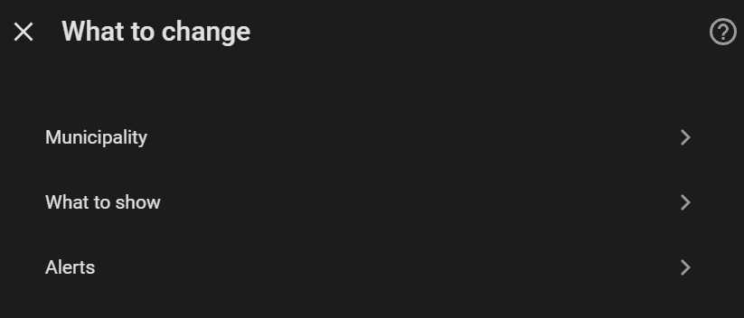

1. **Municipio**: entre los de la zona de alerta del lugar; mientras no se pueda acceder al DPC, se puede escribir cualquier nombre.
2. **Qué mostrar**:
   - **Días**: hoy, mañana y pasado mañana, cada uno un dispositivo con sus entidades. Al desmarcar un día se eliminan su dispositivo y sus entidades; el lugar conserva su alerta y su precipitación máximas y sus boletines.
   - **Entidades**: los sensores binarios de los riesgos, los sensores, los mapas y los fenómenos en el mapa (desactivados por defecto). Al desmarcar un tipo se eliminan sus entidades del lugar y de cada día. El lugar tiene que mostrar algo: sin días, solo los sensores le dan entidades, y pasado mañana no tiene riesgos ni mapas.
3. **Alertas**:
   - **Nivel mínimo de alerta**: alerta amarilla (por defecto), naranja o roja. El sensor binario de cada riesgo se activa a partir de este nivel.
   - **Radio de los fenómenos** (km, 50 por defecto).
   - **Intervalo de actualización** (minutos, 30 por defecto).

### Eliminación

1. Ve a **Configuración → Dispositivos y servicios** y abre **Departamento de Protección Civil**, como Home Assistant llama a la integración en español (Civil Protection Department en inglés).
2. Para cada lugar, abre su menú **⋮** y elige **Eliminar**.
3. Para desinstalar también la integración, abre **DPC Alert (Protezione Civile)** en **Configuración → Marketplace** y elige **Desinstalar**; antes de Home Assistant 2026.11, ábrela en **HACS** y elige **Eliminar** en su menú **⋮**. Después, reinicia Home Assistant.

## Panel de control

La integración incluye un panel de control hecho con las tarjetas de Home Assistant, en el idioma de cada usuario, con los nombres de los días y de las entidades; solo los nombres de los fenómenos siguen el idioma del sistema (consulta [Solución de problemas](#solución-de-problemas)):

1. Ve a **Configuración → Paneles de control → Añadir panel de control**.
2. En **Paneles de control de la comunidad**, elige **DPC Alert**. Si no aparece, recarga la página.

Tiene una pestaña por cada lugar, con los niveles en los colores del mapa de alertas del DPC, del verde al rojo, y la precipitación en la misma escala, de débil a muy fuerte (la ausente, en el azul de los iconos del tema):

- **El lugar**: su alerta máxima y su precipitación máxima, sus zonas, cuándo se publicó cada boletín y hasta cuándo es válido.
- **Cada día** que muestra: un aviso por cada riesgo en el nivel mínimo de alerta o superior, en el color de su nivel (sin los sensores, un mosaico por cada riesgo, activado o desactivado); la alerta, con los riesgos de ese nivel; la criticidad; los mapas de los boletines; los fenómenos del día en un mapa; el nivel de cada riesgo; la precipitación prevista y el número de fenómenos.

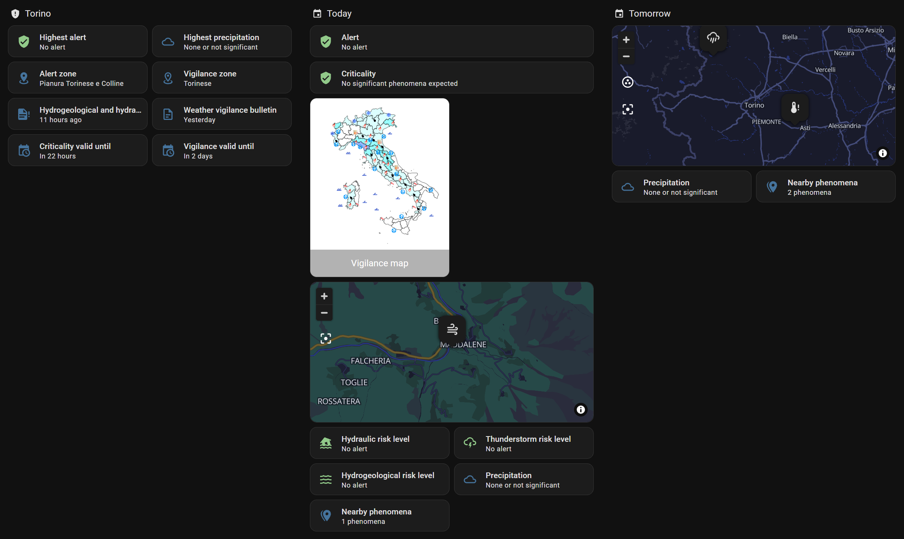

El panel de control sigue a tus lugares: cambia por sí solo cuando añades uno, marcas o desmarcas un día, y cuando un boletín trae otros fenómenos. La alerta, la criticidad, los niveles, la precipitación y los mapas de un día se ocultan mientras no tienen datos, como los de mañana después de medianoche, hasta que el DPC publica el siguiente boletín. Los avisos de color de los riesgos requieren Home Assistant 2026.9 o posterior; antes, los riesgos se muestran como mosaicos.

Para mostrar un lugar en otro panel de control, añade una vista con la estrategia del panel y el ID del dispositivo del lugar, la parte final de la dirección de la página de su dispositivo:

```yaml
views:
  - title: Torino
    strategy:
      type: custom:dpc-alert
      device_id: 0123456789abcdef0123456789abcdef
```

Los sensores binarios de los riesgos son sensores de seguridad: el panel de control **Seguridad** de Home Assistant (2025.11 o posterior) también los muestra.

## Tarjetas

La integración incluye tres tarjetas para tus propios paneles de control, en el selector de tarjetas en cuanto se instala: busca **DPC Alert**. Cada una es una sola tarjeta hecha con las tarjetas de Home Assistant, en los colores de las alertas del DPC y en el idioma de cada usuario, y encuentra las entidades del lugar incluso después de que les cambies el nombre.

- **DPC Alert** (`custom:dpc-card`): la alerta y la precipitación máximas del lugar, y después la alerta y la precipitación de cada día; pasado mañana solo tiene su precipitación.
- **DPC Alert · Boletines** (`custom:dpc-bulletin-card`): el boletín de criticidad y, a su lado, el boletín de vigilancia: sus zonas, cuándo se publicaron y hasta cuándo son válidos.
- **DPC Alert · Mapas** (`custom:dpc-map-card`): el mapa de un día y, a su lado, una lista tan alta como el mapa: un bloque por cada día con mapa, la zona del mapa y el número de fenómenos cercanos al lugar. Con dos días, un clic en un bloque muestra su mapa. Sin mapa, como cuando el DPC lo publica en blanco o después de medianoche hasta el siguiente boletín, la lista ocupa toda la tarjeta.

<p>
  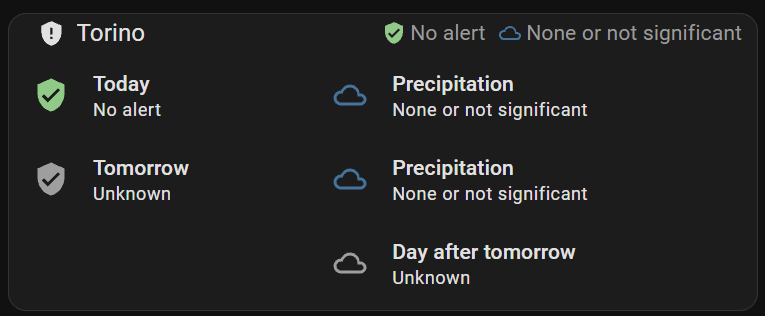
  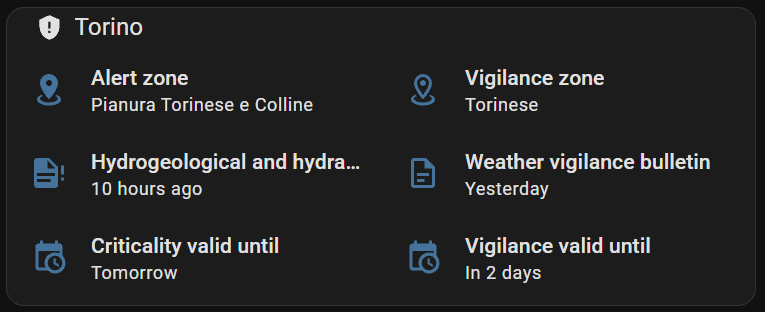
  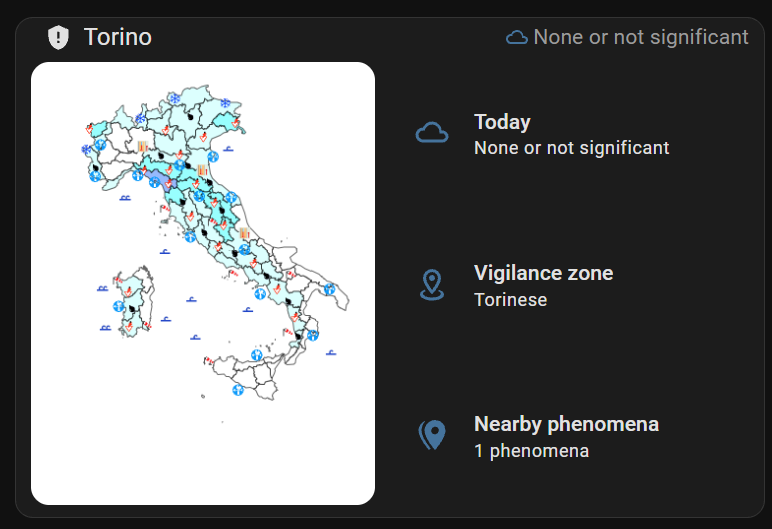
</p>

El editor visual elige lo que muestra cada tarjeta. En YAML, si omites una opción, se muestra todo:

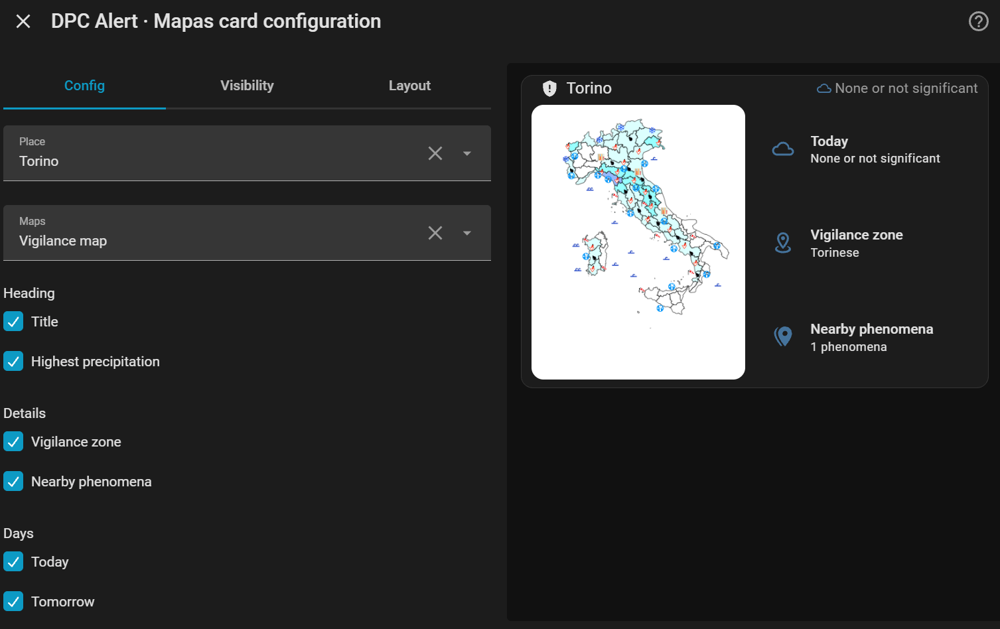

| Opción | Tarjetas | Sin la opción |
| --- | --- | --- |
| `device_id` | todas | El primer lugar. El ID del dispositivo del lugar, la parte final de la dirección de la página de su dispositivo. |
| `show_title: false` | todas | El nombre del lugar, encima del resto. Sin él, los niveles máximos pasan al principio. |
| `show_highest_alert: false` | DPC Alert, Mapas (criticidad) | La alerta máxima del lugar, junto a su nombre. |
| `show_highest_precipitation: false` | DPC Alert, Mapas (vigilancia) | La precipitación máxima del lugar, junto a su nombre. |
| `days` | DPC Alert, Mapas | Todos los días del lugar: `today`, `tomorrow`, `aftertomorrow`; en los mapas, hoy y mañana. |
| `items` | Boletines | Los seis: `alert_zone`, `criticality_bulletin`, `criticality_valid_until`, `vigilance_zone`, `vigilance_bulletin`, `vigilance_valid_until`. |
| `columns: 1` | DPC Alert, Boletines | Dos columnas: la alerta junto a la precipitación, el boletín de criticidad junto al de vigilancia. |
| `map: vigilance` | Mapas | El mapa de criticidad. |
| `show_zone: false` | Mapas | La zona del mapa, a su lado. |
| `show_nearby_phenomena: false` | Mapas | El número de fenómenos cercanos al lugar el día del mapa, a su lado. |

```yaml
# El mapa de vigilancia de hoy, sin el nombre del lugar
type: custom:dpc-map-card
device_id: 0123456789abcdef0123456789abcdef
map: vigilance
show_title: false
days:
  - today
```

### Con las tarjetas de Home Assistant

Las entidades se adaptan a las tarjetas de Home Assistant sin plantillas. Para un lugar en Turín:

```yaml
# La alerta de mañana y los riesgos de su nivel: "Alerta naranja · Riesgo hidrogeológico"
type: tile
entity: sensor.dpc_torino_tomorrow_alert
state_content:
  - state
  - risks
```

```yaml
# El mismo mosaico en el naranja del mapa del DPC, mientras la alerta es naranja; añade
# uno por cada nivel: verde #90c985, amarillo #f8f865, naranja #f0bf01, rojo #fd6767
type: tile
entity: sensor.dpc_torino_tomorrow_alert
color: "#f0bf01"
visibility:
  - condition: state
    entity: sensor.dpc_torino_tomorrow_alert
    state: orange
```

```yaml
# Un aviso mientras el riesgo hidrogeológico de mañana está en el nivel mínimo de alerta
# o superior y es naranja (Home Assistant 2026.9 o posterior)
type: alert
entity: binary_sensor.dpc_torino_tomorrow_hydrogeological_risk
alert_color: "#f0bf01"
visibility:
  - condition: state
    entity: binary_sensor.dpc_torino_tomorrow_hydrogeological_risk
    state: "on"
  - condition: state
    entity: sensor.dpc_torino_tomorrow_hydrogeological_risk_level
    state: orange
```

```yaml
# El mapa de criticidad de hoy
type: picture-entity
entity: image.dpc_torino_today_criticality_map
show_state: false
```

```yaml
# Los fenómenos meteorológicos cercanos a todos tus lugares
type: map
geo_location_sources:
  - dpc
```

## Cómo se actualizan los datos

- El DPC publica el boletín de criticidad cada día antes de las 16:00 (hora italiana), a veces actualizado más tarde el mismo día, y el boletín de vigilancia meteorológica antes de las 15:00.
- Cada 30 minutos (la opción **Intervalo de actualización**), cada lugar comprueba si el DPC ha publicado boletines nuevos. Los lugares que se actualizan al mismo tiempo comparten la comprobación.
- Un boletín nuevo se descarga una sola vez para todos los lugares y se lee en cada lugar: unos 11 MB para un boletín de criticidad y 8 MB para uno de vigilancia.
- Los mapas de los días se descargan con el boletín, una sola vez para todos los lugares, unos 100 kB cada uno. El DPC publica a menudo un mapa en blanco y a veces lo sustituye más tarde en la misma dirección: un mapa en blanco no se muestra, y se vuelve a descargar en cada actualización hasta que el DPC publica el mapa.
- Hoy y mañana siguen la fecha italiana: después de medianoche, el segundo día del boletín pasa a ser hoy, hasta que el DPC publica el siguiente boletín.
- Cuando no se puede acceder al DPC, los lugares conservan sus boletines, cuyos días siguen siendo válidos, y vuelven a comprobar al cabo de 10 minutos, o antes con un intervalo de actualización más corto.

## Limitaciones conocidas

- El DPC solo cubre Italia. San Marino y la Ciudad del Vaticano no están en ninguna zona de alerta del DPC.
- El DPC publica a menudo en blanco el mapa de un día: de agosto a noviembre de 2026, el 40 % de los mapas de criticidad y el 5 % de los de vigilancia, y solo sustituyó más tarde alrededor de un tercio de ellos. El mapa queda entonces no disponible, y los paneles de control lo omiten, a veces durante todo el día.
- El boletín de criticidad cubre hoy y mañana; el de vigilancia, tres días. La alerta máxima de un lugar es la de hoy y mañana, aunque solo muestre hoy.
- Cada municipio solo se puede añadir una vez: dos lugares en él recibirían los mismos boletines. Los municipios con el mismo nombre alejados entre sí, como Peglio, en Lombardía y en las Marcas, son municipios distintos: los IDs de entidad del segundo terminan en `_2`, por ejemplo `sensor.dpc_peglio_highest_alert_2`.
- Los textos de los niveles, riesgos, criticidades, fenómenos y direcciones proceden de la biblioteca aiodpc; en italiano, los niveles, riesgos, criticidades y fenómenos son los que escribe el DPC, mientras que las direcciones las calcula aiodpc. Los lugares, zonas y municipios conservan los nombres que les da el DPC, en italiano; en el Tirol del Sur, también funcionan los nombres alemanes de los municipios.
- En las plantillas y las notificaciones, `state_translated()` da el estado traducido; `state_attr_translated()` (Home Assistant 2026.4 o posterior), un atributo traducido, como el `phenomenon` de un fenómeno. Las listas, como los `risks` de la alerta de un día, solo las traducen los paneles de control.

## Solución de problemas

- **La integración muestra "Error de configuración, se volverá a intentar"**: no se puede acceder al DPC. Home Assistant lo vuelve a intentar por sí solo; comprueba que pueda acceder a `mappe.protezionecivile.gov.it` y `raw.githubusercontent.com`.
- **"… no está en ninguna zona de alerta del DPC"**: el lugar está fuera de Italia, o en San Marino o la Ciudad del Vaticano. Elimínalo y añade un lugar en Italia.
- **Faltan las entidades de un día**: comprueba la opción **Días** del lugar. Los lugares añadidos antes de esta versión muestran hoy y mañana.
- **Una automatización lee un atributo que ya no existe**, como `level`, `info`, `zone_name` o `expires`: los datos de los boletines se han convertido en entidades. El [registro de cambios](https://github.com/caiosweet/Home-Assistant-custom-components-DPC-Alert/blob/main/CHANGELOG.md) indica dónde está ahora cada atributo.
- **Después de una actualización, textos en inglés o nombres como `municipality_in_use` en los formularios**: Home Assistant y el navegador conservan los textos de la versión anterior. Reinicia Home Assistant y luego recarga la página vaciando su caché (Ctrl+F5).
- **Nombres de entidades y dispositivos en otro idioma**: Home Assistant da nombre a las entidades y los dispositivos en el idioma del sistema, no en el de tu perfil: **Configuración → Sistema → Información sobre el hogar → Idioma** (General, en versiones anteriores). Lo mismo ocurre con los nombres de los fenómenos. Los estados y los valores traducidos de los atributos siguen tu perfil, igual que los nombres del panel de control y de las tarjetas DPC Alert.
- **IDs de entidad como `binary_sensor.dpc_torino_idraulico_oggi`**: las entidades de los lugares añadidos con una versión anterior conservan sus IDs, para que las automatizaciones sigan funcionando. Para darles los IDs de los lugares nuevos, como `binary_sensor.dpc_torino_today_hydraulic_risk` (Home Assistant 2025.6 o posterior): en la página de cada dispositivo, elige **⋮ → Volver a crear los IDs de entidad**, o selecciona las entidades en **Configuración → Entidades** y elige **Volver a crear los IDs de entidad de los seleccionados**. Después, actualiza las automatizaciones y los paneles de control que los usan. Así también se obtienen los IDs nuevos después de cambiar el nombre de un lugar.
- **DPC Alert no aparece entre los paneles de control de la comunidad, o sus tarjetas no están en el selector de tarjetas**: el navegador los carga al abrir Home Assistant. Recarga la página después de instalar o actualizar la integración.
- **Un lugar añadido antes de la versión 2026.11 no tiene municipio**: usa la zona de alerta de sus coordenadas, y su dispositivo toma el nombre de su entrada. Elige su municipio en sus opciones, en **Municipio**, entre los de su zona de alerta.
- **Informar de un problema**: en la integración, elige **Habilitar el registro de depuración** en el menú **⋮**, reproduce el problema y luego deshabilítalo para descargar el registro. Adjunta los diagnósticos (**⋮ → Descargar diagnósticos**) a un [issue](https://github.com/caiosweet/Home-Assistant-custom-components-DPC-Alert/issues). Los diagnósticos omiten las coordenadas del lugar y las posiciones, distancias y direcciones de los fenómenos, pero no el municipio ni las zonas del DPC del lugar, que muestran los nombres de sus dispositivos y entidades: quítalos del archivo antes de publicarlo si prefieres mantenerlos en privado.

## Entidades

Para un lugar en Turín, con Home Assistant en español (las imágenes están en inglés). El dispositivo del lugar, **Torino**:

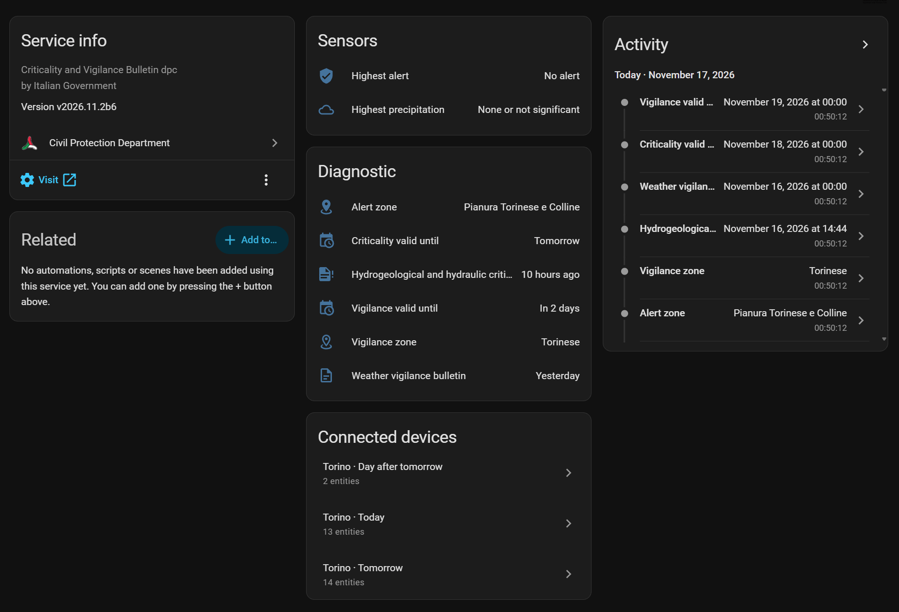

| Entidad | Estado |
| --- | --- |
| `sensor.dpc_torino_highest_alert` | El nivel de alerta más alto de hoy y mañana: de 1 (sin alerta) a 4 (roja), mostrado como la alerta, por ejemplo "Alerta naranja" |
| `sensor.dpc_torino_highest_precipitation` | La precipitación prevista más alta de los próximos tres días: de 1 (ausente o no significativa) a 5 (muy fuerte), mostrada como la precipitación |
| `sensor.dpc_torino_alert_zone`, `…_vigilance_zone` | Las zonas del DPC del lugar, para su diagnóstico |
| `sensor.dpc_torino_criticality_bulletin`, `…_vigilance_bulletin` | Cuándo se publicó el último boletín, para su diagnóstico: la hora del boletín de criticidad; el día del boletín de vigilancia, a medianoche |
| `sensor.dpc_torino_criticality_valid_until`, `…_vigilance_valid_until` | El final del último día que cubre el boletín, para su diagnóstico |

Los dispositivos de los días, **Torino · Hoy** y **Torino · Mañana** (`today` y `tomorrow` en los IDs):

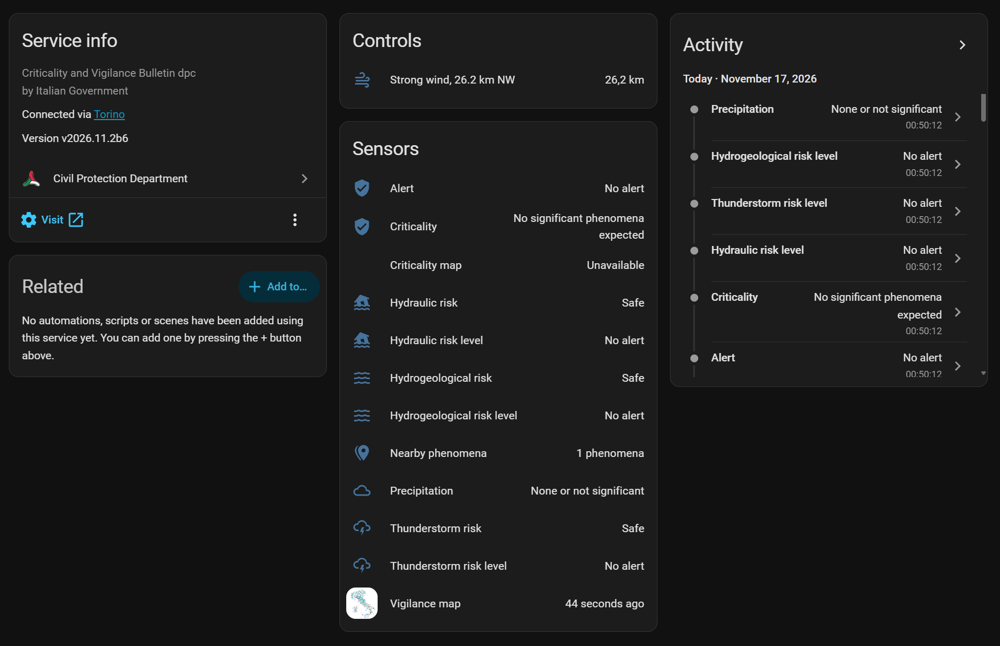

| Entidad | Estado |
| --- | --- |
| `sensor.dpc_torino_today_alert` | La alerta del día: sin alerta, amarilla, naranja o roja |
| `sensor.dpc_torino_today_criticality` | La criticidad que el DPC indica para la zona, y el riesgo que muestra su mapa: "Criticidad moderada por riesgo hidrogeológico" (`moderate_hydrogeological`), o "Ausencia de fenómenos significativos previsibles" (`absent`) |
| `binary_sensor.dpc_torino_today_hydraulic_risk`, `…_thunderstorm_risk`, `…_hydrogeological_risk` | Activado cuando el riesgo alcanza el nivel mínimo de alerta de las opciones |
| `sensor.dpc_torino_today_hydraulic_risk_level`, `…_thunderstorm_risk_level`, `…_hydrogeological_risk_level` | El nivel del riesgo: sin alerta, amarilla, naranja o roja |
| `sensor.dpc_torino_today_precipitation` | La precipitación prevista del día: de ausente o no significativa a muy fuerte |
| `sensor.dpc_torino_today_nearby_phenomena` | El número de fenómenos meteorológicos dentro del radio |
| `image.dpc_torino_today_criticality_map`, `…_vigilance_map` | El mapa nacional del boletín, tal como el DPC lo muestra en su vista previa; no disponible mientras el DPC lo publica en blanco |
| `geo_location.dpc_torino_today_gale_nw` y así sucesivamente | Un fenómeno meteorológico dentro del radio, una vez activados los fenómenos en las opciones, con el nombre de su tipo, distancia y dirección ("Temporal, 12,4 km NO"): su distancia, en km |

El dispositivo de pasado mañana, **Torino · Pasado mañana** (`after_tomorrow` en los IDs), tiene la precipitación, el número de fenómenos y los fenómenos: el boletín de criticidad cubre dos días.

La alerta y los niveles de un día son los del boletín, sea cual sea el nivel mínimo de alerta de las opciones. Después de medianoche, hasta que el DPC publica los siguientes boletines, la alerta, la criticidad, los riesgos y sus niveles de mañana son desconocidos, y sus mapas no están disponibles; la precipitación y el número de fenómenos de pasado mañana son desconocidos, y sus fenómenos se eliminan.

Home Assistant traduce los estados, y los valores de los atributos en los paneles de control. Las plantillas y las automatizaciones ven los valores siguientes; cada entidad tiene además la `attribution` de los datos del DPC.

<details>
<summary>Atributos</summary>

```yaml
# sensor.dpc_torino_tomorrow_alert
state: orange # green (sin alerta), yellow, orange o red
risks: # los riesgos de ese nivel, ninguno cuando es green
  - hydrogeological # hydraulic, thunderstorms o hydrogeological
```

```yaml
# sensor.dpc_torino_highest_alert, y lo mismo para la precipitación máxima
state: 3
total_alerts: 3 # los riesgos (los días, para la precipitación) en el nivel mínimo de alerta o superior
```

```yaml
# sensor.dpc_torino_criticality_bulletin, y lo mismo para el boletín de vigilancia
state: '2026-11-14T13:30:00+00:00' # cuándo se publicó
id: '20261114_1430'
link: https://mappe.protezionecivile.gov.it/it/mappe-rischi/bollettino-di-criticita/
last_check: '2026-11-14T15:00:00+01:00' # cuándo confirmó el DPC por última vez que es el más reciente
```

```yaml
# image.dpc_torino_today_criticality_map
image_url: https://raw.githubusercontent.com/pcm-dpc/DPC-Bollettini-Criticita-Idrogeologica-Idraulica/master/files/preview/20261114_1430_oggi.png
```

```yaml
# geo_location.dpc_torino_tomorrow_light_snow_nne
state: 44.3 # la distancia desde el lugar, en km
source: dpc
latitude: 45.83
longitude: 9.41
phenomenon: light_snow # se muestra como "Nevadas débiles o moderadas"
direction: nne # desde el lugar, se muestra como "NNE"
```

Los fenómenos meteorológicos aparecen y desaparecen con los boletines, cada uno en el dispositivo de su día.

</details>

## Ejemplos de automatizaciones

Los ejemplos usan Turín: sustituye `torino` por tu lugar en los IDs de entidad, y `notify.mobile_app_your_phone` por tu notificación. Pega un ejemplo en el editor YAML de una nueva automatización. Los mensajes están en el idioma de Home Assistant.

<details>
<summary>Notificar la alerta de hoy o de mañana</summary>

```yaml
alias: Alerta DPC
triggers:
  - trigger: state
    entity_id:
      - sensor.dpc_torino_today_alert
      - sensor.dpc_torino_tomorrow_alert
    to:
      - yellow
      - orange
      - red
actions:
  - action: notify.mobile_app_your_phone
    data:
      title: "{{ state_attr(trigger.entity_id, 'friendly_name') }}"
      message: "{{ state_translated(trigger.entity_id) }}"
mode: queued
```

Por ejemplo *Torino · Mañana Alerta: Alerta naranja*, cuando la alerta de un día pasa a amarilla, naranja o roja, o cambia entre ellas.

</details>

<details>
<summary>Notificar un riesgo en el nivel mínimo de alerta</summary>

```yaml
alias: Riesgos DPC
triggers:
  - trigger: state
    entity_id:
      - binary_sensor.dpc_torino_today_hydraulic_risk
      - binary_sensor.dpc_torino_today_thunderstorm_risk
      - binary_sensor.dpc_torino_today_hydrogeological_risk
      - binary_sensor.dpc_torino_tomorrow_hydraulic_risk
      - binary_sensor.dpc_torino_tomorrow_thunderstorm_risk
      - binary_sensor.dpc_torino_tomorrow_hydrogeological_risk
    to: "on"
actions:
  - action: notify.mobile_app_your_phone
    data:
      title: "{{ state_attr(trigger.entity_id, 'friendly_name') }}"
      # El nivel del mismo riesgo y día: binary_sensor.…_risk → sensor.…_risk_level
      message: >-
        {{ state_translated(trigger.entity_id | replace('binary_sensor.', 'sensor.')
        ~ '_level') }}
mode: queued
```

Por ejemplo *Torino · Mañana Riesgo hidrogeológico: Alerta naranja*. Los sensores binarios se activan en el nivel mínimo de alerta de las opciones, un riesgo cada vez. El mensaje obtiene el nivel a partir del ID de entidad del sensor binario, así que necesita los IDs de entidad de los lugares nuevos.

</details>

<details>
<summary>Notificar precipitaciones fuertes</summary>

```yaml
alias: Precipitación DPC
triggers:
  - trigger: state
    entity_id:
      - sensor.dpc_torino_today_precipitation
      - sensor.dpc_torino_tomorrow_precipitation
      - sensor.dpc_torino_after_tomorrow_precipitation
    to:
      - moderate
      - heavy
      - very_heavy
actions:
  - action: notify.mobile_app_your_phone
    data:
      title: "{{ state_attr(trigger.entity_id, 'friendly_name') }}"
      message: "{{ state_translated(trigger.entity_id) }}"
mode: queued
```

</details>

<details>
<summary>Notificar un fenómeno meteorológico cerca de casa</summary>

```yaml
alias: Fenómenos DPC cerca de casa
triggers:
  - trigger: geo_location
    source: dpc
    zone: zone.around_home
    event: enter
actions:
  - action: notify.mobile_app_your_phone
    data:
      title: DPC
      message: "{{ state_attr(trigger.to_state.entity_id, 'friendly_name') }}"
mode: queued
```

Los fenómenos deben estar activados en las opciones. `zone.around_home` es una zona que creas alrededor de casa, con el radio que te interese, por ejemplo 20 km, en **Configuración → Áreas, etiquetas y zonas → Zonas**: la zona Casa suele ser demasiado pequeña. La automatización se ejecuta cuando un fenómeno del boletín está dentro de ella, por ejemplo *Torino · Mañana Nevadas débiles o moderadas, 44,3 km NNE*: su día, tipo, distancia y dirección desde el lugar.

</details>

## Comunidad

Ayuda y novedades en italiano en la comunidad [HassioHelp](https://hassiohelp.eu/): su [foro](https://forum.hassiohelp.eu/), su grupo de [Telegram](https://t.me/HassioHelp) y su grupo de [Facebook](https://www.facebook.com/groups/2062381507393179/).

[](https://paypal.me/hassiohelp)

## Contribuir

Los informes, traducciones y correcciones son bienvenidos: consulta la [guía de contribución](https://github.com/caiosweet/Home-Assistant-custom-components-DPC-Alert/blob/main/CONTRIBUTING.md) (en inglés).

## Licencia

El código de DPC Alert está bajo la [licencia MIT](https://github.com/caiosweet/Home-Assistant-custom-components-DPC-Alert/blob/main/LICENSE.md). Los boletines son datos del Dipartimento della Protezione Civile – Presidenza del Consiglio dei Ministri, bajo la licencia [CC BY 4.0](https://creativecommons.org/licenses/by/4.0/deed.es): cada entidad lleva esta atribución.

Los nombres, logotipos y marcas de este repositorio, como los del Dipartimento della Protezione Civile y de Home Assistant, pertenecen a sus titulares y solo se usan para identificarlos, sin implicar su respaldo.
