# DPC Alert (Protezione Civile)

[English](https://github.com/caiosweet/Home-Assistant-custom-components-DPC-Alert/blob/main/README.md) · [Italiano](https://github.com/caiosweet/Home-Assistant-custom-components-DPC-Alert/blob/main/README.it.md) · **Français** · [Español](https://github.com/caiosweet/Home-Assistant-custom-components-DPC-Alert/blob/main/README.es.md) · [Deutsch](https://github.com/caiosweet/Home-Assistant-custom-components-DPC-Alert/blob/main/README.de.md)

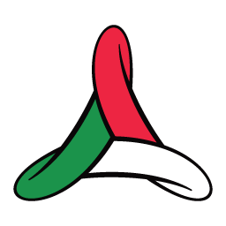

Les alertes du Département de la Protection civile italien (Dipartimento della Protezione Civile, DPC) dans Home Assistant, pour n'importe quel lieu en Italie : le risque hydraulique, hydrogéologique et d'orages d'aujourd'hui et de demain, et la vigilance météo des trois prochains jours avec les phénomènes près de chez vous.

Fonctionnement du système d'alerte : [_Civil Protection Department_](https://rischi.protezionecivile.gov.it/en/meteo-hydro/alert) · [_Dipartimento Protezione Civile_](https://rischi.protezionecivile.gov.it/it/meteo-idro/allertamento)

[![hacs][hacsbadge]][hacs] [](https://github.com/caiosweet/Home-Assistant-custom-components-DPC-Alert/actions/workflows/validate.yaml)

[![GitHub latest release]][githubrelease] ![GitHub Release Date] [![Maintenancebadge]][maintenance] [![GitHub issuesbadge]][github issues]

[![Websitebadge]][website] [![Forum][forumbadge]][forum] [![telegrambadge]][telegram] [![facebookbadge]][facebook]

[](https://paypal.me/hassiohelp)

---

## Fonctionnalités

- **Un appareil pour chaque jour** : Torino · Aujourd'hui, Torino · Demain et Torino · Après-demain, rattachés à l'appareil du lieu. La configuration et les options choisissent les jours.
- **Chaque jour** : l'alerte (pas d'alerte, jaune, orange ou rouge) avec les risques à ce niveau ; la criticité que le DPC indique pour la zone, comme « Criticité modérée pour risque hydrogéologique » ; le niveau du risque hydraulique, hydrogéologique et d'orages, et un capteur binaire pour chacun, activé quand il atteint le niveau d'alerte que vous choisissez ; les précipitations prévues ; et les phénomènes météo dans le rayon que vous choisissez, sur une carte, une fois activés dans les options. Le bulletin de criticité couvre aujourd'hui et demain, le bulletin de vigilance aussi après-demain.
- **Le lieu** : son alerte maximale et ses précipitations maximales, ses zones DPC et ses bulletins.
- **Cartes** des bulletins de criticité et de vigilance, d'aujourd'hui et de demain, sous forme d'images.
- **Un tableau de bord** de chaque lieu, fait des cartes de Home Assistant, aux couleurs des alertes du DPC : voir [Tableau de bord](#tableau-de-bord).
- **Trois cartes** pour vos propres tableaux de bord, avec un éditeur visuel : l'alerte et les précipitations de chaque jour, les bulletins et les cartes : voir [Cartes](#cartes).
- **Plusieurs lieux**, choisis sur une carte ou à partir d'une zone, chacun avec sa commune. Chaque bulletin est téléchargé une seule fois pour tous.
- **Treize langues** : anglais, italien, français, allemand, espagnol et portugais du Brésil, ainsi que celles de quelques-unes des plus grandes communautés étrangères d'Italie : roumain, albanais, arabe, chinois simplifié, ukrainien, bengali et hindi. Les textes des niveaux, des risques, des phénomènes et des directions sont ceux de la bibliothèque [aiodpc](https://github.com/webysther/aiodpc) ; en italien, les niveaux, les risques et les phénomènes sont ceux qu'écrit le DPC.
- **Données officielles** : les bulletins de criticité et de vigilance météorologique que le DPC publie chaque jour.

Nécessite Home Assistant 2025.2 ou plus récent. Consultez le [journal des modifications](https://github.com/caiosweet/Home-Assistant-custom-components-DPC-Alert/blob/main/CHANGELOG.md) (en anglais) pour les nouveautés de chaque version.

## Cas d'utilisation

- Recevoir une notification quand le DPC émet une alerte jaune, orange ou rouge pour votre lieu, aujourd'hui ou demain, avec le risque et son niveau.
- Voir les alertes de chaque jour, les précipitations prévues et les cartes des bulletins dans le tableau de bord DPC Alert, ou dans les vôtres avec les cartes DPC Alert ou celles de Home Assistant.
- Voir sur une carte les phénomènes météo près de vos lieux.
- Annoncer le matin les alertes du jour sur une enceinte.
- Fermer les volets ou rentrer le mobilier de jardin quand du vent fort ou des orages sont prévus à proximité, d'après les phénomènes météo près du lieu.
- Avant un voyage, ajouter le lieu où vous allez et suivre ses alertes.

## Installation

DPC Alert figure dans le catalogue communautaire, à partir duquel le Marketplace de Home Assistant et HACS l'installent tous les deux.

### Avec le Marketplace (Home Assistant 2026.11 ou plus récent)

1. Allez dans **Paramètres → Marketplace** et recherchez `DPC Alert`.
2. Ouvrez **DPC Alert (Protezione Civile)** et choisissez **Installer**.
3. Redémarrez Home Assistant.

### Avec [HACS](https://hacs.xyz/) (de Home Assistant 2025.2 à 2026.10)

1. Ouvrez **HACS** dans le menu de Home Assistant et recherchez `DPC Alert`.
2. Ouvrez **DPC Alert (Protezione Civile)** et choisissez **Télécharger**.
3. Redémarrez Home Assistant.

## Configuration

[](https://my.home-assistant.io/redirect/config_flow_start/?domain=dpc)

1. Dans Home Assistant, allez dans **Paramètres → Appareils et services → Ajouter une intégration** et recherchez `Dpc`, ou utilisez le bouton ci-dessus.
2. Choisissez comment indiquer le lieu à surveiller :
   - **Le choisir sur la carte** : la carte s'ouvre sur votre domicile ; déplacez le repère.
   - **Utiliser une zone**, comme Maison.
3. L'intégration vérifie le lieu auprès du DPC et affiche sa zone d'alerte. Choisissez sa **commune** parmi celles de la zone : une commune qui s'étend sur plusieurs zones d'alerte reçoit l'alerte la plus élevée d'entre elles.
4. **Que montrer** : les jours (aujourd'hui par défaut) et les types d'entités (tous sauf les phénomènes par défaut).
5. **Alertes** : le niveau d'alerte minimal, le rayon des phénomènes et l'intervalle de mise à jour. Chaque champ indique ce qu'il fait, et vous pourrez les changer plus tard dans les options.

<p>
  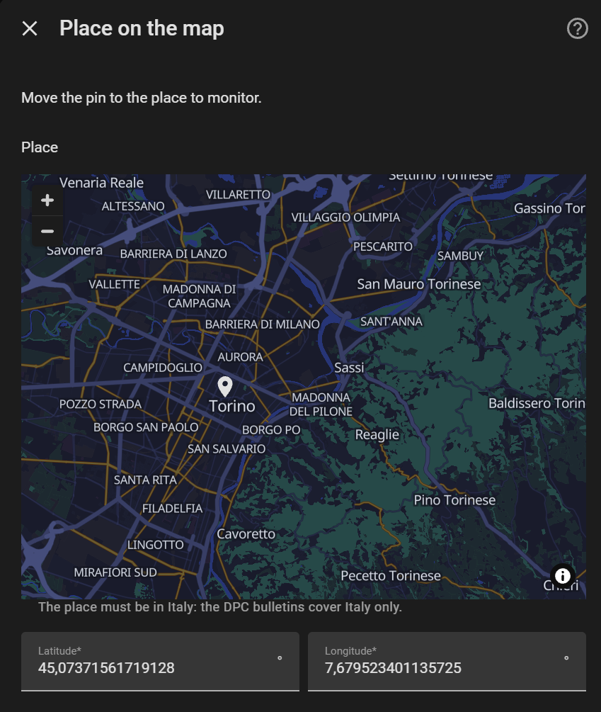
  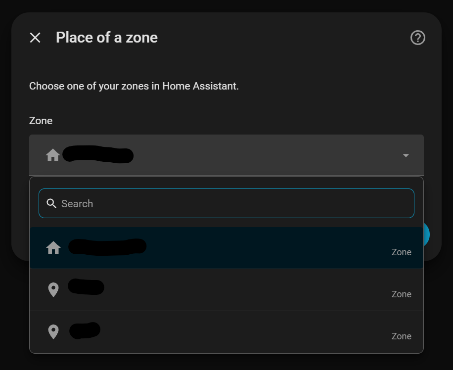
  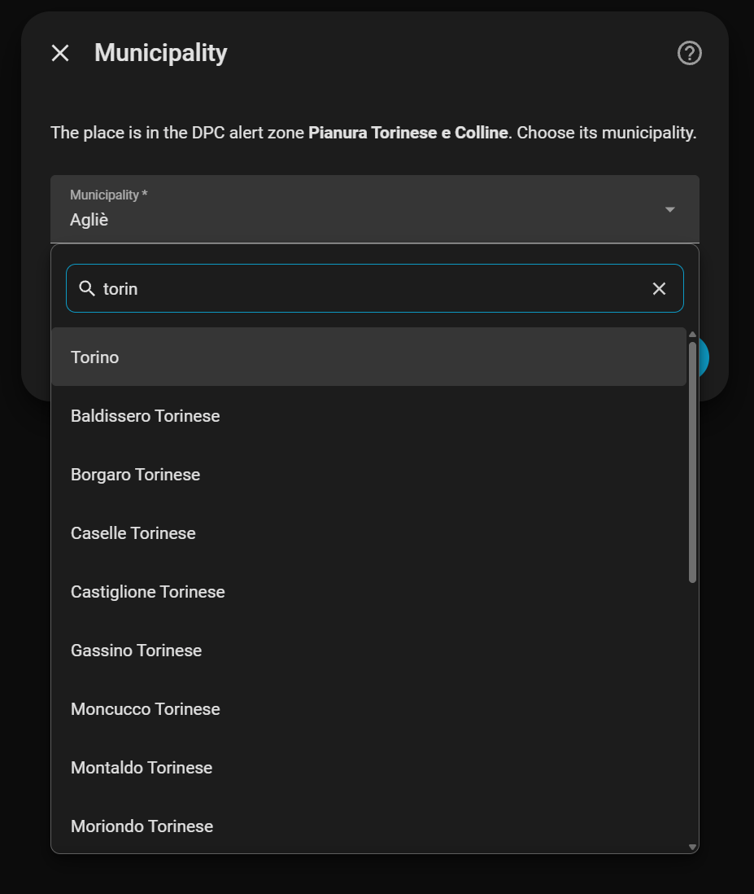
  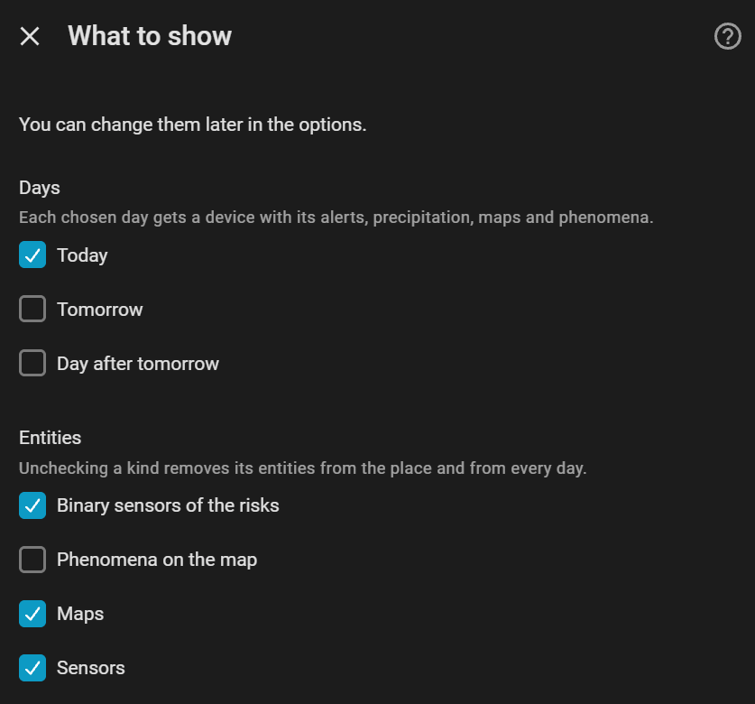
  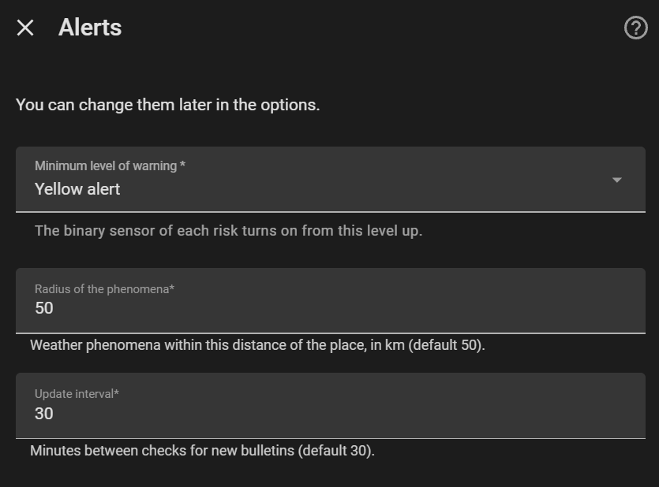
</p>

Ajoutez autant de lieux que vous voulez, chacun avec sa propre commune : deux lieux dans la même commune recevraient les mêmes bulletins. Les lieux partagent les téléchargements : chaque bulletin est téléchargé une seule fois pour tous.

Un lieu porte le nom de sa zone d'alerte, et son appareil celui de sa commune : pour un lieu à Turin, l'appareil est Torino, et l'appareil d'aujourd'hui est Torino · Aujourd'hui. Un nouveau lieu montre aujourd'hui, sauf si vous choisissez d'autres jours. Les identifiants d'entité commencent par `dpc_`, puis le lieu, le jour et l'entité, en anglais quelle que soit la langue : `sensor.dpc_torino_highest_alert`, `binary_sensor.dpc_torino_today_hydraulic_risk`. Voir [Entités](#entités) pour la liste complète.

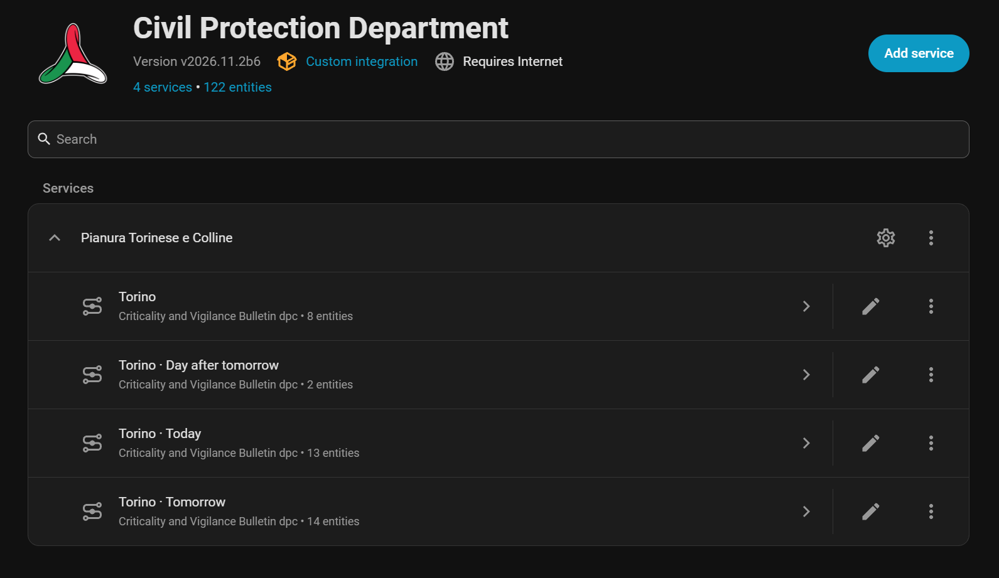

### Options

**Configurer** sur l'intégration ouvre un menu des étapes de la configuration : choisissez celle à modifier, qui s'enregistre d'elle-même.

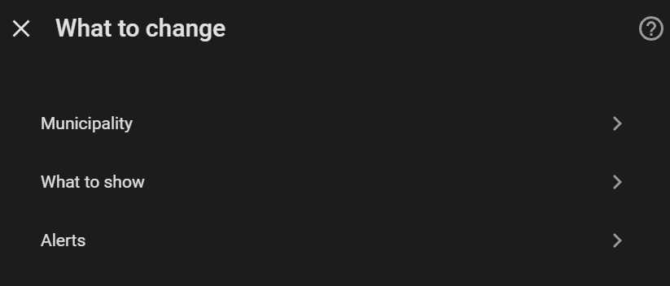

1. **Commune** : parmi celles de la zone d'alerte du lieu ; tant que le DPC est injoignable, n'importe quel nom peut être saisi.
2. **Que montrer** :
   - **Jours** : aujourd'hui, demain et après-demain, chacun un appareil avec ses entités. Décocher un jour supprime son appareil et ses entités ; le lieu garde son alerte et ses précipitations maximales et ses bulletins.
   - **Entités** : les capteurs binaires des risques, les capteurs, les cartes et les phénomènes sur la carte (désactivés par défaut). Décocher un type supprime ses entités du lieu et de chaque jour. Le lieu doit montrer quelque chose : sans jours, seuls les capteurs lui donnent des entités, et après-demain n'a ni risques ni cartes.
3. **Alertes** :
   - **Niveau d'alerte minimal** : alerte jaune (par défaut), orange ou rouge. Le capteur binaire de chaque risque s'active à partir de ce niveau.
   - **Rayon des phénomènes** (km, 50 par défaut).
   - **Intervalle de mise à jour** (minutes, 30 par défaut).

### Suppression

1. Allez dans **Paramètres → Appareils et services** et ouvrez **Département de la Protection civile**, le nom que Home Assistant donne à l'intégration en français (Civil Protection Department en anglais).
2. Pour chaque lieu, ouvrez son menu **⋮** et choisissez **Supprimer**.
3. Pour désinstaller aussi l'intégration, ouvrez **DPC Alert (Protezione Civile)** dans **Paramètres → Marketplace** et choisissez **Désinstaller** ; avant Home Assistant 2026.11, ouvrez-la dans **HACS** et choisissez **Désinstaller** dans son menu **⋮**. Redémarrez ensuite Home Assistant.

## Tableau de bord

L'intégration inclut un tableau de bord fait des cartes de Home Assistant, dans la langue de chaque utilisateur, avec les noms des jours et des entités ; seuls les noms des phénomènes suivent la langue du système (voir [Dépannage](#dépannage)) :

1. Allez dans **Paramètres → Tableaux de bord → Ajouter un tableau de bord**.
2. Sous **Tableaux de bord communautaires**, choisissez **DPC Alert**. S'il n'apparaît pas, rechargez la page.

Il a un onglet pour chaque lieu, avec les niveaux aux couleurs de la carte d'alerte du DPC, du vert au rouge, et les précipitations sur la même échelle, de faibles à très fortes (nulles dans le bleu des icônes du thème) :

- **Le lieu** : son alerte maximale et ses précipitations maximales, ses zones, quand chaque bulletin a été publié et jusqu'à quand il est valable.
- **Chaque jour** qu'il montre : une bannière pour chaque risque au niveau d'alerte minimal ou au-dessus, dans la couleur de son niveau (sans les capteurs, une tuile pour chaque risque, activé ou désactivé) ; l'alerte, avec les risques à ce niveau ; la criticité ; les cartes des bulletins ; les phénomènes du jour sur une carte ; le niveau de chaque risque ; les précipitations prévues et le nombre de phénomènes.

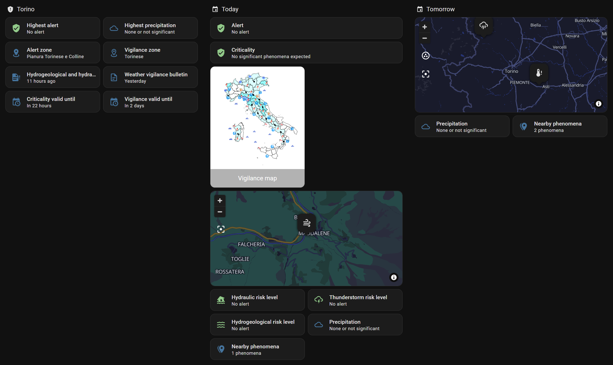

Le tableau de bord suit vos lieux : il change de lui-même quand vous en ajoutez un, cochez ou décochez un jour, et quand un bulletin apporte d'autres phénomènes. L'alerte, la criticité, les niveaux, les précipitations et les cartes d'un jour sont masqués tant qu'ils n'ont pas de données, comme ceux de demain après minuit, jusqu'à ce que le DPC publie le bulletin suivant. Les bannières colorées des risques nécessitent Home Assistant 2026.9 ou plus récent ; avant, les risques sont affichés sous forme de tuiles.

Pour montrer un lieu dans un autre tableau de bord, ajoutez une vue avec la stratégie du tableau de bord et l'identifiant de l'appareil du lieu, la fin de l'adresse de la page de son appareil :

```yaml
views:
  - title: Torino
    strategy:
      type: custom:dpc-alert
      device_id: 0123456789abcdef0123456789abcdef
```

Les capteurs binaires des risques sont des capteurs de sécurité : le tableau de bord **Sécurité** de Home Assistant (2025.11 ou plus récent) les liste aussi.

## Cartes

L'intégration inclut trois cartes pour vos propres tableaux de bord, dans le sélecteur de cartes dès qu'elle est installée : recherchez **DPC Alert**. Chacune est une seule carte faite des cartes de Home Assistant, aux couleurs des alertes du DPC et dans la langue de chaque utilisateur, et trouve les entités du lieu même après que vous les avez renommées.

- **DPC Alert** (`custom:dpc-card`) : l'alerte et les précipitations maximales du lieu, puis l'alerte et les précipitations de chaque jour ; après-demain n'a que ses précipitations.
- **DPC Alert · Bulletins** (`custom:dpc-bulletin-card`) : le bulletin de criticité et, à côté, le bulletin de vigilance : leurs zones, quand ils ont été publiés et jusqu'à quand ils sont valables.
- **DPC Alert · Cartes** (`custom:dpc-map-card`) : la carte d'un jour et, à côté, une liste aussi haute que la carte : un bloc pour chaque jour avec une carte, la zone de la carte et le nombre de phénomènes près du lieu. Avec deux jours, un clic sur un bloc affiche sa carte. Sans carte, comme quand le DPC la publie vierge ou après minuit jusqu'au bulletin suivant, la liste occupe toute la carte.

<p>
  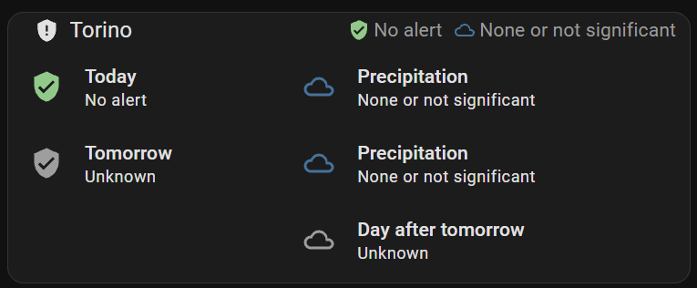
  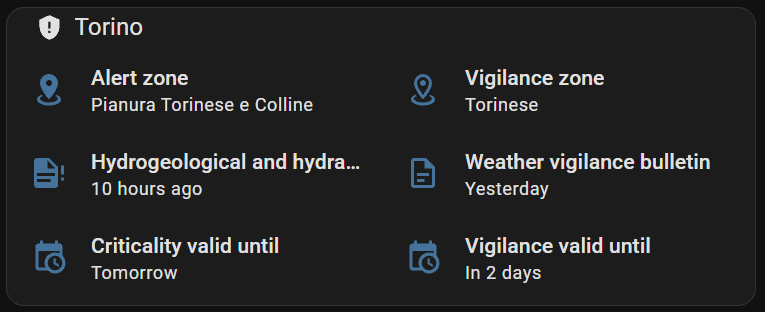
  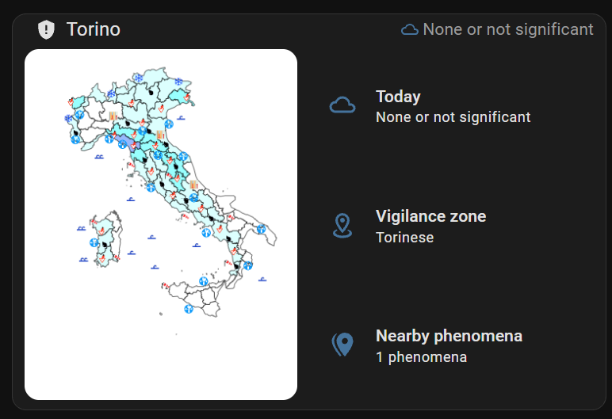
</p>

L'éditeur visuel choisit ce que montre chaque carte. En YAML, une option omise montre tout :

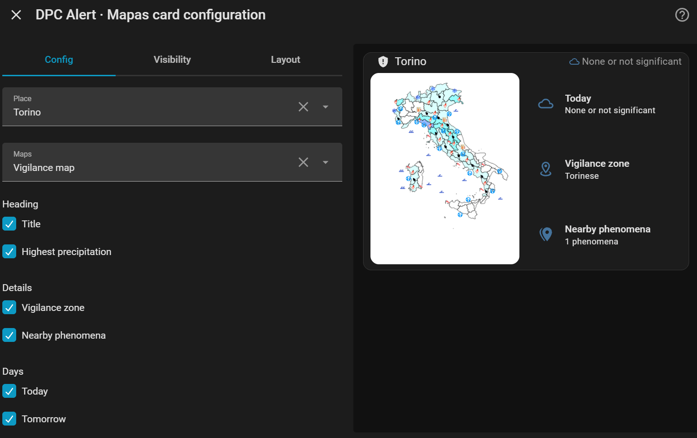

| Option | Cartes | Sans l'option |
| --- | --- | --- |
| `device_id` | toutes | Le premier lieu. L'identifiant de l'appareil du lieu, la fin de l'adresse de la page de son appareil. |
| `show_title: false` | toutes | Le nom du lieu, au-dessus du reste. Sans le nom, les niveaux maximaux passent au début. |
| `show_highest_alert: false` | DPC Alert, Cartes (criticité) | L'alerte maximale du lieu, à côté de son nom. |
| `show_highest_precipitation: false` | DPC Alert, Cartes (vigilance) | Les précipitations maximales du lieu, à côté de son nom. |
| `days` | DPC Alert, Cartes | Tous les jours du lieu : `today`, `tomorrow`, `aftertomorrow` ; pour les cartes, aujourd'hui et demain. |
| `items` | Bulletins | Les six : `alert_zone`, `criticality_bulletin`, `criticality_valid_until`, `vigilance_zone`, `vigilance_bulletin`, `vigilance_valid_until`. |
| `columns: 1` | DPC Alert, Bulletins | Deux colonnes : l'alerte à côté des précipitations, le bulletin de criticité à côté du bulletin de vigilance. |
| `map: vigilance` | Cartes | La carte de criticité. |
| `show_zone: false` | Cartes | La zone de la carte, à côté. |
| `show_nearby_phenomena: false` | Cartes | Le nombre de phénomènes près du lieu le jour de la carte, à côté. |

```yaml
# La carte de vigilance d'aujourd'hui, sans le nom du lieu
type: custom:dpc-map-card
device_id: 0123456789abcdef0123456789abcdef
map: vigilance
show_title: false
days:
  - today
```

### Avec les cartes de Home Assistant

Les entités s'adaptent aux cartes de Home Assistant sans modèles. Pour un lieu à Turin :

```yaml
# L'alerte de demain et les risques à son niveau : « Alerte orange · Risque hydrogéologique »
type: tile
entity: sensor.dpc_torino_tomorrow_alert
state_content:
  - state
  - risks
```

```yaml
# La même tuile dans l'orange de la carte du DPC, tant que l'alerte est orange ;
# ajoutez-en une pour chaque niveau : vert #90c985, jaune #f8f865, orange #f0bf01,
# rouge #fd6767
type: tile
entity: sensor.dpc_torino_tomorrow_alert
color: "#f0bf01"
visibility:
  - condition: state
    entity: sensor.dpc_torino_tomorrow_alert
    state: orange
```

```yaml
# Une bannière tant que le risque hydrogéologique de demain est au niveau d'alerte
# minimal ou au-dessus, et orange (Home Assistant 2026.9 ou plus récent)
type: alert
entity: binary_sensor.dpc_torino_tomorrow_hydrogeological_risk
alert_color: "#f0bf01"
visibility:
  - condition: state
    entity: binary_sensor.dpc_torino_tomorrow_hydrogeological_risk
    state: "on"
  - condition: state
    entity: sensor.dpc_torino_tomorrow_hydrogeological_risk_level
    state: orange
```

```yaml
# La carte de criticité d'aujourd'hui
type: picture-entity
entity: image.dpc_torino_today_criticality_map
show_state: false
```

```yaml
# Les phénomènes météo près de tous vos lieux
type: map
geo_location_sources:
  - dpc
```

## Comment les données sont mises à jour

- Le DPC publie le bulletin de criticité chaque jour au plus tard à 16 h (heure italienne), parfois mis à jour plus tard le même jour, et le bulletin de vigilance météorologique au plus tard à 15 h.
- Toutes les 30 minutes (l'option **Intervalle de mise à jour**), chaque lieu vérifie si le DPC a publié de nouveaux bulletins. Les lieux qui se mettent à jour au même moment partagent la vérification.
- Un nouveau bulletin est téléchargé une seule fois pour tous les lieux et lu pour chaque lieu : environ 11 Mo pour un bulletin de criticité, 8 Mo pour un bulletin de vigilance.
- Les cartes des jours sont téléchargées avec le bulletin, une seule fois pour tous les lieux, environ 100 ko chacune. Le DPC publie souvent une carte vierge et la remplace parfois plus tard à la même adresse : une carte vierge n'est pas affichée, et elle est de nouveau téléchargée à chaque mise à jour jusqu'à ce que le DPC publie la carte.
- Aujourd'hui et demain suivent la date italienne : après minuit, le deuxième jour du bulletin devient aujourd'hui, jusqu'à ce que le DPC publie le bulletin suivant.
- Quand le DPC est injoignable, les lieux gardent leurs bulletins, dont les jours restent valables, et vérifient de nouveau après 10 minutes, ou plus tôt avec un intervalle de mise à jour plus court.

## Limitations connues

- Le DPC ne couvre que l'Italie. Saint-Marin et la Cité du Vatican ne sont dans aucune zone d'alerte du DPC.
- Le DPC publie souvent vierge la carte d'un jour : d'août à novembre 2026, 40 % des cartes de criticité et 5 % des cartes de vigilance, et il n'en a remplacé ensuite qu'environ un tiers. La carte est alors indisponible, et les tableaux de bord l'omettent, parfois toute la journée.
- Le bulletin de criticité couvre aujourd'hui et demain ; le bulletin de vigilance, trois jours. L'alerte maximale d'un lieu est celle d'aujourd'hui et de demain, même quand il ne montre qu'aujourd'hui.
- Chaque commune ne peut être ajoutée qu'une seule fois : deux lieux dans la même commune recevraient les mêmes bulletins. Des communes du même nom éloignées l'une de l'autre, comme Peglio, en Lombardie et dans les Marches, sont des communes différentes : les identifiants d'entité de la seconde se terminent par `_2`, par exemple `sensor.dpc_peglio_highest_alert_2`.
- Les textes des niveaux, des risques, des criticités, des phénomènes et des directions viennent de la bibliothèque aiodpc ; en italien, les niveaux, les risques, les criticités et les phénomènes sont ceux qu'écrit le DPC, tandis que les directions sont calculées par aiodpc. Les lieux, les zones et les communes gardent les noms que leur donne le DPC, en italien ; dans le Haut-Adige, les noms allemands des communes fonctionnent aussi.
- Dans les modèles et les notifications, `state_translated()` donne l'état traduit ; `state_attr_translated()` (Home Assistant 2026.4 ou plus récent) un attribut traduit, comme le `phenomenon` d'un phénomène. Les listes, comme les `risks` de l'alerte d'un jour, ne sont traduites que par les tableaux de bord.

## Dépannage

- **L'intégration affiche « Échec de la configuration, nouvel essai »** : le DPC est injoignable. Home Assistant réessaie de lui-même ; vérifiez qu'il peut joindre `mappe.protezionecivile.gov.it` et `raw.githubusercontent.com`.
- **« … n'est dans aucune zone d'alerte du DPC »** : le lieu est hors d'Italie, ou à Saint-Marin ou dans la Cité du Vatican. Supprimez-le et ajoutez un lieu en Italie.
- **Les entités d'un jour manquent** : vérifiez l'option **Jours** du lieu. Les lieux ajoutés avant cette version montrent aujourd'hui et demain.
- **Une automatisation lit un attribut qui n'existe plus**, comme `level`, `info`, `zone_name` ou `expires` : les données des bulletins sont devenues des entités. Le [journal des modifications](https://github.com/caiosweet/Home-Assistant-custom-components-DPC-Alert/blob/main/CHANGELOG.md) indique où se trouve maintenant chaque attribut.
- **Après une mise à jour, des textes en anglais ou des noms comme `municipality_in_use` dans les formulaires** : Home Assistant et le navigateur gardent les textes de la version précédente. Redémarrez Home Assistant, puis rechargez la page en vidant son cache (Ctrl+F5).
- **Noms d'entités et d'appareils dans une autre langue** : Home Assistant nomme les entités et les appareils dans la langue du système, pas dans celle de votre profil : **Paramètres → Système → Informations sur la maison → Langue** (Général, dans les versions précédentes). Il en va de même pour les noms des phénomènes. Les états et les valeurs traduites des attributs suivent votre profil, tout comme les noms dans le tableau de bord et les cartes DPC Alert.
- **Identifiants d'entité comme `binary_sensor.dpc_torino_idraulico_oggi`** : les entités des lieux ajoutés avec une version antérieure gardent leurs identifiants, pour que les automatisations continuent de fonctionner. Pour leur donner les identifiants des nouveaux lieux, comme `binary_sensor.dpc_torino_today_hydraulic_risk` (Home Assistant 2025.6 ou plus récent) : sur la page de chaque appareil, choisissez **⋮ → Recréer les identifiants d'entité**, ou sélectionnez les entités dans **Paramètres → Entités** et choisissez **Recréer les identifiants d'entité sélectionnés**. Mettez ensuite à jour les automatisations et les tableaux de bord qui les utilisent. La même opération donne les nouveaux identifiants après que vous avez renommé un lieu.
- **DPC Alert n'est pas parmi les tableaux de bord communautaires, ou ses cartes ne sont pas dans le sélecteur de cartes** : le navigateur les charge quand il ouvre Home Assistant. Rechargez la page après avoir installé ou mis à jour l'intégration.
- **Un lieu ajouté avant la version 2026.11 n'a pas de commune** : il utilise la zone d'alerte de ses coordonnées, et son appareil porte le nom de son entrée. Choisissez sa commune dans ses options, sous **Commune**, parmi celles de sa zone d'alerte.
- **Signaler un problème** : sur l'intégration, choisissez **Activer la journalisation de débogage** dans le menu **⋮**, reproduisez le problème, puis désactivez-la pour télécharger le journal. Joignez les diagnostics (**⋮ → Télécharger les diagnostics**) à un [ticket](https://github.com/caiosweet/Home-Assistant-custom-components-DPC-Alert/issues). Ils omettent les coordonnées du lieu et les positions, distances et directions des phénomènes, mais pas la commune et les zones DPC du lieu, que montrent les noms de ses appareils et de ses entités : retirez-les du fichier avant de le publier si vous préférez les garder privées.

## Entités

Pour un lieu à Turin, avec Home Assistant en français (les images sont en anglais). L'appareil du lieu, **Torino** :

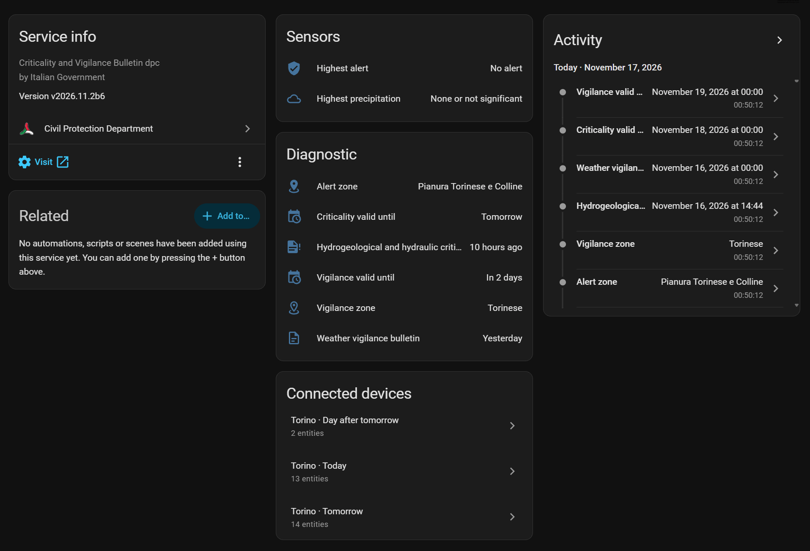

| Entité | État |
| --- | --- |
| `sensor.dpc_torino_highest_alert` | Le niveau d'alerte le plus élevé d'aujourd'hui et de demain : de 1 (pas d'alerte) à 4 (rouge), affiché comme l'alerte, par exemple « Alerte orange » |
| `sensor.dpc_torino_highest_precipitation` | Les précipitations prévues les plus fortes des trois prochains jours : de 1 (nulles) à 5 (très fortes), affichées comme les précipitations |
| `sensor.dpc_torino_alert_zone`, `…_vigilance_zone` | Les zones DPC du lieu, pour ses diagnostics |
| `sensor.dpc_torino_criticality_bulletin`, `…_vigilance_bulletin` | Quand le dernier bulletin a été publié, pour ses diagnostics : l'heure du bulletin de criticité ; le jour du bulletin de vigilance, à minuit |
| `sensor.dpc_torino_criticality_valid_until`, `…_vigilance_valid_until` | La fin du dernier jour couvert par le bulletin, pour ses diagnostics |

Les appareils des jours, **Torino · Aujourd'hui** et **Torino · Demain** (`today` et `tomorrow` dans les identifiants) :

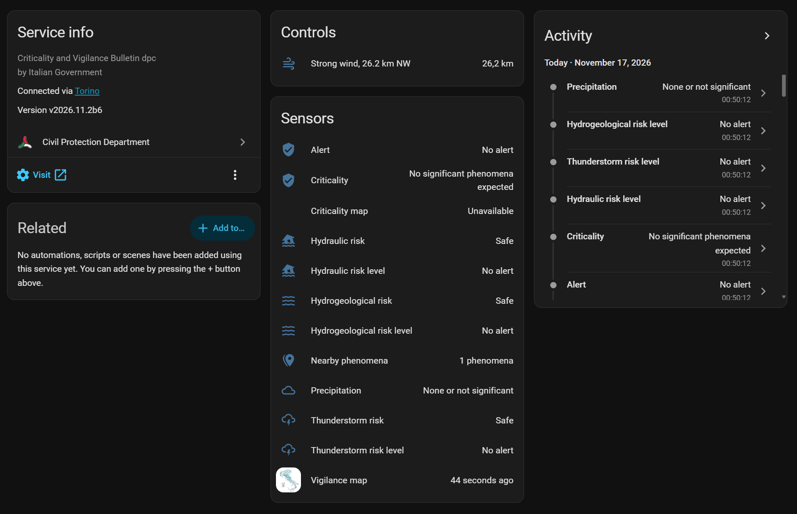

| Entité | État |
| --- | --- |
| `sensor.dpc_torino_today_alert` | L'alerte du jour : pas d'alerte, jaune, orange ou rouge |
| `sensor.dpc_torino_today_criticality` | La criticité que le DPC indique pour la zone, et le risque que montre sa carte : « Criticité modérée pour risque hydrogéologique » (`moderate_hydrogeological`), ou « Absence de phénomènes significatifs prévisibles » (`absent`) |
| `binary_sensor.dpc_torino_today_hydraulic_risk`, `…_thunderstorm_risk`, `…_hydrogeological_risk` | Activé quand le risque atteint le niveau d'alerte minimal des options |
| `sensor.dpc_torino_today_hydraulic_risk_level`, `…_thunderstorm_risk_level`, `…_hydrogeological_risk_level` | Le niveau du risque : pas d'alerte, jaune, orange ou rouge |
| `sensor.dpc_torino_today_precipitation` | Les précipitations prévues du jour : de nulles à très fortes |
| `sensor.dpc_torino_today_nearby_phenomena` | Le nombre de phénomènes météo dans le rayon |
| `image.dpc_torino_today_criticality_map`, `…_vigilance_map` | La carte nationale du bulletin, telle que le DPC la prévisualise ; indisponible tant que le DPC la publie vierge |
| `geo_location.dpc_torino_today_gale_nw` et ainsi de suite | Un phénomène météo dans le rayon, une fois les phénomènes activés dans les options, nommé d'après son type, sa distance et sa direction (« Coup de vent, 12,4 km NO ») : sa distance, en km |

L'appareil d'après-demain, **Torino · Après-demain** (`after_tomorrow` dans les identifiants), a les précipitations, le nombre de phénomènes et les phénomènes : le bulletin de criticité couvre deux jours.

L'alerte et les niveaux d'un jour sont ceux du bulletin, quel que soit le niveau d'alerte minimal des options. Après minuit, jusqu'à ce que le DPC publie les bulletins suivants, l'alerte, la criticité, les risques et leurs niveaux de demain sont inconnus, et ses cartes indisponibles ; les précipitations et le nombre de phénomènes d'après-demain sont inconnus, et ses phénomènes supprimés.

Home Assistant traduit les états, et les valeurs des attributs dans les tableaux de bord. Les modèles et les automatisations voient les valeurs ci-dessous ; chaque entité a aussi l'`attribution` des données du DPC.

<details>
<summary>Attributs</summary>

```yaml
# sensor.dpc_torino_tomorrow_alert
state: orange # green (pas d'alerte), yellow, orange ou red
risks: # les risques à ce niveau, aucun quand green
  - hydrogeological # hydraulic, thunderstorms ou hydrogeological
```

```yaml
# sensor.dpc_torino_highest_alert, et de même pour les précipitations maximales
state: 3
total_alerts: 3 # les risques (les jours, pour les précipitations) au niveau d'alerte minimal ou au-dessus
```

```yaml
# sensor.dpc_torino_criticality_bulletin, et de même pour le bulletin de vigilance
state: '2026-11-14T13:30:00+00:00' # quand il a été publié
id: '20261114_1430'
link: https://mappe.protezionecivile.gov.it/it/mappe-rischi/bollettino-di-criticita/
last_check: '2026-11-14T15:00:00+01:00' # quand le DPC a confirmé pour la dernière fois que c'est le plus récent
```

```yaml
# image.dpc_torino_today_criticality_map
image_url: https://raw.githubusercontent.com/pcm-dpc/DPC-Bollettini-Criticita-Idrogeologica-Idraulica/master/files/preview/20261114_1430_oggi.png
```

```yaml
# geo_location.dpc_torino_tomorrow_light_snow_nne
state: 44.3 # la distance depuis le lieu, en km
source: dpc
latitude: 45.83
longitude: 9.41
phenomenon: light_snow # affiché comme « Chutes de neige faibles ou modérées »
direction: nne # depuis le lieu, affiché comme « NNE »
```

Les phénomènes météo vont et viennent avec les bulletins, chacun sur l'appareil de son jour.

</details>

## Exemples d'automatisations

Les exemples utilisent Turin : remplacez `torino` par votre lieu dans les identifiants d'entité, et `notify.mobile_app_your_phone` par votre notification. Collez un exemple dans l'éditeur YAML d'une nouvelle automatisation. Les messages sont dans la langue de Home Assistant.

<details>
<summary>Notifier l'alerte d'aujourd'hui ou de demain</summary>

```yaml
alias: Alerte DPC
triggers:
  - trigger: state
    entity_id:
      - sensor.dpc_torino_today_alert
      - sensor.dpc_torino_tomorrow_alert
    to:
      - yellow
      - orange
      - red
actions:
  - action: notify.mobile_app_your_phone
    data:
      title: "{{ state_attr(trigger.entity_id, 'friendly_name') }}"
      message: "{{ state_translated(trigger.entity_id) }}"
mode: queued
```

Par exemple *Torino · Demain Alerte : Alerte orange*, quand l'alerte d'un jour devient jaune, orange ou rouge, ou passe de l'une à l'autre.

</details>

<details>
<summary>Notifier un risque au niveau d'alerte minimal</summary>

```yaml
alias: Risques DPC
triggers:
  - trigger: state
    entity_id:
      - binary_sensor.dpc_torino_today_hydraulic_risk
      - binary_sensor.dpc_torino_today_thunderstorm_risk
      - binary_sensor.dpc_torino_today_hydrogeological_risk
      - binary_sensor.dpc_torino_tomorrow_hydraulic_risk
      - binary_sensor.dpc_torino_tomorrow_thunderstorm_risk
      - binary_sensor.dpc_torino_tomorrow_hydrogeological_risk
    to: "on"
actions:
  - action: notify.mobile_app_your_phone
    data:
      title: "{{ state_attr(trigger.entity_id, 'friendly_name') }}"
      # Le niveau du même risque et du même jour : binary_sensor.…_risk → sensor.…_risk_level
      message: >-
        {{ state_translated(trigger.entity_id | replace('binary_sensor.', 'sensor.')
        ~ '_level') }}
mode: queued
```

Par exemple *Torino · Demain Risque hydrogéologique : Alerte orange*. Les capteurs binaires s'activent au niveau d'alerte minimal des options, un risque à la fois. Le message trouve le niveau à partir de l'identifiant d'entité du capteur binaire, il a donc besoin des identifiants d'entité des nouveaux lieux.

</details>

<details>
<summary>Notifier de fortes précipitations</summary>

```yaml
alias: Précipitations DPC
triggers:
  - trigger: state
    entity_id:
      - sensor.dpc_torino_today_precipitation
      - sensor.dpc_torino_tomorrow_precipitation
      - sensor.dpc_torino_after_tomorrow_precipitation
    to:
      - moderate
      - heavy
      - very_heavy
actions:
  - action: notify.mobile_app_your_phone
    data:
      title: "{{ state_attr(trigger.entity_id, 'friendly_name') }}"
      message: "{{ state_translated(trigger.entity_id) }}"
mode: queued
```

</details>

<details>
<summary>Notifier un phénomène météo près de la maison</summary>

```yaml
alias: Phénomènes DPC près de la maison
triggers:
  - trigger: geo_location
    source: dpc
    zone: zone.around_home
    event: enter
actions:
  - action: notify.mobile_app_your_phone
    data:
      title: DPC
      message: "{{ state_attr(trigger.to_state.entity_id, 'friendly_name') }}"
mode: queued
```

Les phénomènes doivent être activés dans les options. `zone.around_home` est une zone que vous créez autour de la maison, avec le rayon qui vous intéresse, par exemple 20 km, dans **Paramètres → Pièces, étiquettes et zones → Zones** : la zone Maison est généralement trop petite. L'automatisation se déclenche quand un phénomène du bulletin se trouve à l'intérieur, par exemple *Torino · Demain Chutes de neige faibles ou modérées, 44,3 km NNE* : son jour, son type, sa distance et sa direction depuis le lieu.

</details>

## Licence

_Informations fournies par le [_Département de la Protection civile - Présidence du Conseil des ministres_](https://www.protezionecivile.gov.it/en/) Licence Creative Commons [_CC BY 4.0._](https://creativecommons.org/licenses/by/4.0/)_

_Dati forniti dal servizio [_Dipartimento della Protezione Civile-Presidenza del Consiglio dei Ministri_](https://www.protezionecivile.gov.it/it/) Licenza Creative Commons [_CC BY 4.0._](https://creativecommons.org/licenses/by/4.0/deed.it)_

## Les contributions sont les bienvenues

---

## Mentions légales sur les marques

Tous les noms de produits, marques et marques déposées figurant dans les images de ce dépôt sont la propriété de leurs détenteurs respectifs.
Toutes les images de ce dépôt sont utilisées par l'auteur à des fins d'identification uniquement.
L'utilisation de ces noms, marques et logos figurant dans ces fichiers d'images n'implique aucune approbation.

[hacs]: https://github.com/hacs/integration
[hacsbadge]: https://img.shields.io/badge/HACS-Default-orange.svg
[github latest release]: https://img.shields.io/github/v/release/caiosweet/Home-Assistant-custom-components-DPC-Alert
[githubrelease]: https://github.com/caiosweet/Home-Assistant-custom-components-DPC-Alert/releases
[github release date]: https://img.shields.io/github/release-date/caiosweet/Home-Assistant-custom-components-DPC-Alert
[maintenancebadge]: https://img.shields.io/badge/Maintained%3F-Yes-brightgreen.svg
[maintenance]: https://github.com/caiosweet/Home-Assistant-custom-components-DPC-Alert/graphs/commit-activity
[github issuesbadge]: https://img.shields.io/github/issues/caiosweet/Home-Assistant-custom-components-DPC-Alert
[github issues]: https://github.com/caiosweet/Home-Assistant-custom-components-DPC-Alert/issues
[website]: https://hassiohelp.eu/
[websitebadge]: https://img.shields.io/website?down_message=Offline&label=HssioHelp&logoColor=blue&up_message=Online&url=https%3A%2F%2Fhassiohelp.eu
[telegram]: https://t.me/HassioHelp
[telegrambadge]: https://img.shields.io/badge/Chat-Telegram-blue?logo=Telegram
[facebook]: https://www.facebook.com/groups/2062381507393179/
[facebookbadge]: https://img.shields.io/badge/Group-Facebook-blue?logo=Facebook
[forum]: https://forum.hassiohelp.eu/
[forumbadge]: https://img.shields.io/badge/HassioHelp-Forum-blue?logo=%2BIDx4OnhtcG1ldGEgeG1sbnM6eD0iYWRvYmU6bnM6bWV0YS8iIHg6eG1wdGs9IkFkb2JlIFhNUCBDb3JlIDUuNS1jMDIxIDc5LjE1NTc3MiwgMjAxNC8wMS8xMy0xOTo0NDowMCAgICAgICAgIj4gPHJkZjpSREYgeG1sbnM6cmRmPSJodHRwOi8vd3d3LnczLm9yZy8xOTk5LzAyLzIyLXJkZi1zeW50YXgtbnMjIj4gPHJkZjpEZXNjcmlwdGlvbiByZGY6YWJvdXQ9IiIgeG1sbnM6eG1wTU09Imh0dHA6Ly9ucy5hZG9iZS5jb20veGFwLzEuMC9tbS8iIHhtbG5zOnN0UmVmPSJodHRwOi8vbnMuYWRvYmUuY29tL3hhcC8xLjAvc1R5cGUvUmVzb3VyY2VSZWYjIiB4bWxuczp4bXA9Imh0dHA6Ly9ucy5hZG9iZS5jb20veGFwLzEuMC8iIHhtcE1NOkRvY3VtZW50SUQ9InhtcC5kaWQ6ODcxMjY2QzY5RUIzMTFFQUEwREVGQzE4OTI4Njk5NDkiIHhtcE1NOkluc3RhbmNlSUQ9InhtcC5paWQ6ODcxMjY2QzU5RUIzMTFFQUEwREVGQzE4OTI4Njk5NDkiIHhtcDpDcmVhdG9yVG9vbD0iQWRvYmUgUGhvdG9zaG9wIENDIDIwMTQgKFdpbmRvd3MpIj4gPHhtcE1NOkRlcml2ZWRGcm9tIHN0UmVmOmluc3RhbmNlSUQ9ImFkb2JlOmRvY2lkOnBob3Rvc2hvcDo0MWVhZDAwNC05ZWFmLTExZWEtOGY3ZS1mNzQ3Zjc1MjgyNGIiIHN0UmVmOmRvY3VtZW50SUQ9ImFkb2JlOmRvY2lkOnBob3Rvc2hvcDo0MWVhZDAwNC05ZWFmLTExZWEtOGY3ZS1mNzQ3Zjc1MjgyNGIiLz4gPC9yZGY6RGVzY3JpcHRpb24%2BIDwvcmRmOlJERj4gPC94OnhtcG1ldGE%2BIDw/eHBhY2tldCBlbmQ9InIiPz4xQPr3AAADq0lEQVR42rRVW2wMURj%2Bz5lL7V27KG26KIuUEJemdalu3VN3Ei/ipSWUuIV4FB4kHrwo8VLRROJBgkYElZCi4olG4rVoROOSbTa0u7pzO/6Z2Zmd3Z2uevBn/8zsf/7zff/tnKGMMRi/pjM6/j08oKiqCm1tbTA4OAhuoqkS8KKPVjceOcgJngkfnl%2B5JiWH0pQvcfUPhULQ0dEBPp8PDBZZlqGyshLGFKG0fHHr/QfNlxnbjFp7uOcl8VVVj%2BXu9XohkUgY2NRpdJMpc5qWN5971zu7ftsWkSAX2iKLYg3NZ/t6Kxbu2Oi2x4g8IxSKSDR2tLXh2JOn3nAkKv9GAzPtyigS%2BSdV1B3sejhv09lTxTBcCXjRK9buu96%2BZG/7dUYEryK59EXWewNcza7zl%2Br237kpessC4yIITIlGGk88666OtR6VMFKmZhZY9sGsdw1ATgFU1O7et%2Brki56JVUtqsl4kl0CVUjB57vo1Tad7X4Wj9U1S0vRj8HfRSQKVC5auPN7zctqiPTs1Rz2pBV6xcOuq%2BkOPusVAeZWxDg5wl%2Bhz1vW%2BpBFMDIYXt9y%2BF6lr2a6kR7IEmipDeFYsRkVewFcTyAXcBtNMhTxCTTErUxZdu96qLW8varhFsyrnQCQOYNXU8qBp//4TH/jkHZ3UCTXFoncQGKciP1SiN1JDVY2IJwgEjq3jYMVsZgC/HSBw9RnA8CgBjmS3MkdefE638sCV0WGQk9/QXYNRicH%2B7eWwYUGpOT4oq%2Bfq0Upw4SEPVOCLnwOWp5o%2BgskfWEoZe8Qg6CGwcp7XWFVxTc0UYdlMrLmQsP8zVuQcWFNiORFCTSvRQTWQs6W101SRXE7/xiDSBeC5BKywRLx/KqbuA44TYUQS4HHfsLHEcZyhulP32zjEUwL2ACuPt24%2BR0HhnONJBA8IoRlG/4P4/%2B57FTTyC9bUMAQk8OJ9Am69VsHjC2cOJbPaU0iQn4DxrjnSwVwp4eF2XwC63uBVLCchpXgQPAiUUrM8xBwlfeqs%2Bc7JwFn//KHKtAI8IkVejFgIgY8p2etEB7cPDbF32wSE8pwx926XTx6pAcPxxmFlzIo2o/qPy84sb4JTSMb7v3qiGFhJIaAzw1wbkmh8tu4IrqKm4v347V1qmvQGKvjJjEyf7v/pX3GmrGp%2BtT73UDyRHCPLMBDKwUj801dl4P7Fwc8fh0rLwiaBrp2dN2Do%2Bxfb%2Bd%2BE2GwEe%2BEPTYaW1gNQUiKaBP9T/ggwAJik5dEKYSC3AAAAAElFTkSuQmCC
