# DPC Alert (Protezione Civile)

[English](https://github.com/caiosweet/Home-Assistant-custom-components-DPC-Alert/blob/main/README.md) · **Italiano** · [Français](https://github.com/caiosweet/Home-Assistant-custom-components-DPC-Alert/blob/main/README.fr.md) · [Español](https://github.com/caiosweet/Home-Assistant-custom-components-DPC-Alert/blob/main/README.es.md) · [Deutsch](https://github.com/caiosweet/Home-Assistant-custom-components-DPC-Alert/blob/main/README.de.md)

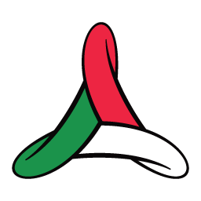

Le allerte del Dipartimento della Protezione Civile (DPC) in Home Assistant, per qualsiasi luogo d'Italia: il rischio idraulico, idrogeologico e temporali di oggi e domani, e la vigilanza meteo dei prossimi tre giorni con i fenomeni vicino a te.

Come funziona il sistema di allertamento: [_Dipartimento Protezione Civile_](https://rischi.protezionecivile.gov.it/it/meteo-idro/allertamento) · [_Civil Protection Department_](https://rischi.protezionecivile.gov.it/en/meteo-hydro/alert)

[![hacs][hacsbadge]][hacs] [](https://github.com/caiosweet/Home-Assistant-custom-components-DPC-Alert/actions/workflows/validate.yaml)

[![GitHub latest release]][githubrelease] ![GitHub Release Date] [![Maintenancebadge]][maintenance] [![GitHub issuesbadge]][github issues]

[![Websitebadge]][website] [![Forum][forumbadge]][forum] [![telegrambadge]][telegram] [![facebookbadge]][facebook]

[](https://paypal.me/hassiohelp)

---

## Funzionalità

- **Un dispositivo per ogni giorno**: Torino · Oggi, Torino · Domani e Torino · Dopodomani, parte del dispositivo del luogo. La configurazione e le opzioni scelgono i giorni.
- **Ogni giorno**: l'allerta (nessuna, gialla, arancione o rossa) con i rischi a quel livello; la criticità che il DPC indica per la zona, come "Moderata per rischio idrogeologico"; il livello del rischio idraulico, idrogeologico e temporali, e un sensore binario per ciascuno, acceso quando raggiunge il livello di allerta che scegli; le precipitazioni previste; e i fenomeni meteo entro il raggio che scegli, su una mappa, una volta attivati nelle opzioni. Il bollettino di criticità copre oggi e domani, quello di vigilanza anche dopodomani.
- **Il luogo**: la sua allerta massima e le precipitazioni massime, le sue zone DPC e i suoi bollettini.
- **Mappe** dei bollettini di criticità e di vigilanza, di oggi e domani, come immagini.
- **Una plancia** di ogni luogo, fatta con le schede di Home Assistant, nei colori delle allerte del DPC: vedi [Plancia](#plancia).
- **Tre schede** per le tue plance, con un editor visivo: l'allerta e le precipitazioni di ogni giorno, i bollettini e le mappe: vedi [Schede](#schede).
- **Più luoghi**, scelti su una mappa o da una zona, ciascuno con il suo comune. Ogni bollettino viene scaricato una sola volta per tutti.
- **Tredici lingue**: inglese, italiano, francese, tedesco, spagnolo e portoghese brasiliano, e quelle di alcune delle maggiori comunità straniere in Italia: rumeno, albanese, arabo, cinese semplificato, ucraino, bengalese e hindi. I testi dei livelli, dei rischi, dei fenomeni e delle direzioni sono quelli della libreria [aiodpc](https://github.com/webysther/aiodpc); in italiano, i livelli, i rischi e i fenomeni sono quelli che scrive il DPC.
- **Dati ufficiali**: i bollettini di criticità e di vigilanza meteorologica che il DPC pubblica ogni giorno.

Richiede Home Assistant 2025.2 o successivo. Vedi il [changelog](https://github.com/caiosweet/Home-Assistant-custom-components-DPC-Alert/blob/main/CHANGELOG.md) (in inglese) per le novità di ogni versione.

## Casi d'uso

- Ricevere una notifica quando il DPC emette un'allerta gialla, arancione o rossa per il tuo luogo, oggi o domani, con il rischio e il suo livello.
- Vedere le allerte di ogni giorno, le precipitazioni previste e le mappe dei bollettini nella plancia DPC Alert, o nelle tue con le schede DPC Alert o quelle di Home Assistant.
- Vedere su una mappa i fenomeni meteo vicino ai tuoi luoghi.
- Annunciare al mattino le allerte del giorno su un altoparlante.
- Chiudere le tapparelle o ritirare i mobili da giardino quando sono previsti vento forte o temporali nelle vicinanze, dai fenomeni meteo vicino al luogo.
- Prima di un viaggio, aggiungere il luogo di destinazione e seguirne le allerte.

## Installazione

DPC Alert è nel catalogo della comunità, da cui installano sia il Marketplace di Home Assistant sia HACS.

### Con il Marketplace (Home Assistant 2026.11 o successivo)

1. Vai in **Impostazioni → Marketplace** e cerca `DPC Alert`.
2. Apri **DPC Alert (Protezione Civile)** e scegli **Installa**.
3. Riavvia Home Assistant.

### Con [HACS](https://hacs.xyz/) (da Home Assistant 2025.2 a 2026.10)

1. Apri **HACS** nel menu di Home Assistant e cerca `DPC Alert`.
2. Apri **DPC Alert (Protezione Civile)** e scegli **Scarica**.
3. Riavvia Home Assistant.

## Configurazione

[](https://my.home-assistant.io/redirect/config_flow_start/?domain=dpc)

1. In Home Assistant, vai in **Impostazioni → Dispositivi e servizi → Aggiungi integrazione** e cerca `Dpc`, oppure usa il pulsante qui sopra.
2. Scegli come indicare il luogo da monitorare:
   - **Sceglilo sulla mappa**: la mappa parte da casa tua; sposta il segnaposto.
   - **Usa una zona**, come Casa.
3. L'integrazione verifica il luogo con il DPC e mostra la sua zona di allerta. Scegli il suo **comune** tra quelli della zona: un comune che si estende su più zone di allerta riceve l'allerta più alta tra tutte.
4. **Cosa mostrare**: i giorni (oggi, se non scegli altro) e i tipi di entità (tutti tranne i fenomeni, se non scegli altro).
5. **Allerte**: il livello minimo di allerta, il raggio dei fenomeni e l'intervallo di aggiornamento. Ogni campo spiega cosa fa, e le opzioni li cambiano in seguito.

<p>
  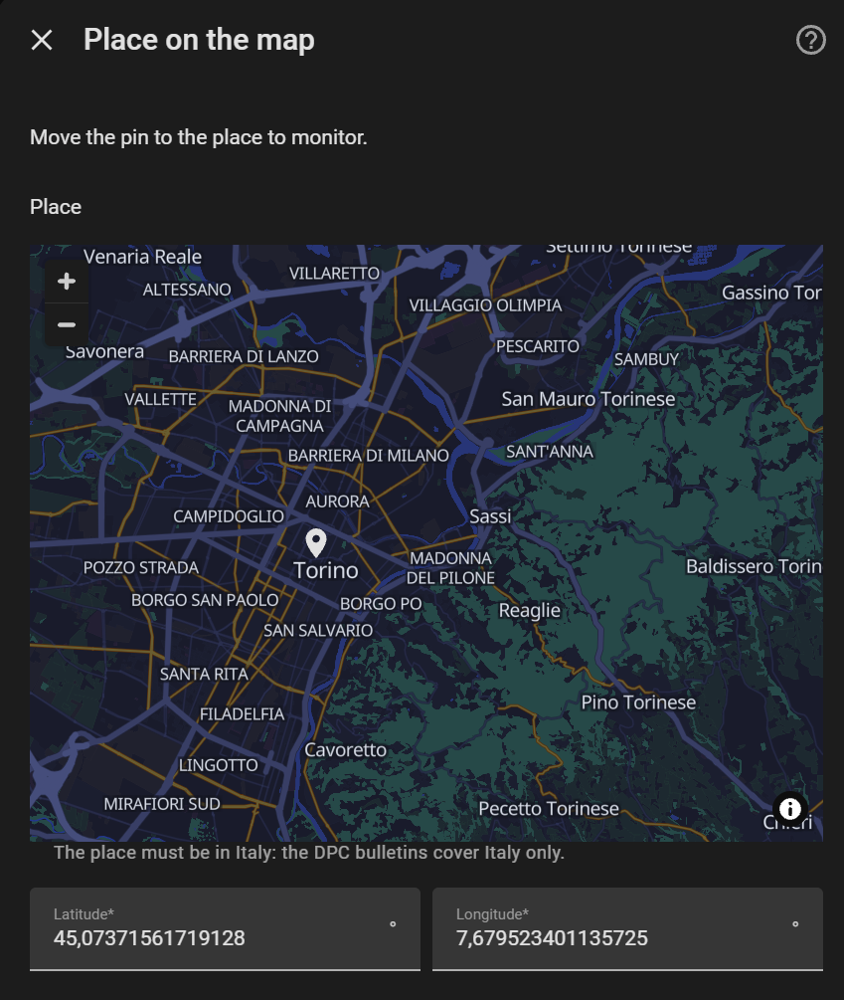
  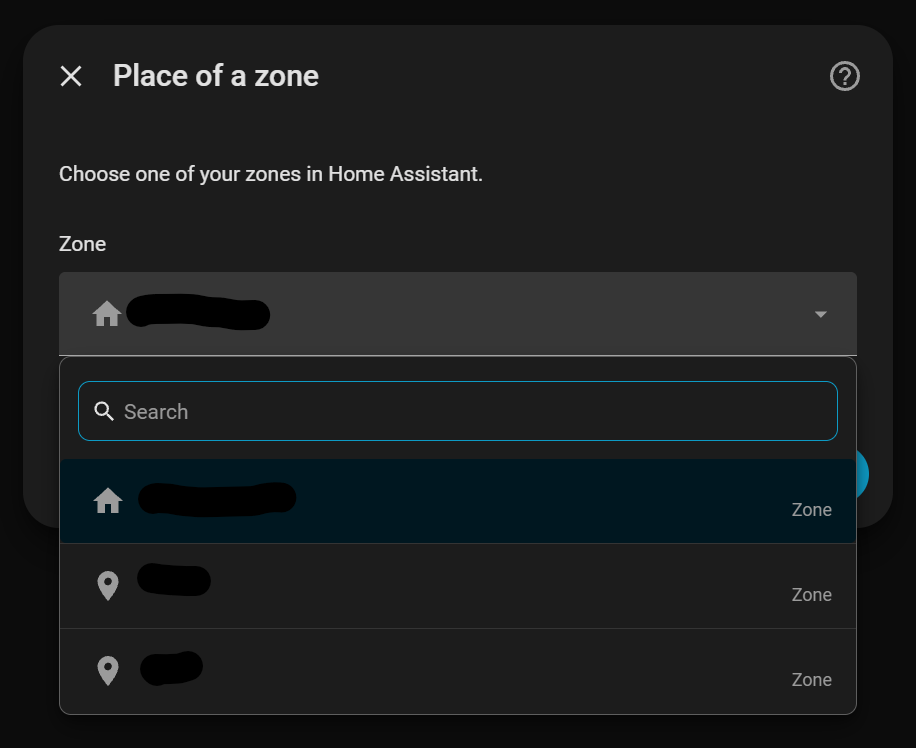
  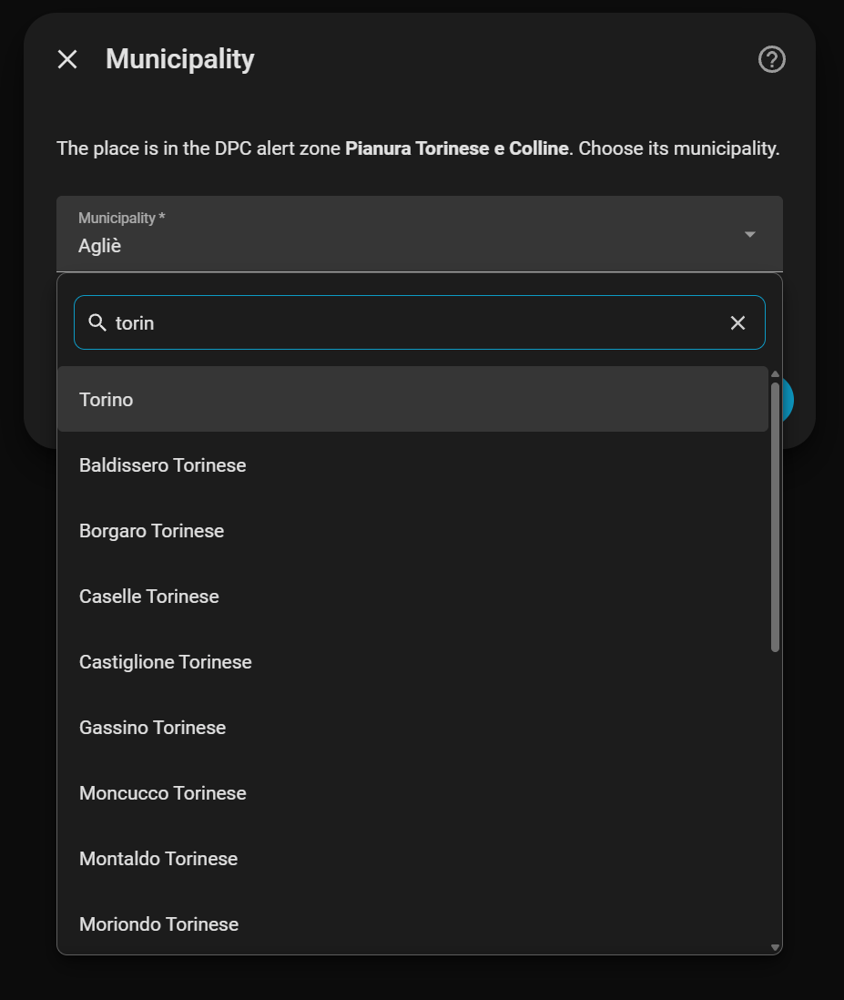
  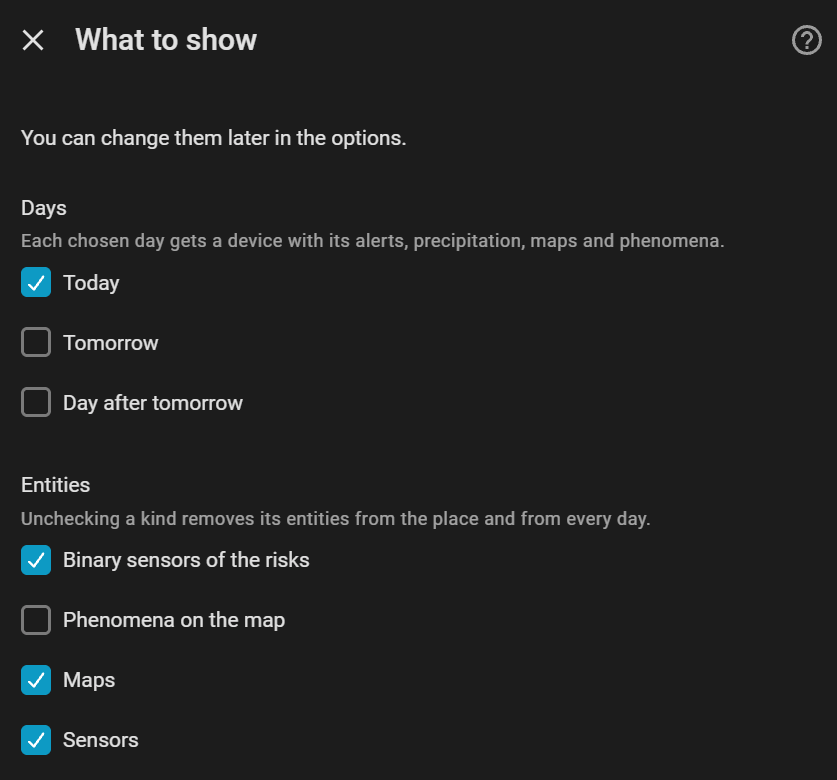
  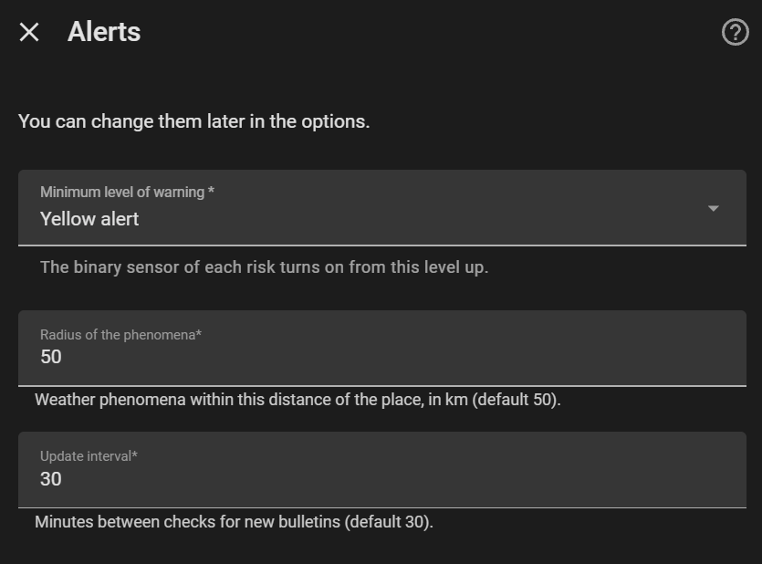
</p>

Aggiungi tutti i luoghi che vuoi, ciascuno con il suo comune: due luoghi nello stesso comune riceverebbero gli stessi bollettini. I luoghi condividono i download: ogni bollettino viene scaricato una sola volta per tutti.

Un luogo prende il nome dalla sua zona di allerta, e il suo dispositivo dal suo comune: per un luogo a Torino, il dispositivo è Torino, e il dispositivo di oggi è Torino · Oggi. Un nuovo luogo mostra oggi, se non scegli altri giorni. Gli ID delle entità iniziano con `dpc_`, poi il luogo, il giorno e l'entità, in inglese qualunque sia la lingua: `sensor.dpc_torino_highest_alert`, `binary_sensor.dpc_torino_today_hydraulic_risk`. Vedi [Entità](#entità) per l'elenco completo.

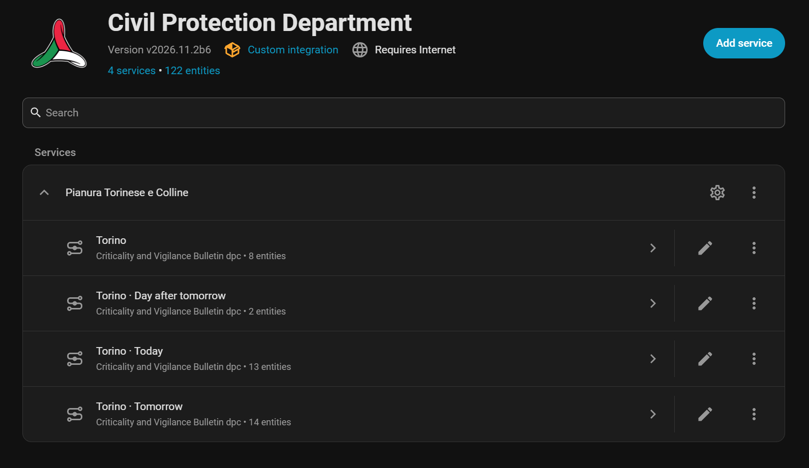

### Opzioni

**Configura** sull'integrazione apre un menu con i passaggi della configurazione: scegli quello da cambiare, che si salva da solo.

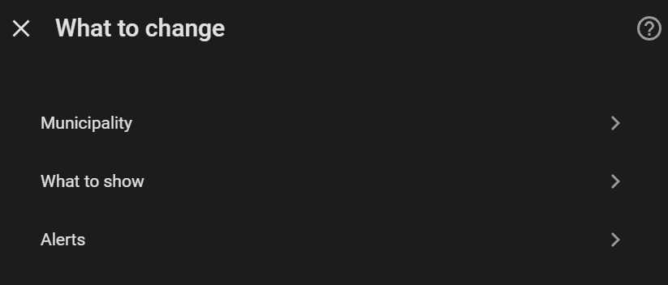

1. **Comune**: tra quelli della zona di allerta del luogo; finché il DPC non è raggiungibile, si può scrivere qualsiasi nome.
2. **Cosa mostrare**:
   - **Giorni**: oggi, domani e dopodomani, ciascuno un dispositivo con le sue entità. Togliendo un giorno, il suo dispositivo e le sue entità vengono rimossi; il luogo mantiene la sua allerta e le precipitazioni massime e i suoi bollettini.
   - **Entità**: i sensori binari dei rischi, i sensori, le mappe e i fenomeni sulla mappa (disattivati, se non scegli altro). Togliendo un tipo, le sue entità vengono rimosse dal luogo e da ogni giorno. Il luogo deve mostrare qualcosa: senza giorni, solo i sensori gli danno delle entità, e dopodomani non ha rischi né mappe.
3. **Allerte**:
   - **Livello minimo di allerta**: allerta gialla (predefinita), arancione o rossa. Il sensore binario di ogni rischio si accende da questo livello in su.
   - **Raggio dei fenomeni** (km, predefinito 50).
   - **Intervallo di aggiornamento** (minuti, predefinito 30).

### Rimozione

1. Vai in **Impostazioni → Dispositivi e servizi** e apri **Dipartimento Protezione Civile**, come Home Assistant chiama l'integrazione in italiano (Civil Protection Department in inglese).
2. Per ogni luogo, apri il suo menu **⋮** e scegli **Elimina**.
3. Per disinstallare anche l'integrazione, apri **DPC Alert (Protezione Civile)** in **Impostazioni → Marketplace** e scegli **Disinstalla**; prima di Home Assistant 2026.11, aprila in **HACS** e scegli **Rimuovi** nel suo menu **⋮**. Poi riavvia Home Assistant.

## Plancia

L'integrazione include una plancia fatta con le schede di Home Assistant, nella lingua di ogni utente, con i nomi dei giorni e delle entità; solo i nomi dei fenomeni seguono la lingua del sistema (vedi [Risoluzione dei problemi](#risoluzione-dei-problemi)):

1. Vai in **Impostazioni → Plance → Aggiungi plancia**.
2. Tra le **Plance della comunità**, scegli **DPC Alert**. Se non c'è, ricarica la pagina.

Ha una scheda per ogni luogo, con i livelli nei colori della mappa di allerta del DPC, dal verde al rosso, e le precipitazioni nella stessa scala, da deboli a molto elevate (assenti nel blu delle icone del tema):

- **Il luogo**: la sua allerta massima e le precipitazioni massime, le sue zone, quando è stato pubblicato ogni bollettino e fino a quando è valido.
- **Ogni giorno** che mostra: un avviso per ogni rischio al livello minimo di allerta o oltre, nel colore del suo livello (senza i sensori, un riquadro per ogni rischio, acceso o spento); l'allerta, con i rischi a quel livello; la criticità; le mappe dei bollettini; i fenomeni del giorno su una mappa; il livello di ogni rischio; le precipitazioni previste e il numero di fenomeni.

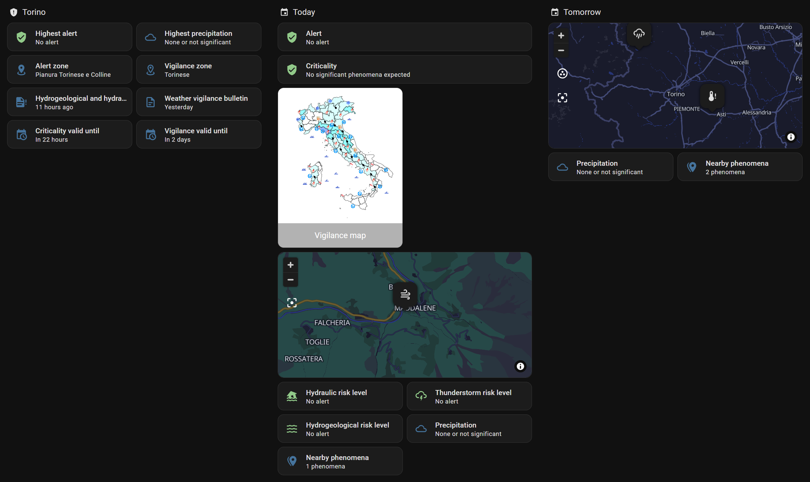

La plancia segue i tuoi luoghi: cambia da sola quando ne aggiungi uno, scegli o togli un giorno, e quando un bollettino porta altri fenomeni. L'allerta, la criticità, i livelli, le precipitazioni e le mappe di un giorno restano nascosti finché non hanno dati, come quelli di domani dopo mezzanotte, finché il DPC non pubblica il bollettino successivo. Gli avvisi colorati dei rischi richiedono Home Assistant 2026.9 o successivo; prima, i rischi sono mostrati come riquadri.

Per mostrare un luogo in un'altra plancia, aggiungi una vista con la strategia della plancia e l'ID del dispositivo del luogo, la parte finale dell'indirizzo della pagina del suo dispositivo:

```yaml
views:
  - title: Torino
    strategy:
      type: custom:dpc-alert
      device_id: 0123456789abcdef0123456789abcdef
```

I sensori binari dei rischi sono sensori di sicurezza: anche la plancia **Sicurezza** di Home Assistant (2025.11 o successivo) li elenca.

## Schede

L'integrazione include tre schede per le tue plance, nel selettore delle schede appena installata: cerca **DPC Alert**. Ognuna è una sola scheda fatta con le schede di Home Assistant, nei colori delle allerte del DPC e nella lingua di ogni utente, e trova le entità del luogo anche dopo che le hai rinominate.

- **DPC Alert** (`custom:dpc-card`): l'allerta e le precipitazioni massime del luogo, poi l'allerta e le precipitazioni di ogni giorno; dopodomani ha solo le precipitazioni.
- **DPC Alert · Bollettini** (`custom:dpc-bulletin-card`): il bollettino di criticità e, accanto, quello di vigilanza: le loro zone, quando sono stati pubblicati e fino a quando sono validi.
- **DPC Alert · Mappe** (`custom:dpc-map-card`): la mappa di un giorno e, accanto, un elenco alto quanto la mappa: un blocco per ogni giorno con una mappa, la zona della mappa e il numero di fenomeni vicino al luogo. Con due giorni, un clic su un blocco mostra la sua mappa. Senza una mappa, come quando il DPC la pubblica bianca o dopo mezzanotte fino al bollettino successivo, l'elenco occupa tutta la scheda.

<p>
  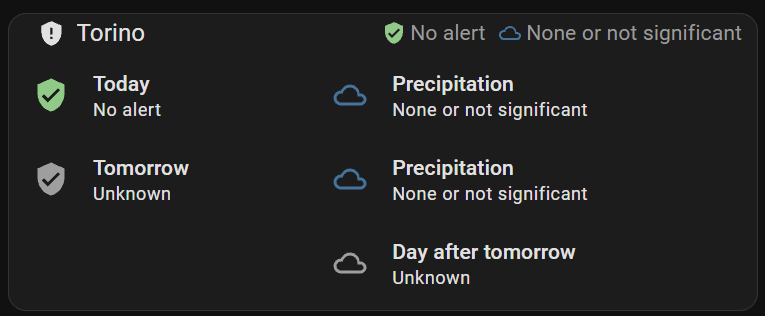
  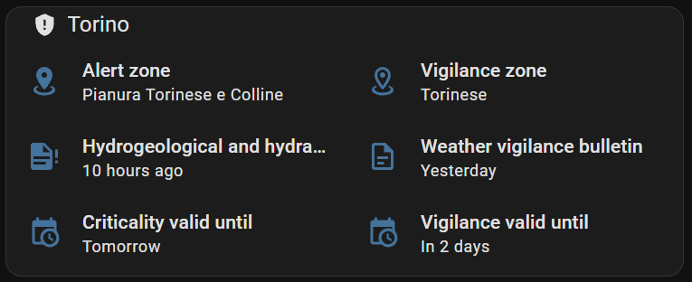
  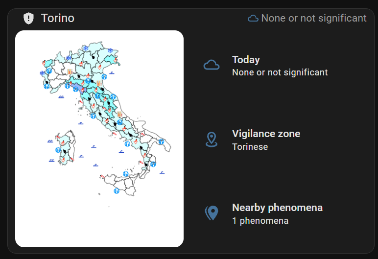
</p>

L'editor visivo sceglie cosa mostra ogni scheda. In YAML, un'opzione omessa mostra tutto:

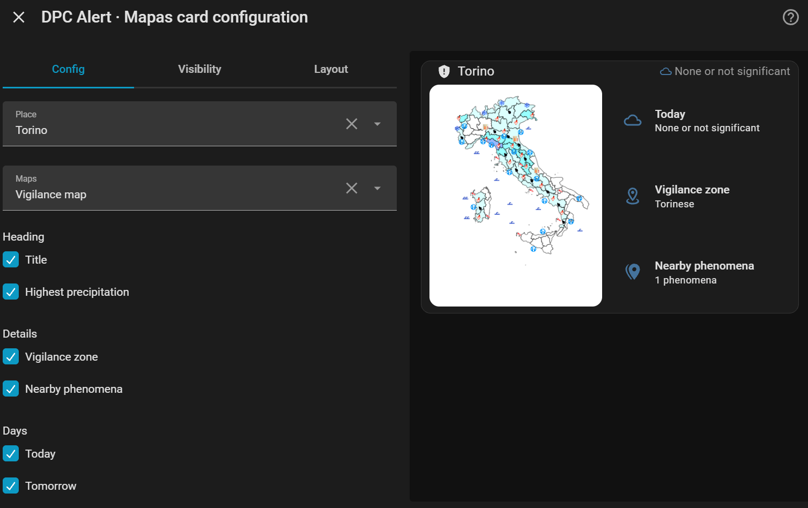

| Opzione | Schede | Senza l'opzione |
| --- | --- | --- |
| `device_id` | tutte | Il primo luogo. L'ID del dispositivo del luogo, la parte finale dell'indirizzo della pagina del suo dispositivo. |
| `show_title: false` | tutte | Il nome del luogo, sopra il resto. Senza, i livelli massimi passano all'inizio. |
| `show_highest_alert: false` | DPC Alert, Mappe (criticità) | L'allerta massima del luogo, accanto al suo nome. |
| `show_highest_precipitation: false` | DPC Alert, Mappe (vigilanza) | Le precipitazioni massime del luogo, accanto al suo nome. |
| `days` | DPC Alert, Mappe | Tutti i giorni del luogo: `today`, `tomorrow`, `aftertomorrow`; per le mappe, oggi e domani. |
| `items` | Bollettini | Tutti e sei: `alert_zone`, `criticality_bulletin`, `criticality_valid_until`, `vigilance_zone`, `vigilance_bulletin`, `vigilance_valid_until`. |
| `columns: 1` | DPC Alert, Bollettini | Due colonne: l'allerta accanto alle precipitazioni, il bollettino di criticità accanto a quello di vigilanza. |
| `map: vigilance` | Mappe | La mappa di criticità. |
| `show_zone: false` | Mappe | La zona della mappa, accanto. |
| `show_nearby_phenomena: false` | Mappe | Il numero di fenomeni vicino al luogo nel giorno della mappa, accanto. |

```yaml
# La mappa di vigilanza di oggi, senza il nome del luogo
type: custom:dpc-map-card
device_id: 0123456789abcdef0123456789abcdef
map: vigilance
show_title: false
days:
  - today
```

### Con le schede di Home Assistant

Le entità si adattano alle schede di Home Assistant senza template. Per un luogo a Torino:

```yaml
# L'allerta di domani e i rischi al suo livello: "Allerta arancione · Rischio idrogeologico"
type: tile
entity: sensor.dpc_torino_tomorrow_alert
state_content:
  - state
  - risks
```

```yaml
# Lo stesso riquadro nell'arancione della mappa del DPC, finché l'allerta è arancione;
# aggiungine uno per ogni livello: verde #90c985, giallo #f8f865, arancione #f0bf01,
# rosso #fd6767
type: tile
entity: sensor.dpc_torino_tomorrow_alert
color: "#f0bf01"
visibility:
  - condition: state
    entity: sensor.dpc_torino_tomorrow_alert
    state: orange
```

```yaml
# Un avviso finché il rischio idrogeologico di domani è al livello minimo di allerta
# o oltre, ed è arancione (Home Assistant 2026.9 o successivo)
type: alert
entity: binary_sensor.dpc_torino_tomorrow_hydrogeological_risk
alert_color: "#f0bf01"
visibility:
  - condition: state
    entity: binary_sensor.dpc_torino_tomorrow_hydrogeological_risk
    state: "on"
  - condition: state
    entity: sensor.dpc_torino_tomorrow_hydrogeological_risk_level
    state: orange
```

```yaml
# La mappa di criticità di oggi
type: picture-entity
entity: image.dpc_torino_today_criticality_map
show_state: false
```

```yaml
# I fenomeni meteo vicino a tutti i tuoi luoghi
type: map
geo_location_sources:
  - dpc
```

## Come vengono aggiornati i dati

- Il DPC pubblica il bollettino di criticità ogni giorno entro le 16:00, a volte aggiornato più tardi nello stesso giorno, e il bollettino di vigilanza meteorologica entro le 15:00.
- Ogni 30 minuti (l'opzione **Intervallo di aggiornamento**), ogni luogo controlla se il DPC ha pubblicato nuovi bollettini. I luoghi che si aggiornano nello stesso momento condividono il controllo.
- Un nuovo bollettino viene scaricato una sola volta per tutti i luoghi e letto per ciascuno: circa 11 MB per un bollettino di criticità, 8 MB per uno di vigilanza.
- Le mappe dei giorni vengono scaricate con il bollettino, una sola volta per tutti i luoghi, circa 100 kB ciascuna. Il DPC pubblica spesso una mappa bianca e a volte la sostituisce più tardi allo stesso indirizzo: una mappa bianca non viene mostrata, e viene scaricata di nuovo a ogni aggiornamento finché il DPC non pubblica la mappa.
- Oggi e domani seguono la data italiana: dopo mezzanotte, il secondo giorno del bollettino diventa oggi, finché il DPC non pubblica il bollettino successivo.
- Quando il DPC non è raggiungibile, i luoghi mantengono i loro bollettini, i cui giorni restano validi, e ricontrollano dopo 10 minuti, o prima con un intervallo di aggiornamento più breve.

## Limitazioni note

- Il DPC copre solo l'Italia. San Marino e la Città del Vaticano non sono in nessuna zona di allerta del DPC.
- Il DPC pubblica spesso bianca la mappa di un giorno: da agosto a novembre 2026, il 40% delle mappe di criticità e il 5% di quelle di vigilanza, e ne ha sostituite più tardi solo un terzo circa. La mappa è allora non disponibile, e le plance la omettono, a volte per tutto il giorno.
- Il bollettino di criticità copre oggi e domani; quello di vigilanza, tre giorni. L'allerta massima di un luogo è quella di oggi e domani, anche quando mostra solo oggi.
- Ogni comune può essere aggiunto una sola volta: due luoghi nello stesso comune riceverebbero gli stessi bollettini. Comuni con lo stesso nome lontani tra loro, come Peglio, in Lombardia e nelle Marche, sono comuni diversi: gli ID delle entità del secondo finiscono con `_2`, ad esempio `sensor.dpc_peglio_highest_alert_2`.
- I testi dei livelli, dei rischi, delle criticità, dei fenomeni e delle direzioni vengono dalla libreria aiodpc; in italiano, i livelli, i rischi, le criticità e i fenomeni sono quelli che scrive il DPC, mentre le direzioni sono calcolate da aiodpc. Luoghi, zone e comuni mantengono i nomi che dà il DPC, in italiano; in Alto Adige funzionano anche i nomi tedeschi dei comuni.
- Nei template e nelle notifiche, `state_translated()` dà lo stato tradotto; `state_attr_translated()` (Home Assistant 2026.4 o successivo) un attributo tradotto, come il `phenomenon` di un fenomeno. Gli elenchi, come i `risks` dell'allerta di un giorno, sono tradotti solo dalle plance.

## Risoluzione dei problemi

- **L'integrazione mostra "Configurazione non riuscita, riproverà"**: il DPC non è raggiungibile. Home Assistant riprova da solo; verifica che possa raggiungere `mappe.protezionecivile.gov.it` e `raw.githubusercontent.com`.
- **"… non è in nessuna zona di allerta del DPC"**: il luogo è fuori dall'Italia, o a San Marino o nella Città del Vaticano. Eliminalo e aggiungi un luogo in Italia.
- **Mancano le entità di un giorno**: controlla l'opzione **Giorni** del luogo. I luoghi aggiunti prima di questa versione mostrano oggi e domani.
- **Un'automazione legge un attributo che non c'è più**, come `level`, `info`, `zone_name` o `expires`: i dati dei bollettini sono diventati entità. Il [changelog](https://github.com/caiosweet/Home-Assistant-custom-components-DPC-Alert/blob/main/CHANGELOG.md) indica dove si trova ora ogni attributo.
- **Dopo un aggiornamento, testi in inglese o nomi come `municipality_in_use` nei moduli**: Home Assistant e il browser mantengono i testi della versione precedente. Riavvia Home Assistant, poi ricarica la pagina svuotandone la cache (Ctrl+F5).
- **Nomi di entità e dispositivi in un'altra lingua**: Home Assistant dà i nomi a entità e dispositivi nella lingua del sistema, non in quella del tuo profilo: **Impostazioni → Sistema → Informazioni sulla casa → Lingua** (Generale, nelle versioni precedenti). Lo stesso vale per i nomi dei fenomeni. Gli stati e i valori tradotti degli attributi seguono il tuo profilo, così come i nomi nella plancia e nelle schede DPC Alert.
- **ID di entità come `binary_sensor.dpc_torino_idraulico_oggi`**: le entità dei luoghi aggiunti con una versione precedente mantengono i loro ID, perché le automazioni continuino a funzionare. Per dare loro gli ID dei nuovi luoghi, come `binary_sensor.dpc_torino_today_hydraulic_risk` (Home Assistant 2025.6 o successivo): nella pagina di ogni dispositivo, scegli **⋮ → Rigenera gli ID delle entità**, oppure seleziona le entità in **Impostazioni → Entità** e scegli **Rigenera gli ID delle entità selezionate**. Poi aggiorna le automazioni e le plance che le usano. Lo stesso dà i nuovi ID dopo che hai rinominato un luogo.
- **DPC Alert non è tra le plance della comunità, o le sue schede non sono nel selettore delle schede**: il browser le carica quando apre Home Assistant. Ricarica la pagina dopo aver installato o aggiornato l'integrazione.
- **Un luogo aggiunto prima della 2026.11 non ha un comune**: usa la zona di allerta delle sue coordinate, e il suo dispositivo prende il nome dalla sua voce. Scegli il suo comune nelle sue opzioni, in **Comune**, tra quelli della sua zona di allerta.
- **Segnalare un problema**: sull'integrazione, scegli **Abilita la registrazione di debug** nel menu **⋮**, riproduci il problema, poi disabilitala per scaricare il log. Aggiungi la diagnostica (**⋮ → Scarica la diagnostica**) a una [issue](https://github.com/caiosweet/Home-Assistant-custom-components-DPC-Alert/issues). La diagnostica omette le coordinate del luogo e le posizioni, le distanze e le direzioni dei fenomeni, ma non il comune e le zone DPC del luogo, che i nomi dei suoi dispositivi e delle sue entità mostrano: toglili dal file prima di pubblicarlo se preferisci mantenerli privati.

## Entità

Per un luogo a Torino, con Home Assistant in italiano (le immagini sono in inglese). Il dispositivo del luogo, **Torino**:

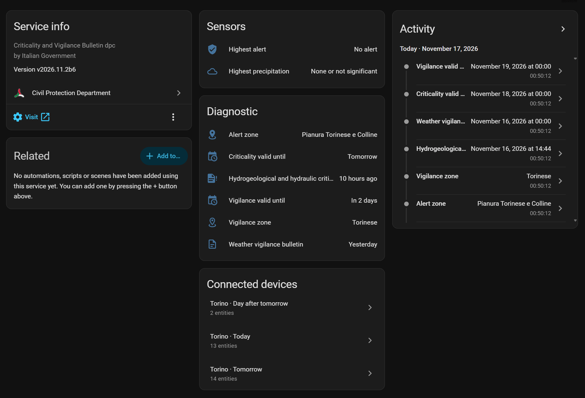

| Entità | Stato |
| --- | --- |
| `sensor.dpc_torino_highest_alert` | Il livello di allerta più alto di oggi e domani: da 1 (nessuna allerta) a 4 (rossa), mostrato come allerta, ad esempio "Allerta arancione" |
| `sensor.dpc_torino_highest_precipitation` | Le precipitazioni previste più elevate dei prossimi tre giorni: da 1 (assenti) a 5 (molto elevate), mostrate come precipitazioni |
| `sensor.dpc_torino_alert_zone`, `…_vigilance_zone` | Le zone DPC del luogo, per la sua diagnostica |
| `sensor.dpc_torino_criticality_bulletin`, `…_vigilance_bulletin` | Quando è stato pubblicato l'ultimo bollettino, per la sua diagnostica: l'ora del bollettino di criticità; il giorno del bollettino di vigilanza, a mezzanotte |
| `sensor.dpc_torino_criticality_valid_until`, `…_vigilance_valid_until` | La fine dell'ultimo giorno coperto dal bollettino, per la sua diagnostica |

I dispositivi dei giorni, **Torino · Oggi** e **Torino · Domani** (`today` e `tomorrow` negli ID):

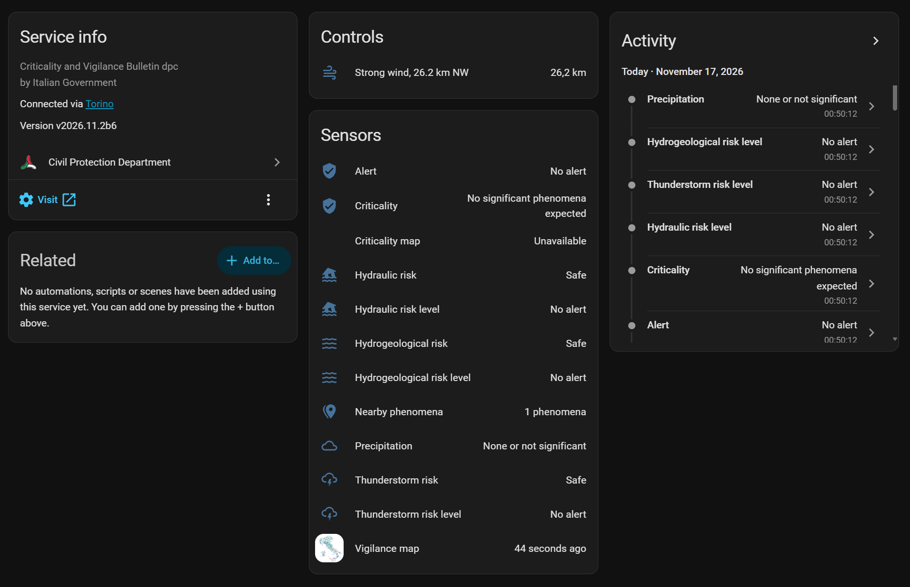

| Entità | Stato |
| --- | --- |
| `sensor.dpc_torino_today_alert` | L'allerta del giorno: nessuna, gialla, arancione o rossa |
| `sensor.dpc_torino_today_criticality` | La criticità che il DPC indica per la zona, e il rischio che la sua mappa mostra: "Moderata per rischio idrogeologico" (`moderate_hydrogeological`), o "Assenza di fenomeni significativi prevedibili" (`absent`) |
| `binary_sensor.dpc_torino_today_hydraulic_risk`, `…_thunderstorm_risk`, `…_hydrogeological_risk` | Acceso quando il rischio raggiunge il livello minimo di allerta delle opzioni |
| `sensor.dpc_torino_today_hydraulic_risk_level`, `…_thunderstorm_risk_level`, `…_hydrogeological_risk_level` | Il livello del rischio: nessuna allerta, gialla, arancione o rossa |
| `sensor.dpc_torino_today_precipitation` | Le precipitazioni previste del giorno: da assenti a molto elevate |
| `sensor.dpc_torino_today_nearby_phenomena` | Il numero di fenomeni meteo entro il raggio |
| `image.dpc_torino_today_criticality_map`, `…_vigilance_map` | La mappa nazionale del bollettino, come la anticipa il DPC; non disponibile finché il DPC la pubblica bianca |
| `geo_location.dpc_torino_today_gale_nw` e così via | Un fenomeno meteo entro il raggio, una volta attivati i fenomeni nelle opzioni, con il nome del suo tipo, la distanza e la direzione ("Venti di burrasca, 12,4 km NO"): la sua distanza, in km |

Il dispositivo di dopodomani, **Torino · Dopodomani** (`after_tomorrow` negli ID), ha le precipitazioni, il numero di fenomeni e i fenomeni: il bollettino di criticità copre due giorni.

L'allerta e i livelli di un giorno sono quelli del bollettino, qualunque sia il livello minimo di allerta delle opzioni. Dopo mezzanotte, finché il DPC non pubblica i bollettini successivi, l'allerta, la criticità, i rischi e i loro livelli di domani sono sconosciuti, e le sue mappe non disponibili; le precipitazioni e il numero di fenomeni di dopodomani sono sconosciuti, e i suoi fenomeni rimossi.

Home Assistant traduce gli stati, e i valori degli attributi nelle plance. Template e automazioni vedono i valori qui sotto; ogni entità ha anche l'`attribution` dei dati del DPC.

<details>
<summary>Attributi</summary>

```yaml
# sensor.dpc_torino_tomorrow_alert
state: orange # green (nessuna allerta), yellow, orange o red
risks: # i rischi a quel livello, nessuno quando è green
  - hydrogeological # hydraulic, thunderstorms o hydrogeological
```

```yaml
# sensor.dpc_torino_highest_alert, e lo stesso per le precipitazioni massime
state: 3
total_alerts: 3 # i rischi (i giorni, per le precipitazioni) al livello minimo di allerta o oltre
```

```yaml
# sensor.dpc_torino_criticality_bulletin, e lo stesso per il bollettino di vigilanza
state: '2026-11-14T13:30:00+00:00' # quando è stato pubblicato
id: '20261114_1430'
link: https://mappe.protezionecivile.gov.it/it/mappe-rischi/bollettino-di-criticita/
last_check: '2026-11-14T15:00:00+01:00' # quando il DPC ha confermato per l'ultima volta che è il più recente
```

```yaml
# image.dpc_torino_today_criticality_map
image_url: https://raw.githubusercontent.com/pcm-dpc/DPC-Bollettini-Criticita-Idrogeologica-Idraulica/master/files/preview/20261114_1430_oggi.png
```

```yaml
# geo_location.dpc_torino_tomorrow_light_snow_nne
state: 44.3 # la distanza dal luogo, in km
source: dpc
latitude: 45.83
longitude: 9.41
phenomenon: light_snow # mostrato come "Nevicate deboli o moderate"
direction: nne # dal luogo, mostrato come "NNE"
```

I fenomeni meteo vanno e vengono con i bollettini, ciascuno sul dispositivo del suo giorno.

</details>

## Esempi di automazioni

Gli esempi usano Torino: sostituisci `torino` con il tuo luogo negli ID delle entità, e `notify.mobile_app_your_phone` con la tua notifica. Incolla un esempio nell'editor YAML di una nuova automazione. I messaggi sono nella lingua di Home Assistant.

<details>
<summary>Notificare l'allerta di oggi o di domani</summary>

```yaml
alias: Allerta DPC
triggers:
  - trigger: state
    entity_id:
      - sensor.dpc_torino_today_alert
      - sensor.dpc_torino_tomorrow_alert
    to:
      - yellow
      - orange
      - red
actions:
  - action: notify.mobile_app_your_phone
    data:
      title: "{{ state_attr(trigger.entity_id, 'friendly_name') }}"
      message: "{{ state_translated(trigger.entity_id) }}"
mode: queued
```

Ad esempio *Torino · Domani Allerta: Allerta arancione*, quando l'allerta di un giorno diventa gialla, arancione o rossa, o cambia tra questi livelli.

</details>

<details>
<summary>Notificare un rischio al livello minimo di allerta</summary>

```yaml
alias: Rischi DPC
triggers:
  - trigger: state
    entity_id:
      - binary_sensor.dpc_torino_today_hydraulic_risk
      - binary_sensor.dpc_torino_today_thunderstorm_risk
      - binary_sensor.dpc_torino_today_hydrogeological_risk
      - binary_sensor.dpc_torino_tomorrow_hydraulic_risk
      - binary_sensor.dpc_torino_tomorrow_thunderstorm_risk
      - binary_sensor.dpc_torino_tomorrow_hydrogeological_risk
    to: "on"
actions:
  - action: notify.mobile_app_your_phone
    data:
      title: "{{ state_attr(trigger.entity_id, 'friendly_name') }}"
      # Il livello dello stesso rischio e giorno: binary_sensor.…_risk → sensor.…_risk_level
      message: >-
        {{ state_translated(trigger.entity_id | replace('binary_sensor.', 'sensor.')
        ~ '_level') }}
mode: queued
```

Ad esempio *Torino · Domani Rischio idrogeologico: Allerta arancione*. I sensori binari si accendono al livello minimo di allerta delle opzioni, un rischio alla volta. Il messaggio trova il livello dall'ID dell'entità del sensore binario, quindi richiede gli ID delle entità dei nuovi luoghi.

</details>

<details>
<summary>Notificare precipitazioni elevate</summary>

```yaml
alias: Precipitazioni DPC
triggers:
  - trigger: state
    entity_id:
      - sensor.dpc_torino_today_precipitation
      - sensor.dpc_torino_tomorrow_precipitation
      - sensor.dpc_torino_after_tomorrow_precipitation
    to:
      - moderate
      - heavy
      - very_heavy
actions:
  - action: notify.mobile_app_your_phone
    data:
      title: "{{ state_attr(trigger.entity_id, 'friendly_name') }}"
      message: "{{ state_translated(trigger.entity_id) }}"
mode: queued
```

</details>

<details>
<summary>Notificare un fenomeno meteo vicino a casa</summary>

```yaml
alias: Fenomeni DPC vicino a casa
triggers:
  - trigger: geo_location
    source: dpc
    zone: zone.around_home
    event: enter
actions:
  - action: notify.mobile_app_your_phone
    data:
      title: DPC
      message: "{{ state_attr(trigger.to_state.entity_id, 'friendly_name') }}"
mode: queued
```

I fenomeni devono essere attivati nelle opzioni. `zone.around_home` è una zona che crei intorno a casa, con il raggio che ti interessa, ad esempio 20 km, in **Impostazioni → Aree, etichette e zone → Zone**: la zona Casa di solito è troppo piccola. L'automazione si attiva quando un fenomeno del bollettino è al suo interno, ad esempio *Torino · Domani Nevicate deboli o moderate, 44,3 km NNE*: il suo giorno, il tipo, la distanza e la direzione dal luogo.

</details>

## Licenza

_Dati forniti dal servizio [_Dipartimento della Protezione Civile-Presidenza del Consiglio dei Ministri_](https://www.protezionecivile.gov.it/it/) Licenza Creative Commons [_CC BY 4.0._](https://creativecommons.org/licenses/by/4.0/deed.it)_

_Information provided by [_Department of Civil Protection - Presidency of the Council of Ministers_](https://www.protezionecivile.gov.it/en/) Creative Commons License [_CC BY 4.0._](https://creativecommons.org/licenses/by/4.0/)_

## I contributi sono benvenuti

---

## Note legali sui marchi

Tutti i nomi di prodotti, i marchi e i marchi registrati nelle immagini di questo repository sono di proprietà dei rispettivi titolari.
Tutte le immagini di questo repository sono usate dall'autore solo a scopo di identificazione.
L'uso di questi nomi, marchi e loghi nelle immagini non implica alcuna approvazione.

[hacs]: https://github.com/hacs/integration
[hacsbadge]: https://img.shields.io/badge/HACS-Default-orange.svg
[github latest release]: https://img.shields.io/github/v/release/caiosweet/Home-Assistant-custom-components-DPC-Alert
[githubrelease]: https://github.com/caiosweet/Home-Assistant-custom-components-DPC-Alert/releases
[github release date]: https://img.shields.io/github/release-date/caiosweet/Home-Assistant-custom-components-DPC-Alert
[maintenancebadge]: https://img.shields.io/badge/Maintained%3F-Yes-brightgreen.svg
[maintenance]: https://github.com/caiosweet/Home-Assistant-custom-components-DPC-Alert/graphs/commit-activity
[github issuesbadge]: https://img.shields.io/github/issues/caiosweet/Home-Assistant-custom-components-DPC-Alert
[github issues]: https://github.com/caiosweet/Home-Assistant-custom-components-DPC-Alert/issues
[website]: https://hassiohelp.eu/
[websitebadge]: https://img.shields.io/website?down_message=Offline&label=HssioHelp&logoColor=blue&up_message=Online&url=https%3A%2F%2Fhassiohelp.eu
[telegram]: https://t.me/HassioHelp
[telegrambadge]: https://img.shields.io/badge/Chat-Telegram-blue?logo=Telegram
[facebook]: https://www.facebook.com/groups/2062381507393179/
[facebookbadge]: https://img.shields.io/badge/Group-Facebook-blue?logo=Facebook
[forum]: https://forum.hassiohelp.eu/
[forumbadge]: https://img.shields.io/badge/HassioHelp-Forum-blue?logo=%2BIDx4OnhtcG1ldGEgeG1sbnM6eD0iYWRvYmU6bnM6bWV0YS8iIHg6eG1wdGs9IkFkb2JlIFhNUCBDb3JlIDUuNS1jMDIxIDc5LjE1NTc3MiwgMjAxNC8wMS8xMy0xOTo0NDowMCAgICAgICAgIj4gPHJkZjpSREYgeG1sbnM6cmRmPSJodHRwOi8vd3d3LnczLm9yZy8xOTk5LzAyLzIyLXJkZi1zeW50YXgtbnMjIj4gPHJkZjpEZXNjcmlwdGlvbiByZGY6YWJvdXQ9IiIgeG1sbnM6eG1wTU09Imh0dHA6Ly9ucy5hZG9iZS5jb20veGFwLzEuMC9tbS8iIHhtbG5zOnN0UmVmPSJodHRwOi8vbnMuYWRvYmUuY29tL3hhcC8xLjAvc1R5cGUvUmVzb3VyY2VSZWYjIiB4bWxuczp4bXA9Imh0dHA6Ly9ucy5hZG9iZS5jb20veGFwLzEuMC8iIHhtcE1NOkRvY3VtZW50SUQ9InhtcC5kaWQ6ODcxMjY2QzY5RUIzMTFFQUEwREVGQzE4OTI4Njk5NDkiIHhtcE1NOkluc3RhbmNlSUQ9InhtcC5paWQ6ODcxMjY2QzU5RUIzMTFFQUEwREVGQzE4OTI4Njk5NDkiIHhtcDpDcmVhdG9yVG9vbD0iQWRvYmUgUGhvdG9zaG9wIENDIDIwMTQgKFdpbmRvd3MpIj4gPHhtcE1NOkRlcml2ZWRGcm9tIHN0UmVmOmluc3RhbmNlSUQ9ImFkb2JlOmRvY2lkOnBob3Rvc2hvcDo0MWVhZDAwNC05ZWFmLTExZWEtOGY3ZS1mNzQ3Zjc1MjgyNGIiIHN0UmVmOmRvY3VtZW50SUQ9ImFkb2JlOmRvY2lkOnBob3Rvc2hvcDo0MWVhZDAwNC05ZWFmLTExZWEtOGY3ZS1mNzQ3Zjc1MjgyNGIiLz4gPC9yZGY6RGVzY3JpcHRpb24%2BIDwvcmRmOlJERj4gPC94OnhtcG1ldGE%2BIDw/eHBhY2tldCBlbmQ9InIiPz4xQPr3AAADq0lEQVR42rRVW2wMURj%2Bz5lL7V27KG26KIuUEJemdalu3VN3Ei/ipSWUuIV4FB4kHrwo8VLRROJBgkYElZCi4olG4rVoROOSbTa0u7pzO/6Z2Zmd3Z2uevBn/8zsf/7zff/tnKGMMRi/pjM6/j08oKiqCm1tbTA4OAhuoqkS8KKPVjceOcgJngkfnl%2B5JiWH0pQvcfUPhULQ0dEBPp8PDBZZlqGyshLGFKG0fHHr/QfNlxnbjFp7uOcl8VVVj%2BXu9XohkUgY2NRpdJMpc5qWN5971zu7ftsWkSAX2iKLYg3NZ/t6Kxbu2Oi2x4g8IxSKSDR2tLXh2JOn3nAkKv9GAzPtyigS%2BSdV1B3sejhv09lTxTBcCXjRK9buu96%2BZG/7dUYEryK59EXWewNcza7zl%2Br237kpessC4yIITIlGGk88666OtR6VMFKmZhZY9sGsdw1ATgFU1O7et%2Brki56JVUtqsl4kl0CVUjB57vo1Tad7X4Wj9U1S0vRj8HfRSQKVC5auPN7zctqiPTs1Rz2pBV6xcOuq%2BkOPusVAeZWxDg5wl%2Bhz1vW%2BpBFMDIYXt9y%2BF6lr2a6kR7IEmipDeFYsRkVewFcTyAXcBtNMhTxCTTErUxZdu96qLW8varhFsyrnQCQOYNXU8qBp//4TH/jkHZ3UCTXFoncQGKciP1SiN1JDVY2IJwgEjq3jYMVsZgC/HSBw9RnA8CgBjmS3MkdefE638sCV0WGQk9/QXYNRicH%2B7eWwYUGpOT4oq%2Bfq0Upw4SEPVOCLnwOWp5o%2BgskfWEoZe8Qg6CGwcp7XWFVxTc0UYdlMrLmQsP8zVuQcWFNiORFCTSvRQTWQs6W101SRXE7/xiDSBeC5BKywRLx/KqbuA44TYUQS4HHfsLHEcZyhulP32zjEUwL2ACuPt24%2BR0HhnONJBA8IoRlG/4P4/%2B57FTTyC9bUMAQk8OJ9Am69VsHjC2cOJbPaU0iQn4DxrjnSwVwp4eF2XwC63uBVLCchpXgQPAiUUrM8xBwlfeqs%2Bc7JwFn//KHKtAI8IkVejFgIgY8p2etEB7cPDbF32wSE8pwx926XTx6pAcPxxmFlzIo2o/qPy84sb4JTSMb7v3qiGFhJIaAzw1wbkmh8tu4IrqKm4v347V1qmvQGKvjJjEyf7v/pX3GmrGp%2BtT73UDyRHCPLMBDKwUj801dl4P7Fwc8fh0rLwiaBrp2dN2Do%2Bxfb%2Bd%2BE2GwEe%2BEPTYaW1gNQUiKaBP9T/ggwAJik5dEKYSC3AAAAAElFTkSuQmCC
