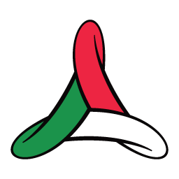

# DPC Alert (Protezione Civile)



The alerts of the Italian Civil Protection Department (Dipartimento della Protezione Civile, DPC) in Home Assistant, for any place in Italy: the hydraulic, hydrogeological and thunderstorm risk of today and tomorrow, and the weather vigilance of the next three days with the phenomena near you.

How the alert system works: [_Civil Protection Department_](https://rischi.protezionecivile.gov.it/en/meteo-hydro/alert) · [_Dipartimento Protezione Civile_](https://rischi.protezionecivile.gov.it/it/meteo-idro/allertamento)

[![hacs][hacsbadge]][hacs] [](https://github.com/caiosweet/Home-Assistant-custom-components-DPC-Alert/actions/workflows/validate.yaml)

[![GitHub latest release]][githubrelease] ![GitHub Release Date] [![Maintenancebadge]][maintenance] [![GitHub issuesbadge]][github issues]

[![Websitebadge]][website] [![Forum][forumbadge]][forum] [![telegrambadge]][telegram] [![facebookbadge]][facebook]

[](https://paypal.me/hassiohelp)

---

## Features

- **Six binary sensors**: hydraulic, hydrogeological and thunderstorm risk, for today and tomorrow. Each one is on when its risk reaches the alert level you choose (1 green to 4 red).
- **Alert sensor**: the highest alert level of today and tomorrow, with the assessment of each risk in its attributes.
- **Vigilance sensor**: the expected precipitation of the next three days, and the weather phenomena within the radius you choose: rain, snow, thunderstorms, wind, frost, fog, rough sea and temperature.
- **Sensors of each day**: the alert of today and tomorrow (no alert, yellow, orange, red) with the risks at that level, and the expected precipitation of the next three days, translated, ready for the cards of Home Assistant.
- **Maps** of the criticality and vigilance bulletins, today and tomorrow, as images.
- **Weather phenomena on a map**: each phenomenon within the radius is a geolocation entity.
- **A dashboard** of the alerts and the weather vigilance of every place, made of the cards of Home Assistant: see [Dashboard](#dashboard).
- **Several places**, picked on a map or from a zone, each with its municipality. Each bulletin is downloaded once for all of them.
- **Six languages**: English, Italian, French, German, Spanish and Brazilian Portuguese.
- **Official data**: the criticality and weather vigilance bulletins that DPC publishes every day.

Requires Home Assistant 2025.2 or newer. See the [changelog](https://github.com/caiosweet/Home-Assistant-custom-components-DPC-Alert/blob/main/CHANGELOG.md) for what changed in each version.

## Use cases

- Get a notification when DPC issues a yellow, orange or red alert for your place, today or tomorrow, with the risk and the link to the bulletin.
- See the alerts of today and tomorrow, the expected precipitation and the maps of the bulletins on the DPC Alert dashboard, or on your own with the cards of Home Assistant.
- See the weather phenomena near your places on a map.
- Announce the alerts of the day on a speaker in the morning.
- Close the shutters or bring in the garden furniture when strong wind or thunderstorms are expected nearby, from the weather phenomena of the vigilance sensor.
- Before a trip, add the place you are going to and follow its alerts.

## Installation

### Using [Home Assistant Community Store](https://hacs.xyz/) (recommended)

1. Click on HACS in the Home Assistant menu
2. Click on `Integrations`
3. Click the `EXPLORE & ADD REPOSITORIES` button
4. Search for `Dpc`
5. Click the `INSTALL THIS REPOSITORY IN HACS` button
6. Restart Home Assistant

## Configuration

[](https://my.home-assistant.io/redirect/config_flow_start/?domain=dpc)

1. In Home Assistant, go to **Settings → Devices & services → Add integration** and search for `Dpc`, or use the button above.
2. Choose how to give the place to monitor:
   - **Pick it on a map**: the map starts at your home; move the pin.
   - **Use a zone**, such as Home.
3. The integration checks the place with DPC and shows its alert zone. Choose its **municipality** among those of the zone: a municipality that spans several alert zones gets the highest alert of all of them.

Add as many places as you want, each with its own municipality: two places in the same municipality would get the same bulletins. The places share the downloads: each bulletin is downloaded once for all of them.

A place is named after its alert zone, and its device after its municipality: for Portula, in the alert zone Val Sesia, Cervo e Chiusella, the device is Portula. Home Assistant gives its entities IDs made of the device and the English names, as for other integrations: `sensor.portula_alert`, `binary_sensor.portula_hydraulic_risk_today` and so on. See [Entities](#entities) for all of them.

### Options

**Configure** on the integration changes:

1. Binary sensors, sensors, maps (image) and phenomena (geolocation) enabled
2. Municipality, among those of the alert zone of the place
3. Update interval (minutes, default 30)
4. Minimum level of warning (1 green to 4 red, default 2): when the binary sensors turn on
5. Radius of the weather phenomena (km, default 50)

### Removal

1. Go to **Settings → Devices & services → Dipartimento Protezione Civile**.
2. For each place, open its **⋮** menu and choose **Delete**.
3. To uninstall the integration too, open **Settings → Marketplace**, find **DPC Alert (Protezione Civile)**, choose **Remove** in its **⋮** menu, and restart Home Assistant.

## Dashboard

The integration comes with a dashboard made of the cards of Home Assistant, in the language of each user:

1. Go to **Settings → Dashboards → Add dashboard**.
2. Under **Community dashboards**, choose **DPC Alert**. If it is not listed, reload the page.

It has a tab for each place:

- **Alerts**: the alert of today and tomorrow, in the color of its level and with the risks at that level; a banner for each risk at or above the warning level; the criticality maps.
- **Weather vigilance**: the expected precipitation of the next three days; the weather phenomena within the radius on a map; the vigilance maps.

The dashboard follows your places: it changes by itself when you add one, and when a bulletin brings other phenomena. What has no data is hidden, such as the alert and the maps of tomorrow after midnight, until DPC publishes the next bulletin. The colored banners of the risks need Home Assistant 2026.9 or newer; before, the risks are shown as tiles.

To show a place in another dashboard, add a view with the strategy of the dashboard and the ID of the device of the place, the end of the address of its device page:

```yaml
views:
  - title: Portula
    strategy:
      type: custom:dpc-alert
      device_id: 0123456789abcdef0123456789abcdef
```

The binary sensors of the risks are safety sensors: the **Security** dashboard of Home Assistant lists them too.

### Cards for your own dashboards

The entities fit the cards of Home Assistant without templates. For a place in Portula:

```yaml
# The alert of tomorrow and the risks at its level: "Orange alert · Hydrogeological risk"
type: tile
entity: sensor.portula_alert_tomorrow
state_content:
  - state
  - risks
```

```yaml
# A banner while the hydrogeological risk of tomorrow is at or above the warning
# level (Home Assistant 2026.9 or newer)
type: alert
entity: binary_sensor.portula_hydrogeological_risk_tomorrow
alert_color: orange
```

```yaml
# The criticality map of today
type: picture-entity
entity: image.portula_criticality_map_today
show_state: false
```

```yaml
# The weather phenomena near all your places
type: map
geo_location_sources:
  - dpc
```

## How the data is updated

- DPC publishes the criticality bulletin every day by 16:00 (Italian time), sometimes updated later the same day, and the weather vigilance bulletin by 15:00.
- Every 30 minutes (the **Update interval** option), each place checks whether DPC has published new bulletins. The places that update at the same time share the check.
- A new bulletin is downloaded once for all the places, about 18 MB, and read at each place.
- Today and tomorrow follow the Italian date: after midnight, the second day of the bulletin becomes today, until DPC publishes the next bulletin.
- When DPC cannot be reached, the places keep their bulletins, whose days stay valid, and check again after 10 minutes.

## Known limitations

- DPC covers Italy only. San Marino and Vatican City are in no DPC alert zone.
- The criticality bulletin covers today and tomorrow; the vigilance bulletin, three days.
- Each municipality can be added once: two places in it would get the same bulletins. Municipalities of the same name far apart, such as Peglio, in Lombardy and in the Marche, are different ones: the entity IDs of the second end in `_2`, e.g. `sensor.peglio_alert_2`.
- Home Assistant translates the states and attributes of the sensors of each day and of the phenomena. The texts of DPC stay, in Italian, next to them: the `description` of the alert of a day and of a phenomenon. The binary sensors of the risks keep their attributes in Italian (`risk`, `info`, `alert`), so that existing automations keep working.
- In templates and notifications, `state_translated()` gives the translated state; `state_attr_translated()` (Home Assistant 2026.4 or newer) a translated attribute, such as the `phenomenon` of a phenomenon. Lists, such as the `risks` of the alert of a day, are translated by the dashboards only.
- Municipalities are named as DPC writes them, in Italian; in South Tyrol, the German names work too.

## Troubleshooting

- **The integration shows "Retrying setup"**: DPC cannot be reached. Home Assistant retries on its own; check that it can reach `mappe.protezionecivile.gov.it` and `raw.githubusercontent.com`.
- **"… is not inside any DPC alert zone"**: the place is outside Italy, or in San Marino or Vatican City. Delete it and add a place in Italy.
- **After an update, texts in English or names such as `municipality_in_use` in the forms**: the browser keeps the texts of the previous version. Reload the page, clearing its cache (Ctrl+F5).
- **Entity names in another language**: Home Assistant names entities in the language of the system, not of your profile: **Settings → System → General → Language**. The labels and the translated values of the attributes follow your profile.
- **Entity IDs such as `binary_sensor.dpc_portula_idraulico_oggi`**: the entities of places added with an earlier version keep their IDs, so that automations keep working. To give them the IDs of new places, select them in **Settings → Entities**, then **⋮ → Recreate entity IDs**, and update the automations and dashboards that use them.
- **DPC Alert is not among the community dashboards**: the browser loads it when it opens Home Assistant. Reload the page after installing or updating the integration.
- **A place added before 2026.11 asks for its municipality** when you open its options: the municipality has become required. Choose it in the list of its alert zone.
- **Reporting a problem**: on the integration, choose **Enable debug logging** in the **⋮** menu, reproduce the problem, then disable it to download the log. Add the diagnostics (**⋮ → Download diagnostics**: they leave out where the place is) to an [issue](https://github.com/caiosweet/Home-Assistant-custom-components-DPC-Alert/issues).

## Entities

For a place in Portula, with Home Assistant in English:

| Entity | State |
| --- | --- |
| `binary_sensor.portula_hydraulic_risk_today`, `…_thunderstorm_risk_today`, `…_hydrogeological_risk_today`, and the same `…_tomorrow` | On when the risk reaches the minimum level of warning of the options |
| `sensor.portula_alert_today`, `sensor.portula_alert_tomorrow` | The alert of the day: no alert, yellow, orange or red |
| `sensor.portula_precipitation_today`, `…_tomorrow`, `…_aftertomorrow` | The expected precipitation of the day: none to very heavy |
| `image.portula_criticality_map_today`, `…_tomorrow`, `image.portula_vigilance_map_today`, `…_tomorrow` | The national map of the bulletin, as DPC previews it |
| `geo_location.portula_nearby_wind` and so on | A weather phenomenon within the radius: its distance, in km |
| `sensor.portula_alert` | The highest alert level of today and tomorrow, 1 (green) to 4 (red) |
| `sensor.portula_vigilance` | The highest expected precipitation of the next three days, 1 (none) to 5 (very heavy) |

Home Assistant translates the states, and the values of the attributes in the dashboards. Templates and automations see the values below.

<details>
<summary>Binary sensors of the risks</summary>

```yaml
# binary_sensor.portula_hydrogeological_risk_tomorrow
state: 'on'
attribution: Dipartimento della Protezione Civile – Presidenza del Consiglio dei Ministri
integration: dpc
id: '20261114_1430'
publication_date: '2026-11-14T14:30:00+01:00'
last_update: '2026-11-14T15:00:00+01:00'
link: https://mappe.protezionecivile.gov.it/it/mappe-rischi/bollettino-di-criticita/
risk: Idrogeologico
info: Moderata
alert: ALLERTA ARANCIONE
level: 3
image_url: https://raw.githubusercontent.com/pcm-dpc/DPC-Bollettini-Criticita-Idrogeologica-Idraulica/master/files/preview/20261114_1430_domani.png
expires: '2026-11-16T00:00:00+01:00'
zone_name: Val Sesia, Cervo e Chiusella
device_class: safety
friendly_name: Portula Hydrogeological risk tomorrow
```

`risk`, `info` and `alert` are in Italian, as DPC writes them: these attributes are as they have always been, for existing automations.

</details>

<details>
<summary>Sensors of each day</summary>

```yaml
# sensor.portula_alert_tomorrow
state: orange # green (no alert), yellow, orange or red
risks: # the risks at that level, none when green
  - hydrogeological # hydraulic, thunderstorms or hydrogeological
valid_until: '2026-11-16T00:00:00+01:00'
description: Moderata per rischio idrogeologico # as DPC writes it
```

```yaml
# sensor.portula_precipitation_today, _tomorrow and _aftertomorrow
state: light # none, light, moderate, heavy or very_heavy
valid_until: '2026-11-15T00:00:00+01:00'
```

The alert of a day is the level of the bulletin, whatever the minimum level of warning of the options. After midnight, until DPC publishes the next bulletin, the alert of tomorrow is unknown.

</details>

<details>
<summary>Maps</summary>

Each map shows the national map of its bulletin and day, as DPC previews it. After midnight, until DPC publishes the next bulletin, the maps of tomorrow are unavailable: the dashboards hide them. DPC publishes no vigilance map for the day after tomorrow.

</details>

<details>
<summary>Weather phenomena</summary>

Each phenomenon within the radius is an entity of the source `dpc`, named after its category: nearby precipitation, wind, frost, fog, sea state, waves or temperature. They come and go with the bulletins.

```yaml
# geo_location.portula_nearby_precipitation
state: 44.3 # the distance from the place, in km
source: dpc
latitude: 46.07
longitude: 8.3
phenomenon: light_snow # shown as "Light or moderate snowfall"
day: tomorrow # today, tomorrow or aftertomorrow
valid_until: '2026-11-17T00:00:00+01:00'
direction: NNE # from the place
description: nevicate deboli o moderate # as DPC writes it
```

</details>

<details>
<summary>Alert and vigilance sensors</summary>

```yaml
# sensor.portula_alert
state: 3
attribution: Dipartimento della Protezione Civile – Presidenza del Consiglio dei Ministri
integration: dpc
id: '20261114_1430'
publication_date: '2026-11-14T14:30:00+01:00'
last_update: '2026-11-14T15:00:00+01:00'
link: https://mappe.protezionecivile.gov.it/it/mappe-rischi/bollettino-di-criticita/
max_level: 3
total_alerts: 3 # the risks at or above the minimum level of warning
zone_name: Val Sesia, Cervo e Chiusella
```

```yaml
# sensor.portula_vigilance
state: 3
attribution: Dipartimento della Protezione Civile – Presidenza del Consiglio dei Ministri
integration: dpc
id: '20261114'
publication_date: '2026-11-14T00:00:00+01:00'
last_update: '2026-11-14T15:00:00+01:00'
link: https://mappe.protezionecivile.gov.it/it/mappe-rischi/bollettino-di-vigilanza/
total_phenomena: 2
max_level: 3
total_alerts: 2 # the days at or above the minimum level of warning
zone_name: Novarese, vercellese, biellese
```

</details>

## Automation examples

The examples use Portula: replace `portula` with the start of the entity IDs of your place, and `notify.mobile_app_your_phone` with your notification. Paste an example into the YAML editor of a new automation. The messages are in the language of Home Assistant.

<details>
<summary>Notify the alert of today or tomorrow</summary>

```yaml
alias: DPC alert
triggers:
  - trigger: state
    entity_id:
      - sensor.portula_alert_today
      - sensor.portula_alert_tomorrow
    to:
      - yellow
      - orange
      - red
actions:
  - action: notify.mobile_app_your_phone
    data:
      title: "{{ state_attr(trigger.entity_id, 'friendly_name') }}"
      message: "{{ state_translated(trigger.entity_id) }}"
mode: queued
```

For example *Portula Alert tomorrow: Orange alert*, when the alert of a day becomes yellow, orange or red, or changes between them.

</details>

<details>
<summary>Notify a risk at the minimum level of warning</summary>

```yaml
alias: DPC risks
triggers:
  - trigger: state
    entity_id:
      - binary_sensor.portula_hydraulic_risk_today
      - binary_sensor.portula_thunderstorm_risk_today
      - binary_sensor.portula_hydrogeological_risk_today
      - binary_sensor.portula_hydraulic_risk_tomorrow
      - binary_sensor.portula_thunderstorm_risk_tomorrow
      - binary_sensor.portula_hydrogeological_risk_tomorrow
    to: "on"
actions:
  - action: notify.mobile_app_your_phone
    data:
      title: "{{ state_attr(trigger.entity_id, 'friendly_name') }}"
      message: "Level {{ state_attr(trigger.entity_id, 'level') }} of 4"
mode: queued
```

The binary sensors turn on at the minimum level of warning of the options, one risk at a time.

</details>

<details>
<summary>Notify heavy precipitation</summary>

```yaml
alias: DPC precipitation
triggers:
  - trigger: state
    entity_id:
      - sensor.portula_precipitation_today
      - sensor.portula_precipitation_tomorrow
      - sensor.portula_precipitation_aftertomorrow
    to:
      - moderate
      - heavy
      - very_heavy
actions:
  - action: notify.mobile_app_your_phone
    data:
      title: "{{ state_attr(trigger.entity_id, 'friendly_name') }}"
      message: "{{ state_translated(trigger.entity_id) }}"
mode: queued
```

</details>

<details>
<summary>Notify a weather phenomenon near home</summary>

```yaml
alias: DPC phenomena near home
triggers:
  - trigger: geo_location
    source: dpc
    zone: zone.around_home
    event: enter
actions:
  - action: notify.mobile_app_your_phone
    data:
      title: "{{ state_attr(trigger.to_state.entity_id, 'friendly_name') }}"
      message: >-
        {{ state_attr_translated(trigger.to_state.entity_id, 'phenomenon') }},
        {{ trigger.to_state.state }} km
        {{ state_attr(trigger.to_state.entity_id, 'direction') }}
mode: queued
```

`zone.around_home` is a zone you create around home, with the radius you care about, such as 20 km, in **Settings → Areas, labels & zones → Zones**: the zone Home is usually too small. The automation runs when a phenomenon of the bulletin is inside it, for example *Portula Nearby precipitation: Light or moderate snowfall, 44.3 km NNE*. `state_attr_translated` needs Home Assistant 2026.4 or newer.

</details>

## License

_Information provided by [_Department of Civil Protection - Presidency of the Council of Ministers_](https://www.protezionecivile.gov.it/en/) Creative Commons Licenses [_CC-BY-SA 4.0._](https://creativecommons.org/licenses/by-sa/4.0/)_

_Dati forniti dal servizio [_Dipartimento della Protezione Civile-Presidenza del Consiglio dei Ministri_](https://www.protezionecivile.gov.it/it/) Licenza Creative Commons [_CC-BY-SA 4.0._](https://creativecommons.org/licenses/by-sa/4.0/deed.it)_

## Contributions are welcome

---

## Trademark Legal Notices

All product names, trademarks and registered trademarks in the images in this repository, are property of their respective owners.
All images in this repository are used by the author for identification purposes only.
The use of these names, trademarks and brands appearing in these image files, do not imply endorsement.

[hacs]: https://github.com/hacs/integration
[hacsbadge]: https://img.shields.io/badge/HACS-Default-orange.svg
[github latest release]: https://img.shields.io/github/v/release/caiosweet/Home-Assistant-custom-components-DPC-Alert
[githubrelease]: https://github.com/caiosweet/Home-Assistant-custom-components-DPC-Alert/releases
[github release date]: https://img.shields.io/github/release-date/caiosweet/Home-Assistant-custom-components-DPC-Alert
[maintenancebadge]: https://img.shields.io/badge/Maintained%3F-Yes-brightgreen.svg
[maintenance]: https://github.com/caiosweet/Home-Assistant-custom-components-DPC-Alert/graphs/commit-activity
[github issuesbadge]: https://img.shields.io/github/issues/caiosweet/Home-Assistant-custom-components-DPC-Alert
[github issues]: https://github.com/caiosweet/Home-Assistant-custom-components-DPC-Alert/issues
[website]: https://hassiohelp.eu/
[websitebadge]: https://img.shields.io/website?down_message=Offline&label=HssioHelp&logoColor=blue&up_message=Online&url=https%3A%2F%2Fhassiohelp.eu
[telegram]: https://t.me/HassioHelp
[telegrambadge]: https://img.shields.io/badge/Chat-Telegram-blue?logo=Telegram
[facebook]: https://www.facebook.com/groups/2062381507393179/
[facebookbadge]: https://img.shields.io/badge/Group-Facebook-blue?logo=Facebook
[forum]: https://forum.hassiohelp.eu/
[forumbadge]: https://img.shields.io/badge/HassioHelp-Forum-blue?logo=%2BIDx4OnhtcG1ldGEgeG1sbnM6eD0iYWRvYmU6bnM6bWV0YS8iIHg6eG1wdGs9IkFkb2JlIFhNUCBDb3JlIDUuNS1jMDIxIDc5LjE1NTc3MiwgMjAxNC8wMS8xMy0xOTo0NDowMCAgICAgICAgIj4gPHJkZjpSREYgeG1sbnM6cmRmPSJodHRwOi8vd3d3LnczLm9yZy8xOTk5LzAyLzIyLXJkZi1zeW50YXgtbnMjIj4gPHJkZjpEZXNjcmlwdGlvbiByZGY6YWJvdXQ9IiIgeG1sbnM6eG1wTU09Imh0dHA6Ly9ucy5hZG9iZS5jb20veGFwLzEuMC9tbS8iIHhtbG5zOnN0UmVmPSJodHRwOi8vbnMuYWRvYmUuY29tL3hhcC8xLjAvc1R5cGUvUmVzb3VyY2VSZWYjIiB4bWxuczp4bXA9Imh0dHA6Ly9ucy5hZG9iZS5jb20veGFwLzEuMC8iIHhtcE1NOkRvY3VtZW50SUQ9InhtcC5kaWQ6ODcxMjY2QzY5RUIzMTFFQUEwREVGQzE4OTI4Njk5NDkiIHhtcE1NOkluc3RhbmNlSUQ9InhtcC5paWQ6ODcxMjY2QzU5RUIzMTFFQUEwREVGQzE4OTI4Njk5NDkiIHhtcDpDcmVhdG9yVG9vbD0iQWRvYmUgUGhvdG9zaG9wIENDIDIwMTQgKFdpbmRvd3MpIj4gPHhtcE1NOkRlcml2ZWRGcm9tIHN0UmVmOmluc3RhbmNlSUQ9ImFkb2JlOmRvY2lkOnBob3Rvc2hvcDo0MWVhZDAwNC05ZWFmLTExZWEtOGY3ZS1mNzQ3Zjc1MjgyNGIiIHN0UmVmOmRvY3VtZW50SUQ9ImFkb2JlOmRvY2lkOnBob3Rvc2hvcDo0MWVhZDAwNC05ZWFmLTExZWEtOGY3ZS1mNzQ3Zjc1MjgyNGIiLz4gPC9yZGY6RGVzY3JpcHRpb24%2BIDwvcmRmOlJERj4gPC94OnhtcG1ldGE%2BIDw/eHBhY2tldCBlbmQ9InIiPz4xQPr3AAADq0lEQVR42rRVW2wMURj%2Bz5lL7V27KG26KIuUEJemdalu3VN3Ei/ipSWUuIV4FB4kHrwo8VLRROJBgkYElZCi4olG4rVoROOSbTa0u7pzO/6Z2Zmd3Z2uevBn/8zsf/7zff/tnKGMMRi/pjM6/j08oKiqCm1tbTA4OAhuoqkS8KKPVjceOcgJngkfnl%2B5JiWH0pQvcfUPhULQ0dEBPp8PDBZZlqGyshLGFKG0fHHr/QfNlxnbjFp7uOcl8VVVj%2BXu9XohkUgY2NRpdJMpc5qWN5971zu7ftsWkSAX2iKLYg3NZ/t6Kxbu2Oi2x4g8IxSKSDR2tLXh2JOn3nAkKv9GAzPtyigS%2BSdV1B3sejhv09lTxTBcCXjRK9buu96%2BZG/7dUYEryK59EXWewNcza7zl%2Br237kpessC4yIITIlGGk88666OtR6VMFKmZhZY9sGsdw1ATgFU1O7et%2Brki56JVUtqsl4kl0CVUjB57vo1Tad7X4Wj9U1S0vRj8HfRSQKVC5auPN7zctqiPTs1Rz2pBV6xcOuq%2BkOPusVAeZWxDg5wl%2Bhz1vW%2BpBFMDIYXt9y%2BF6lr2a6kR7IEmipDeFYsRkVewFcTyAXcBtNMhTxCTTErUxZdu96qLW8varhFsyrnQCQOYNXU8qBp//4TH/jkHZ3UCTXFoncQGKciP1SiN1JDVY2IJwgEjq3jYMVsZgC/HSBw9RnA8CgBjmS3MkdefE638sCV0WGQk9/QXYNRicH%2B7eWwYUGpOT4oq%2Bfq0Upw4SEPVOCLnwOWp5o%2BgskfWEoZe8Qg6CGwcp7XWFVxTc0UYdlMrLmQsP8zVuQcWFNiORFCTSvRQTWQs6W101SRXE7/xiDSBeC5BKywRLx/KqbuA44TYUQS4HHfsLHEcZyhulP32zjEUwL2ACuPt24%2BR0HhnONJBA8IoRlG/4P4/%2B57FTTyC9bUMAQk8OJ9Am69VsHjC2cOJbPaU0iQn4DxrjnSwVwp4eF2XwC63uBVLCchpXgQPAiUUrM8xBwlfeqs%2Bc7JwFn//KHKtAI8IkVejFgIgY8p2etEB7cPDbF32wSE8pwx926XTx6pAcPxxmFlzIo2o/qPy84sb4JTSMb7v3qiGFhJIaAzw1wbkmh8tu4IrqKm4v347V1qmvQGKvjJjEyf7v/pX3GmrGp%2BtT73UDyRHCPLMBDKwUj801dl4P7Fwc8fh0rLwiaBrp2dN2Do%2Bxfb%2Bd%2BE2GwEe%2BEPTYaW1gNQUiKaBP9T/ggwAJik5dEKYSC3AAAAAElFTkSuQmCC
